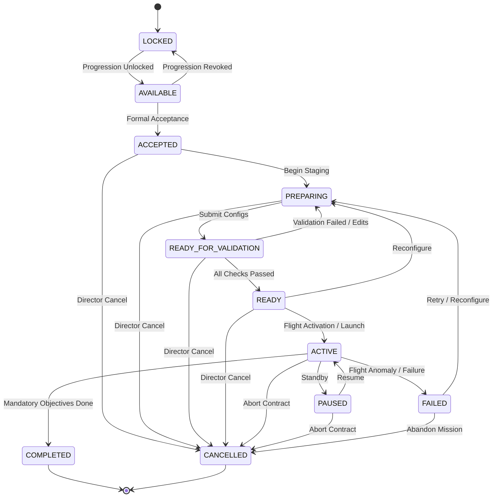

# Development Handoff: INTERSTELLAR CONTINUUM

## 1. Summary of Completed Work (Phase 4: Camera & Viewport Systems)

Phase 4 established the complete camera, viewport, coordinate-conversion, and screen-scaling architecture for INTERSTELLAR CONTINUUM, fully prepared for headquarters exploration, planetary surfaces, and mission operations:

1. **Central Camera System (`src/camera/CameraSystem.ts`):**
   - Implemented `CameraSystem` implementing `ICameraSystem` registered in `SystemRegistry` at priority 12.
   - Position $(x, y)$, zoom, rotation (radians), and framing offsets.
   - Smooth interpolation using exponential dampening and follow strength.
   - Scripted transitions (`panTo`, `focusOn`, `reset`) with cubic ease-in-out and completion callbacks.
   - `Camera2D` updated as a backward-compatible wrapper.
2. **7 Discrete Camera Modes (`src/camera/CameraMode.ts`):**
   - `PLAYER_FOLLOW`: Smooth player/vehicle follow with deadzone and velocity lookahead.
   - `FREE`: Unconstrained manual panning (mouse drag / arrow keys), detached from targets.
   - `CINEMATIC`: Scripted cinematic pans, gentle floating drift, slow rotation, letterbox framing.
   - `MISSION_OVERVIEW`: High-altitude strategic view of the operational zone.
   - `PLANETARY_EXPLORATION`: Large-scale planetary surface navigation with terrain bounds clamping.
   - `HEADQUARTERS`: Facility room-to-room / floor-focused interior exploration.
   - `INTERFACE_FOCUSED`: Focuses on an interaction terminal, workbench, or console with UI offset.
3. **Target Tracking & Deadzone Architecture (`src/camera/CameraTarget.ts`):**
   - Deadzone box eliminating micro-jitter when target moves within configurable threshold.
   - Velocity lookahead projecting forward along target motion vector $(vx, vy)$ clamped to maximum lead distance.
4. **Camera Boundary Clamping (`src/camera/CameraBounds.ts`):**
   - Clamps focal point and visible viewport frustum to ensure black boundaries outside playable maps are never exposed.
   - Auto-centers camera along axes where bounds are smaller than visible screen.
5. **Smooth Zoom Architecture & Presets:**
   - Presets: `CLOSE_INTERACTION` (1.8x), `NORMAL_EXPLORATION` (1.0x), `WIDE_ENVIRONMENT` (0.65x), `MISSION_OVERVIEW` (0.4x), `MAP_VIEW` (0.25x).
   - Mode-based zoom permissions and clamping between `minZoom` (0.2x) and `maxZoom` (5.0x).
6. **Comprehensive 4-Way Coordinate Conversion Pipeline (`src/camera/CoordinateConverter.ts`):**
   - Bi-directional conversion between:
     - **World Coordinates** $(wx, wy)$ — Game world units.
     - **Camera Coordinates** $(cx, cy)$ — Relative to camera focal center with rotation support.
     - **Virtual Screen Coordinates** $(vx, vy)$ — Canonical $1920 \times 1080$ virtual space (used for HUD markers & overlays).
     - **Physical Screen Coordinates** $(px, py)$ — Physical browser window pixels (mouse events).
7. **Viewport Frustum & Culling (`src/camera/Viewport.ts`):**
   - Computes visible world frustum AABB (`minX, maxX, minY, maxY`).
   - Viewport culling queries: `isPointVisible` and `isRectVisible` with padding margins.
   - Safe UI area calculation (5% margin) and pillarbox/letterbox margin metrics.
8. **Parallax Layer Integration:**
   - Connects with `RenderPipeline` / `LayerManager` to drive world layers at depth-scaled parallax speeds while keeping screen overlays pinned.
9. **Trauma-Based Screen Shake System (`src/camera/CameraShake.ts`):**
   - Quadratic trauma model ($shake = trauma^2$) with multi-harmonic oscillation and linear decay.
   - Full accessibility integration: `reducedMotion` strictly zeros out shake offsets; `intensityMultiplier` provides fine-grained scale.
10. **Automated Testing & Build Verification:**

- **129 unit tests passed across 30 test suites** with 100% pass rate.
- Production build compiles cleanly in **330 ms**.

---

## 2. Camera System Architecture & APIs

### `CameraSystem` API (`src/camera/CameraSystem.ts`)

```typescript
export class CameraSystem implements ICameraSystem {
  readonly id = SystemId.CAMERA;
  readonly priority = 12;

  setMode(
    mode: CameraMode,
    customConfig?: Partial<CameraModeConfig>,
    immediateZoom?: boolean,
  ): void;
  getMode(): CameraMode;

  setTarget(target: ICameraTarget | null): void;
  getTarget(): ICameraTarget | null;
  setDeadzone(width: number, height: number): void;

  setBounds(bounds: CameraBounds | null): void;
  getBounds(): CameraBounds | null;

  setPosition(x: number, y: number, immediate?: boolean): void;
  setOffset(offsetX: number, offsetY: number): void;
  setRotation(rotationRadians: number, immediate?: boolean): void;

  setZoom(zoom: number, immediate?: boolean): void;
  setZoomPreset(preset: ZoomPreset, immediate?: boolean): void;
  zoomBy(factor: number): void;
  panBy(deltaX: number, deltaY: number): void;

  panTo(x: number, y: number, options?: CameraTransitionOptions): void;
  focusOn(
    targetOrPos: { x: number; y: number },
    zoom?: number,
    options?: CameraTransitionOptions,
  ): void;
  reset(immediate?: boolean): void;

  shake(intensity: number): void;
  addTrauma(trauma: number): void;

  setReducedMotion(reducedMotion: boolean): void;
  setShakeIntensity(intensityMultiplier: number): void;

  // Coordinate transformations
  screenToWorld(
    screenX: number,
    screenY: number,
    viewportCenterX?: number,
    viewportCenterY?: number,
  ): Point2D;
  worldToScreen(
    worldX: number,
    worldY: number,
    viewportCenterX?: number,
    viewportCenterY?: number,
  ): Point2D;
  worldToVirtual(worldX: number, worldY: number): Point2D;
  virtualToWorld(virtualX: number, virtualY: number): Point2D;

  getStateView(): CameraStateView;
  getVisibleFrustum(): WorldFrustum;
  applyToContainer(
    container: Container,
    viewportCenterX?: number,
    viewportCenterY?: number,
  ): void;
}
```

---

## 3. Coordinate Conversion Matrix

| From Space                   | To Space                     | Method                              | Purpose                                                                  |
| :--------------------------- | :--------------------------- | :---------------------------------- | :----------------------------------------------------------------------- |
| **Physical Screen** (px, py) | **World** (wx, wy)           | `camera.screenToWorld(px, py)`      | Mouse clicks, raycasting, click-to-move, object selection                |
| **World** (wx, wy)           | **Physical Screen** (px, py) | `camera.worldToScreen(wx, wy)`      | Tooltips, DOM overlays, accessibility highlights                         |
| **World** (wx, wy)           | **Virtual Screen** (vx, vy)  | `camera.worldToVirtual(wx, wy)`     | Pinning HUD brackets, target reticles, and health bars to world entities |
| **Virtual Screen** (vx, vy)  | **World** (wx, wy)           | `camera.virtualToWorld(vx, vy)`     | Virtual pointer coordinates to world positions                           |
| **World** (wx, wy)           | **Camera-Relative** (cx, cy) | `CoordinateConverter.worldToCamera` | Local displacement from camera focal point                               |

---

## 4. Camera Modes & Zoom Presets

| Mode                    | Follow Smoothing |        Default Zoom         | Manual Pan | Manual Zoom | Deadzone | Lookahead |
| :---------------------- | :--------------: | :-------------------------: | :--------: | :---------: | :------: | :-------: |
| `PLAYER_FOLLOW`         |       0.12       | 1.0x (`NORMAL_EXPLORATION`) |  Disabled  |   Enabled   | Enabled  |  Enabled  |
| `FREE`                  |       0.20       | 1.0x (`NORMAL_EXPLORATION`) |  Enabled   |   Enabled   | Disabled | Disabled  |
| `CINEMATIC`             |       0.04       | 0.65x (`WIDE_ENVIRONMENT`)  |  Disabled  |  Disabled   | Disabled | Disabled  |
| `MISSION_OVERVIEW`      |       0.10       | 0.40x (`MISSION_OVERVIEW`)  |  Enabled   |   Enabled   | Disabled | Disabled  |
| `PLANETARY_EXPLORATION` |       0.10       | 1.0x (`NORMAL_EXPLORATION`) |  Enabled   |   Enabled   | Enabled  |  Enabled  |
| `HEADQUARTERS`          |       0.15       | 1.0x (`NORMAL_EXPLORATION`) |  Disabled  |   Enabled   | Enabled  | Disabled  |
| `INTERFACE_FOCUSED`     |       0.18       | 1.8x (`CLOSE_INTERACTION`)  |  Disabled  |   Enabled   | Disabled | Disabled  |

---

## 5. Summary of Completed Work (Phase 5: Playable Character Controller, Movement & 2D Collision Architecture)

Phase 5 established the complete character movement, physical collision sliding, and environmental interaction foundation:

1. **Mission Director Representation (`src/player/PlayerCharacter.ts`):**
   - Player character represents the **Mission Director** of the independent aerospace organization exploring Earth headquarters.
   - Professional aerospace business/field attire: dark navy blazer (`#1b2838`), light collared shirt, gold security badge on corporate cyan lanyard (`#00f0ff`), slate trousers (`#2d3748`), dress boots, and styled dark hair.
   - Grounding: Dynamic elliptical drop shadow (`0x000000`, 35% alpha) squashing and stretching with foot stride cycles.
   - 2.5D Depth sorting: Base foot Y coordinate dynamically drives `container.zIndex`.
   - Implements `ICameraTarget` (`getPosition()` and `getVelocity()`) directly feeding into `CameraSystem`.
   - Procedural stride animation supporting `IDLE`, `WALK` (8.5 strides/s), and `SPRINT` (13 strides/s) across 4 facing directions (`NORTH`, `SOUTH`, `EAST`, `WEST`).
2. **Movement Integration & Diagonal Normalization (`src/player/MovementComponent.ts`):**
   - Cardinal and diagonal movement with strict diagonal vector normalization ($1/\sqrt{2} \approx 0.7071$).
   - Velocity integration with acceleration (1400 px/s²), deceleration (1800 px/s²), walking speed (180 px/s), and sprinting speed (310 px/s).
3. **Independent Axis Sliding Collision Resolution (`src/collision/CollisionSystem.ts`):**
   - Resolves movement along the X-axis first: checks collisions against nearby solid obstacles and clamps position against obstacle boundary.
   - Resolves movement along the Y-axis second: checks collisions and clamps position against obstacle boundary.
   - Prevents corner sticking and allows effortless, natural sliding along walls and console desks.
4. **Collision Geometry & Broadphase Acceleration (`src/collision/`):**
   - `BoxCollider` & `CircleCollider` with customizable offsets (allowing foot-level collision shapes separate from visual torso bounds).
   - `CollisionMath` implementing pure geometric intersection tests: AABB vs AABB, Circle vs Circle, Circle vs AABB.
   - `SpatialHashGrid` providing $O(1)$ spatial queries for high-density environments.
   - Categorized colliders: `SOLID`, `OBSTACLE`, `TRIGGER`, `RESTRICTED`, `BOUNDARY`.
5. **Centralized Input & Event Integration (`src/player/PlayerController.ts`):**
   - Pulls inputs from `InputManager` (`MoveUp`, `MoveDown`, `MoveLeft`, `MoveRight`, `Sprint`, `Interact`).
   - Respects `isInputLocked()`, freezing character controls during dialog, pause, or diagnostics.
   - Overlap triggers emit `collision:trigger-enter` and `collision:trigger-exit`.
   - Pressing `Interact` (`KeyE`) dispatches `player:interact` events on `EventBus`.
6. **Headquarters Movement Test Environment (`src/scenes/PlayerMovementTestScene.ts`):**
   - $2400 \times 1600$ facility layout with tiled floor, perimeter bulkhead walls, flight director command console, lateral telemetry workstations, engineering workbenches, cryogenic propellant tanks, server mainframes, hydroponic planters, and interactive triggers (`MISSION_TERMINAL`, `CLEANROOM_AIRLOCK`, `HOLOPROJECTOR`).
   - Real-time diagnostic HUD with Director telemetry, camera info, control buttons, and hotkey (`F1` / `C`) for collision debug wireframe overlay.
7. **Verification & Testing:**
   - **171 unit tests passed across 36 test suites** with 100% pass rate.
   - Production build cleanly bundles 819 modules in **352ms** with 0 errors.

---

## 6. Summary of Completed Work (Phase 6: Character Animation, Directional Sprites & Facility Interaction Polish)

Phase 6 established the complete character animation architecture, directional resolution with hysteresis, breathing/blinking idle motions, dynamic walk/run cycles, and terminal interaction poses:

1. **Animation State Machine (`src/animation/AnimationStateMachine.ts`):**
   - Supports `IDLE`, `WALK`, `RUN`, `INTERACT`, `ENTER_BUILDING`, `EXIT_BUILDING`, and `STOP_TRANSITION` states.
   - Enforces transition priority rules and non-interruptible action states.
   - Dynamically scales frame timing based on actual movement velocity ($ratio = \text{speed} / \text{baseSpeed}$), strictly eliminating foot sliding across all movement speeds.
   - Emits event notifications: `onStateEnter`, `onStateExit`, `onFrameChange`, `onLoop`, `onComplete`.
2. **Direction Selector with Hysteresis (`src/animation/DirectionSelector.ts`):**
   - Resolves movement vectors to cardinal directions (`NORTH`, `SOUTH`, `EAST`, `WEST`).
   - Employs a 25% directional hysteresis threshold ($1.25\times$), eliminating rapid sprite flickering during diagonal movement while maintaining smooth responsiveness.
3. **Layered Visual Renderer (`src/animation/CharacterVisualRenderer.ts`):**
   - `IDLE`: Sinusoidal chest/shoulder breathing oscillation and natural 3.8s eye-blinking cadence.
   - `WALK`: Natural 8-frame walk stride cycle with counter-balanced arm swings and vertical bounce.
   - `RUN`: Aggressive sprint cycle with forward torso lean (5 degrees), wider stride amplitude, bent elbow arm pumps, and higher bounce.
   - `INTERACT`: Terminal typing posture with raised arm, rhythmic finger tapping, and head tilt towards console screens.
   - `ENTER_BUILDING` / `EXIT_BUILDING`: Smooth step-in portal walk with linear alpha fade transitions.
   - `STOP_TRANSITION`: 3-frame foot-bracing settling motion when stopping from high speeds.
   - **Contact Ground Shadow:** Dynamic elliptical drop shadow anchored to $(0, 0)$ that squashes on foot plant and softens/shrinks on peak bounce.
   - **Stride Contact Effects:** Dust/impact rings triggered on ground contact during sprinting and stops.
4. **Sprite Sheet & Frame Cache (`src/animation/CharacterSpriteSheetGenerator.ts`):**
   - Canonical frame boundaries ($48 \times 72$ px) and anchor metadata $(0.5, 0.95)$ at character feet.
   - Texture caching with disposal routines and headless environment safety guards.
5. **Player & Controller Upgrades:**
   - `PlayerCharacter` refactored to delegate to `AnimationStateMachine`, `DirectionSelector`, and `CharacterVisualRenderer`.
   - Added scripted action promises: `playInteraction()`, `playEnterBuilding()`, `playExitBuilding()`.
   - `PlayerController` automatically triggers `playInteraction()` on console triggers and enforces state priorities.
6. **Headquarters Movement Test Scene (`PlayerMovementTestScene.ts`):**
   - Updated HUD with live animation telemetry (state, frame index, normalized time percentage, facing, breathing cycle).
   - Added interactive buttons for terminal typing animation and airlock enter/exit transitions.
7. **Verification & Testing:**
   - **191 unit tests passed across 40 test suites** with 100% pass rate.
   - Production build cleanly bundles 823 modules in **739ms** with 0 errors.

---

## 8. Summary of Completed Work (Phase 7: Environmental Interaction Framework & Headquarters Facilities)

Phase 7 implemented the general, decoupled environmental interaction framework connecting the player character to headquarters buildings, equipment, mission systems, terminals, doors, research facilities, and planetary objects:

1. **Decoupled System Architecture (`src/interaction/InteractionSystem.ts`):**
   - Implemented `InteractionSystem` implementing `IInteractionSystem` and `IGameSystem`, registered in `SystemRegistry` at **priority 14** (between `PlayerSystem` priority 13 and `RenderSystem` priority 15).
   - Manages an object registry of `IInteractiveObject` instances completely separated from `PlayerController` and movement logic.
2. **Stable Proximity Discovery with 20% Hysteresis (`src/interaction/TargetSelector.ts`):**
   - Implements **20% distance hysteresis** ($0.8\times$ distance ratio threshold): once an active target is selected, alternative candidates must be at least 20% closer or have strictly higher priority to steal focus. This completely eliminates visual badge flickering when traversing dense facility environments.
3. **Contextual In-World Interaction Prompt (`src/interaction/ContextualPrompt.ts`):**
   - Displays styled `[ E ]` key badge, dynamic contextual action text (e.g. `Access Flight Director Console`, `Enter Rocket Engineering Bay`), and status reasons when unavailable.
   - Smooth alpha fade-in/fade-out transitions, world-coordinate positioning with camera tracking, and pointer event handling for mouse clicks.
4. **Reusable Dialogue & Inspection Modal (`src/interaction/InformationPanel.ts`):**
   - Cyber-glass modal panel with glowing cyan borders, category tags, multi-line narratives, structured key-value specifications with highlight flags, and Confirm/Close buttons.
   - Integrates with `InputManager` to safely lock input on modal open and unlock on close.
   - Supports keyboard shortcuts (`Escape`, `E`, `Enter`, `Space`) and backdrop dismiss.
5. **Physical Facility Portals & Airlocks (`src/interaction/BuildingEntrance.ts`):**
   - Specialized interactive entity supporting building entrance and exit transitions.
   - Dispatches system events (`building:entered`, `building:exited`) and domain events (`BuildingEntered`).
   - Automatically binds to player entrance and exit animations (`ENTER_BUILDING` and `EXIT_BUILDING`).
6. **Resilient Interaction Execution Pipeline:**
   - Validates preconditions and requirement callbacks (`CLEARANCE`, `TECH`, `RESOURCE`, `CUSTOM`).
   - Locks player movement input (`InputManager.lockInput('InteractionExecution')`).
   - Triggers player character animations (`playInteraction` or `playEnterBuilding`).
   - Dispatches domain lifecycle events (`InteractionRequested`, `interaction:executed`, `InteractionCompleted`).
   - Guarantees player recovery via a **3.0-second safety timeout** and `finally` unlocking block, preventing permanent soft-locks.
7. **Headquarters Movement Test Scene Integration (`PlayerMovementTestScene.ts`):**
   - Registered 6 interactive facility stations in the headquarters map:
     1. `CONSOLE_FLIGHT_DIRECTOR`: Primary flight operations command console.
     2. `AIRLOCK_ENGINEERING`: Physical portal to Rocket Engineering Bay.
     3. `AIRLOCK_SCIENCE_LAB`: Physical portal to Science & Astrobiology Lab.
     4. `CRYO_PROPELLANT_DEPOT`: High-pressure propellant manifold with cooldown timer.
     5. `AIRLOCK_CLEANROOM_RESTRICTED`: Security-gated cleanroom airlock requiring Clearance Level 2.
     6. `HQ_HOLOGRAM_ARCHIVE`: Volumetric roadmap projector.
   - Added interactive HUD control buttons for click-based interaction execution and real-time clearance level toggling.
8. **Automated Testing & Build Verification:**
   - **212 unit tests passed across 44 test suites** (100% pass rate).
   - Production build compiles 831 modules cleanly in **637ms** with zero errors.

---

## 10. Summary of Completed Work (Phase 8: Earth-Based Headquarters Campus Environment - PROMPT 9)

Phase 8 established the first major explorable game environment: the Earth-based **Headquarters Campus** for INTERSTELLAR CONTINUUM, fully built, visually polished, navigable, and tested:

### 1. Campus World Dimensions & Coordinate Layout
- **Dimensions:** $3600 \times 2400$ px (aspect ratio $3:2$, providing ample room for 12 facilities, internal roads, promenades, parks, and the launch complex while remaining quick and enjoyable to traverse at 180–310 px/s).
- **Spawn Anchor:** Central Headquarters Plaza $(1800, 1260)$ centered on the inlaid Agency Compass Rose emblem.
- **Facility Footprints & Coordinates (`src/environment/headquarters/CampusTypes.ts`):**
  1. `ARRIVAL_GATE` (x: 380, y: 1250, entrance: 380, 1350) — Campus Security, visitor arrival loop.
  2. `FINANCE_ADMIN` (x: 480, y: 920, entrance: 480, 1030) — Agency governance, contracts, executive offices.
  3. `SPACECRAFT_LAB` (x: 650, y: 450, entrance: 650, 565) — ISO Class 5 cleanroom, satellite payload assembly.
  4. `RESEARCH_DEVELOPMENT` (x: 1800, y: 420, entrance: 1800, 540) — Propulsion physics, materials science, tech tree lab.
  5. `PLANETARY_DATA_CENTRE` (x: 3300, y: 420, entrance: 3300, 535) — Optical observatory dome, sample vaults.
  6. `MANUFACTURING_CENTRE` (x: 2750, y: 420, entrance: 2750, 535) — Additive metal 3D printers, CNC machining, chemical synthesis.
  7. `CENTRAL_PLAZA_KIOSK` (x: 1800, y: 1200, entrance: 1800, 1260) — Campus directory, map, system settings terminal.
  8. `ROCKET_ENGINEERING` (x: 2750, y: 1050, entrance: 2750, 1210) — High-bay VAB, crane rails, rocket assembly.
  9. `ROBOTICS_CENTRE` (x: 650, y: 1950, entrance: 650, 1835) — Planetary rover testing hangar, simulated regolith yard.
  10. `COMMUNICATIONS_CENTRE` (x: 1200, y: 1950, entrance: 1200, 1845) — Ground station bunker, twin 18m DSN parabolic dishes.
  11. `MISSION_OPERATIONS` (x: 1800, y: 1850, entrance: 1800, 1730) — Main flight control room, telemetry tracking auditorium.
  12. `LAUNCH_COMPLEX_PAD_ALPHA` (x: 3050, y: 1850, entrance: 2850, 1850) — Hexagonal launch pad, flame trench, umbilical tower, cryogenic depot.

### 2. Multi-Layer Environmental Art & Ground Renderer (`CampusGroundRenderer.ts`)
- **Base Terrain:** Rich manicured campus lawn grass with subtle mower striping.
- **Vehicular Roads:** 90px-wide asphalt roads with concrete curbs and yellow dashed centerlines connecting Arrival to VAB, Pad Alpha, and North/South corridors.
- **Pedestrian Promenades:** 48px-wide stone pedestrian walkways with recessed cyan/accent guide strips connecting Central Plaza directly to every facility entrance.
- **Crawler Rollout Track:** Dual heavy-gauge crawler tracks with embedded railroad ties connecting the VAB assembly bay to the launch pad.
- **Launch Pad Geometry:** Concrete hexagonal blast foundation, deep flame trench pit with steel heat deflector grill, and water suppression trenches.

### 3. Procedural Architectural Building Generator (`CampusBuilding.ts`)
- Angled top-down / 2.5D architectural facades with ambient occlusion drop shadows, tinted curtain glass, illuminated office/lab windows, customized roof fixtures (`RADOME`, `SOLAR`, `CRANE`, `ANTENNA`, `DOME`), glowing department signage labels, and entrance portals.
- Decoupled `BoxCollider` protecting solid structural envelopes while leaving entrance porticos freely walkable.
- Binds each building to `BuildingEntrance` or `InteractiveObject` for environmental interaction.

### 4. Environmental Props & Infrastructure (`CampusDecorations.ts`)
- Perimeter chainlink security fences with access gates and solid colliders.
- Landscaped deciduous and evergreen trees with drop shadows and trunk colliders.
- Campus lamp posts with soft illumination circles.
- Central Plaza benches and electric cargo haulers.
- Twin 18m parabolic Cassegrain DSN tracking dishes.
- Pad Alpha steel truss umbilical service tower (180px tall) with red-and-white aviation bands, propellant swing-arms, lightning rod, and spherical LOX/LH2 cryogenic propellant storage tanks.

### 5. Headquarters Scene (`HeadquartersScene.ts`)
- Production scene implementing `SceneId.HEADQUARTERS`.
- Connects camera bounds $(0, 0, 3600, 2400)$, smooth follow, deadzone tracking, and lookahead.
- Atmospheric dust motes drifting across the campus on wind vectors.
- Telemetry HUD with district detection and quick-navigation buttons (`CENTRAL PLAZA`, `PAD ALPHA`, `VAB`, `MOC`, `R&D`, `ARRIVAL GATE`).
- All 12 facilities registered with `InteractionSystem`.

### 6. Automated Testing & Build Verification
- **220 unit tests passed across 45 test suites** (100% pass rate).
- Production build cleanly compiles 836 modules in **904ms** with 0 errors.

---

## 11. Summary of Completed Work (Phase 9: Headquarters Facilities & Physical Launch Complex Functionality - PROMPT 10)

Phase 9 made all headquarters facilities and the physical launch complex function as real interactive game locations with identifiable entrances, contextual interaction prompts, standardized access dialogues, data-driven availability states, visit tracking, interior room navigation, and 7 physical launch complex installations:

### 1. Centralized Data-Driven Facility Registry (`src/facilities/FacilityRegistry.ts`)
- Authoritative singleton registry managing metadata, status, rank progression requirements, visit logs, and upgrades for all 10 Headquarters Facilities, Pad Alpha, and Arrival Gate.
- **Facility IDs & Canonical World Coordinates:**
  1. `FAC_MISSION_OPERATIONS` — Center $(1800, 1850)$, Entrance $(1800, 1730)$. Category: `MISSION_CONTROL`. Connected System: `MISSION_OPERATIONS_SYSTEM`. Purpose: Central coordination of Solar System missions, destination charting, and flight telemetry.
  2. `FAC_ROCKET_ENGINEERING` — Center $(2750, 1050)$, Entrance $(2750, 1210)$. Category: `ENGINEERING`. Connected System: `ROCKET_ENGINEERING_SYSTEM`. Purpose: Design, assemble, inspect, and validate launch vehicles.
  3. `FAC_SPACECRAFT_LAB` — Center $(650, 450)$, Entrance $(650, 565)$. Category: `LABORATORY`. Connected System: `SPACECRAFT_LAB_SYSTEM`. Purpose: Develop satellites, orbiters, landers, probes, and science instruments.
  4. `FAC_RESEARCH_DEVELOPMENT` — Center $(1800, 420)$, Entrance $(1800, 540)$. Category: `RESEARCH`. Connected System: `RESEARCH_DEVELOPMENT_SYSTEM`. Purpose: Conduct research, develop new technologies, and improve engineering capabilities.
  5. `FAC_FINANCE_ADMIN` — Center $(480, 920)$, Entrance $(480, 1030)$. Category: `ADMINISTRATION`. Connected System: `FINANCE_ADMIN_SYSTEM`. Purpose: Manage organisation finances, funding, expenses, staff, and contracts.
  6. `FAC_MANUFACTURING_CENTRE` — Center $(2750, 420)$, Entrance $(2750, 535)$. Category: `MANUFACTURING`. Connected System: `MANUFACTURING_SYSTEM`. Purpose: Manage materials, inventory, production, component manufacturing, and facility construction.
  7. `FAC_ROBOTICS_CENTRE` — Center $(650, 1950)$, Entrance $(650, 1835)$. Category: `ROBOTICS`. Connected System: `ROBOTICS_SYSTEM`. Purpose: Develop and manage robotic exploration systems (rovers, robotic arms, sample drills).
  8. `FAC_COMMUNICATIONS_CENTRE` — Center $(1200, 1950)$, Entrance $(1200, 1845)$. Category: `COMMUNICATIONS`. Connected System: `COMMUNICATIONS_SYSTEM`. Purpose: Monitor communication infrastructure, deployed satellites, ground stations, and relay systems.
  9. `FAC_PLANETARY_DATA_CENTRE` — Center $(3300, 420)$, Entrance $(3300, 535)$. Category: `PLANETARY_SCIENCE`. Connected System: `PLANETARY_SCIENCE_SYSTEM`. Purpose: Analyse scientific observations, planetary images, geological data, and atmospheric measurements.
  10. `FAC_CENTRAL_PLAZA_KIOSK` — Center $(1800, 1200)$, Entrance $(1800, 1260)$. Category: `SYSTEM_SETTINGS`. Connected System: `SETTINGS_SYSTEM`. Purpose: Control game configuration and organisation-level system preferences.
  11. `FAC_LAUNCH_COMPLEX_PAD_ALPHA` — Center $(3050, 1850)$, Entrance $(2850, 1850)$. Category: `LAUNCH_INFRASTRUCTURE`. Connected System: `LAUNCH_OPERATIONS_SYSTEM`. Purpose: Launchpad and ground operations complex for orbital countdown, fueling, and launch simulation.
  12. `FAC_ARRIVAL_GATE` — Center $(380, 1250)$, Entrance $(380, 1350)$. Category: `SECURITY`. Connected System: `CAMPUS_SECURITY_SYSTEM`. Purpose: Authenticate staff credentials, manage incoming logistical deliveries, and secure campus perimeter.
- **Availability States:** `OPERATIONAL`, `AVAILABLE`, `RESTRICTED`, `LOCKED`, and `UNDER_UPGRADE`. Gating evaluates both availability state and player organization rank requirement (`requiredRank`).
- **Visit Tracking:** `recordVisit(facilityId)` automatically marks `visited = true`, increments `visitCount`, logs `firstVisitedTimestamp` and `lastVisitedTimestamp`, and emits `facility:visited`.

### 2. Standardized Facility Access Experience (`src/facilities/FacilityAccessModal.ts`)
- Reusable, coherent 2.5D aerospace access dialogue overlaid on `UI_OVERLAY` virtual resolution space.
- Displays facility header, department code, glowing procedural icon, status LED badge, clearance rank requirement, operational purpose statement, and description.
- Future Subsystem Integration card lists specific upcoming capabilities without fake controls or non-functional buttons.
- Functional action buttons: **ENTER FACILITY** (triggers transition into facility interior and logs visit) and **RETURN TO CAMPUS** (dismisses modal and restores movement input).

### 3. Physical Launch Complex Interactive Zones (`src/environment/headquarters/LaunchComplexInteractiveZones.ts`)
- Dedicated physical campus area housing 7 interactive installations with solid colliders and contextual interactables:
  1. `LC_ZONE_LAUNCHPAD`: Launchpad mount, refractory flame trench deflector, and 4x hydraulic hold-down clamps (`Inspect Launchpad Mount & Clamps`).
  2. `LC_ZONE_INFRASTRUCTURE`: Umbilical service tower, swing-arm propellant feed lines, and lightning mast (`Examine Launch Infrastructure & Umbilicals`).
  3. `LC_ZONE_ROCKET_PREPARATION`: Dual-gauge crawler transporter rollout apron and mobile launcher ties (`Access Rocket Preparation Area`).
  4. `LC_ZONE_ASSEMBLY_ROLLOUT`: VAB South high-bay rollout interface and motorized guillotine door (`View Assembly Facility Rollout Gate`).
  5. `LC_ZONE_PRELAUNCH_INSPECTION`: Weatherproof avionics checkout station and pyrotechnic safety interlocks (`Conduct Pre-Launch Systems Inspection`).
  6. `LC_ZONE_OBSERVATION_BUNKER`: Blast-hardened bunker with periscope viewing slits and countdown clocks (`Access Launch Observation Bunker`).
  7. `LC_ZONE_GSE_CRYO`: Cryogenic propellant storage farm: LOX, LH2, high-pressure helium purges (`Inspect Ground Support Equipment & Cryo Depots`).
- Interacting with each zone returns rich operational telemetry and explicitly confirms that launch simulation will activate once flight vehicles are designed and rolled out.

### 4. Reusable Facility Interior Scene (`src/scenes/FacilityInteriorScene.ts`)
- 2.5D interior environment ($1600 \times 1000$ px) with metallic tiled flooring, wall boundary colliders, ambient lighting, and facility-specific screen arrays.
- Features an interactive South airlock door (`BuildingEntrance` with `isExit: true`) that transitions seamlessly back to `HeadquartersScene`, returning the player character to the exact exterior entrance coordinate and smoothly restoring input.
- `HeadquartersScene` supports `onActivate(payload)` with coordinate restoration and preserves campus state via `cleanupPrevious: false`.

### 5. Key Files Created/Modified
- `src/facilities/FacilityTypes.ts`: Data contracts, enums, and interfaces for facilities, availability, future systems, and visit state.
- `src/facilities/FacilityData.ts`: Authoritative registry dataset for all 12 facilities.
- `src/facilities/FacilityRegistry.ts`: Centralized facility registry managing queries, visits, and availability.
- `src/facilities/FacilityAccessModal.ts`: 2.5D modal access experience.
- `src/scenes/FacilityInteriorScene.ts`: Reusable interior scene with exit portal and coordinate return.
- `src/environment/headquarters/LaunchComplexInteractiveZones.ts`: 7 physical installations in Pad Alpha.
- `src/scenes/HeadquartersScene.ts`: Integrated registry, access modal, launch zones, and return coordinate handoff.
- `tests/facilities/FacilityRegistry.test.ts`: 6 unit tests for registry functionality.
- `tests/facilities/FacilityAccessAndInterior.test.ts`: 5 integration tests for access modal, interior navigation, return coordinates, and launch complex zones.

### 6. Automated Testing & Build Verification
- **231 unit tests passed across 47 test suites** (100% pass rate).
- Production build cleanly compiles 840 modules in **359ms** with 0 errors.

---

## 12. Phase 9 Implementation: Interactive Facilities & Physical Launch Complex (PROMPT 10)

The interactive facilities and launch complex systems have been completed and verified.

---

## 13. Phase 10 Implementation: Complete Game Startup Experience, Title Screen & Main Menu (PROMPT 11)

### 1. Architectural Summary
Prompt 11 established the complete game startup flow, professional 2D/2.5D title screen, and comprehensive main menu system. The startup flow intelligently routes players based on whether they are new or returning, guards existing progress against accidental overwrites, provides interactive settings and credits modals, and features rich atmospheric visuals with layered starfields, nebulae, crescent planetary limbs, and orbital satellite tracking.

### 2. Centralized Startup Flow Controller (`src/startup/StartupFlowController.ts`)
- **Player Startup Evaluation:**
  - Evaluates save slot 1 via `SaveService.hasSave(1)`.
  - Determines player profile: `FIRST_TIME` vs `RETURNING`.
- **Continue Game Action:**
  - Strictly gated on existing save presence.
  - Automatically loads save state, synchronizes `GameStateManager` with restored organisation profile, credits, and metrics.
  - Dispatches `startup:continue` and transitions directly to `HEADQUARTERS` scene without repeating the introductory cinematic.
- **New Organisation Action:**
  - Checks if an active save already exists. If present, blocks execution unless explicit `overwrite: true` confirmation is passed.
  - Initializes a fresh game state, persists to slot 1, marks first-time introduction pending, and routes player to `INTRO_CINEMATIC`.
- **Replay Introduction Action:**
  - Sets replay introduction mode without resetting save progress or mutating organisation resources. Routes to `INTRO_CINEMATIC`.
- **Typed Startup Events:**
  - Emits `startup:continue`, `startup:new-game`, `startup:replay-intro`, and `startup:destination-changed`.

### 3. Atmospheric 2D/2.5D Title Screen Presentation (`src/scenes/title/`)
- **Deep Space Visuals (`TitleBackgroundRenderer.ts`):**
  - Multi-layer starfield of 220 procedural stars across 3 depth planes with twinkling scintillation.
  - Procedural cyan and deep violet radial cosmic nebulae.
  - Large illuminated crescent Earth with dual-layer Rayleigh scattering atmospheric glow.
  - Distant Moon/Mars orb on elliptical trajectory.
  - Moving artificial satellite traversing an orbital trajectory arc with blinking beacon LED.
  - Interactive mouse parallax subtly shifting star layers, nebulae, and planetary bodies based on cursor position.
- **Aerospace Title Logo & Typography (`TitleLogoRenderer.ts`):**
  - Bold, architectural title treatment `INTERSTELLAR CONTINUUM` with drop shadows and subtle luminescence breathing.
  - Subtitle: `A Solar System Exploration and Mission Design Experience`.
  - Organization and version badge: `EARTH HQ OPERATIONS // VERSION 0.1.0`.
- **Title Menu & Navigation (`TitleMenuRenderer.ts`):**
  - Initial "PRESS TO START" mode with sinusoidal breathing animation responding to keyboard, mouse click, and gamepad.
  - Main menu options:
    - `Continue`: Displayed as disabled with dimmed text when no save is present; fully interactive when save exists.
    - `New Organisation`: Prompts confirmation modal if save exists.
    - `Settings`: Opens settings modal.
    - `Credits`: Opens credits modal.
    - `Replay Introduction`: Replays cinematic prologue.
    - `Exit Game`: Platform-aware quit handler.
  - Keyboard (Up/Down/W/S/Enter/Space/Escape) and pointer hover/tap navigation with visual chevron indicators.

### 4. Interactive Dialogs & Modals (`src/scenes/title/`)
- **Save Overwrite Confirmation Dialog (`ConfirmationDialog.ts`):**
  - Aerospace-themed modal warning of impending save replacement.
  - Summarizes current organisation: Name, Rank, and Founding Date.
  - Provides clear choices: `PROCEED & OVERWRITE` (warning red) vs `CANCEL & KEEP VENTURE` (primary cyan).
- **Settings Modal (`SettingsModal.ts`):**
  - Real-time adjustment of Master, Music, SFX, and UI audio volume channels synced with `AudioService` and `ConfigManager`.
  - Accessibility toggles for Reduced Motion and High-Contrast Subtitles.
  - Technical keyboard controls card displaying gameplay keybindings.
- **Credits Modal (`CreditsModal.ts`):**
  - Aerospace roll displaying Project Direction, Technical Architecture, Astrodynamics Engineering, Sound Design, and dedication.

### 5. Introductory Cinematic Prelude (`src/scenes/IntroCinematicScene.ts`)
- Implemented `SceneId.INTRO_CINEMATIC` bridging startup flow to Earth Headquarters campus.
- Features deep space backdrop, glowing Solar System diagram with planetary orbits, and narrative prologue.
- Auto-advance timer and keybind skip (Enter, Space, Escape, Click) transitioning smoothly via `FadeTransition` to `HEADQUARTERS`.

### 6. Key Files Created/Modified
- `src/startup/StartupFlowController.ts`: Centralized state machine managing startup routing and save safety.
- `src/startup/index.ts`: Module export barrel.
- `src/scenes/title/TitleBackgroundRenderer.ts`: Multi-layer 2.5D deep space, celestial bodies, and satellite.
- `src/scenes/title/TitleLogoRenderer.ts`: Title typography and technical badges.
- `src/scenes/title/TitleMenuRenderer.ts`: "PRESS TO START" and interactive main menu options.
- `src/scenes/title/ConfirmationDialog.ts`: Save overwrite protection modal.
- `src/scenes/title/SettingsModal.ts`: In-game settings configuration panel.
- `src/scenes/title/CreditsModal.ts`: Project credits modal.
- `src/scenes/TitleScreenScene.ts`: Production scene coordinating title experience.
- `src/scenes/IntroCinematicScene.ts`: Narrative prologue scene leading into headquarters.
- `src/core/events/GameEvents.ts`: Registered typed startup events.
- `src/services/SaveService.ts`: Added headless in-memory fallback for test environments.
- `src/application/ApplicationController.ts`: Registered startup controller, scenes, and updated bootstrap.
- `tests/startup/StartupFlowController.test.ts`: 6 unit tests for startup controller.
- `tests/scenes/TitleScreenScene.test.ts`: 6 integration tests for title screen scene.

### 7. Automated Testing & Build Verification
- **243 unit tests passed across 49 test suites** (100% pass rate).
- Production build cleanly compiles 849 modules in **372ms** with 0 errors.

---

## 14. Phase 11 Implementation: Introductory Cinematic & Narrative Solar System Prelude (PROMPT 12)

### 1. Architectural Summary
Prompt 12 implemented the complete, original, 6-act 2D/2.5D introductory cinematic establishing the narrative setting of INTERSTELLAR CONTINUUM, the player's appointment as Mission Director, and the independent aerospace organisation's long-term objective to explore the Solar System. The cinematic is powered by a reusable timeline-based sequencer, tactical subtitle display, interactive pause and skip controls, and concludes with a seamless transition into the explorable Earth headquarters campus with the player character spawning at the Main Arrival Gate (`480, 1350`).

### 2. The 6-Act Cinematic Narrative
1. **Act I: Earth (`src/cinematics/scenes/EarthCinematicScene.ts`):**
   - 2.5D planetary view from orbit with atmospheric Rayleigh scattering glow, deep oceans, stylized continental contours, slowly translating/rotating cloud strata, twinkling starfield, and an orbital satellite with a flashing telemetry beacon.
   - Narration: Humanity's historic bond to Earth by gravity and atmosphere, and the yearning to reach beyond.
2. **Act II: The Scale of Space (`src/cinematics/scenes/SolarScaleCinematicScene.ts`):**
   - Heliocentric artistic composition featuring a radiant Sun with a pulsing corona, elliptical orbits for Mercury through Saturn, authentic planetary silhouettes with Saturnian rings, an asteroid belt dust ring, and a robotic interplanetary deep-space probe.
   - Narration: The vast expanse of the Solar System—eight worlds, countless frontiers, and billions of kilometers of vacuum.
3. **Act III: The Independent Organisation (`src/cinematics/scenes/HeadquartersOverviewCinematicScene.ts`):**
   - 2.5D panoramic architectural overview strictly matching the established Earth headquarters campus: Rocket Engineering VAB high-bay, R&D facility with observatory dome, Mission Operations Centre (MOC) with satellite dish, Central Plaza with compass rose, and Pad Alpha launch complex with umbilical service tower and blinking red safety beacon.
   - Narration: An independent venture founded on disciplined engineering, modest seed funding, and unrelenting curiosity when traditional state agencies slowed under bureaucracy.
4. **Act IV: The Opportunity (`src/cinematics/scenes/OpportunityCinematicScene.ts`):**
   - Technical vector CAD blueprints: 2-stage orbital launch vehicle with dimension lines, 12U CubeSat scientific satellite bus with solar array cell divisions and optical camera aperture, and orbital insertion trajectory flight profiles with delta-V budgets.
   - Narration: Engineers drafting early vehicle designs, scientists mapping orbital windows, and proving capabilities step by step.
5. **Act V: The Player's Role (`src/cinematics/scenes/PlayerRoleCinematicScene.ts`):**
   - Tactical Directorate command console confirming appointment as Mission Director with unrestricted operational command clearance.
   - Detail cards highlighting the four executive pillars: Vehicle Engineering & Spacecraft Design, Mission Operations & Trajectory Guidance, Resource & Treasury Allocation, and Campus Expansion & Exploration.
   - Narration: Handing the helm to the player to lead the organisation from humble beginnings into deep space.
6. **Act VI: The First Step (`src/cinematics/scenes/FirstStepCinematicScene.ts`):**
   - Dawn approach perspective looking directly at the Main Arrival & Security Gate (`FAC_ARRIVAL_GATE`, coordinate `480, 1350`).
   - Open barrier arm, illuminated welcome terminal (`WELCOME MISSION DIRECTOR // ACCESS AUTHORIZED`), approach roadway markings, and distant facility silhouettes.
   - Narration: The engineering bays are humming, the launchpad stands ready, and the journey begins.

### 3. Reusable Cinematic Sequencer (`src/cinematics/CinematicSequencer.ts`)
- Manages timeline progression, chronological act transitions, camera waypoint easing, subtitle cue evaluation, and event emission.
- State machine: `STOPPED`, `PLAYING`, `PAUSED`, `COMPLETED`, `SKIPPED`.
- Camera waypoints: smooth cubic ease-in-out interpolation of coordinates and zoom levels.
- Full skip handling: immediately stops playback, tears down visual nodes, and calls the completion callback.
- Pause handling: freezes timeline progression, displays pause overlay, and permits clean resume.
- Dispatches typed events: `cinematic:started`, `cinematic:scene-changed`, `cinematic:narration`, `cinematic:paused`, `cinematic:resumed`, `cinematic:skipped`, `cinematic:completed`.

### 4. Overlays & Audio Integration
- **`CinematicSubtitleRenderer`:** Lower-third letterbox glass banner displaying speaker callsign (`// PLANETARY OBSERVATION ARCHIVE //`), narration text, and act indicator with smooth alpha transitions.
- **`CinematicControlsOverlay`:** Top timeline act dots (indicating active/completed acts), interactive skip button (`▶ SKIP [ESC / SPACE] ◀`), and pause modal screen.
- **`AudioService` Hook:** Triggers `cinematic_intro` musical score on sequence activation with volume control support.

### 5. Transition into Earth Headquarters
- Upon sequence completion or skip, `IntroCinematicScene` triggers a transition to `SceneId.HEADQUARTERS` via `FadeTransition(0.6)`.
- Passes payload `{ spawnX: 480, spawnY: 1350, isNewGame: true, isReplay: this.isReplay }`.
- Spawns the player character directly outside the Main Arrival Gate portico with full 8-directional movement, camera tracking, and facility access restored.

### 6. Key Files Created/Modified
- `src/cinematics/CinematicTypes.ts`: Data types, sequence configs, narration cues, camera waypoints, and playback states.
- `src/cinematics/IntroCinematicData.ts`: Authoritative 6-act cinematic script and timing.
- `src/cinematics/CinematicSequencer.ts`: Central timeline runner and state machine.
- `src/cinematics/scenes/EarthCinematicScene.ts`: Act I Earth planetary composition.
- `src/cinematics/scenes/SolarScaleCinematicScene.ts`: Act II Solar System heliocentric scale.
- `src/cinematics/scenes/HeadquartersOverviewCinematicScene.ts`: Act III Campus architectural overview.
- `src/cinematics/scenes/OpportunityCinematicScene.ts`: Act IV Technical CAD blueprints.
- `src/cinematics/scenes/PlayerRoleCinematicScene.ts`: Act V Directorate command console.
- `src/cinematics/scenes/FirstStepCinematicScene.ts`: Act VI Arrival gate first step.
- `src/cinematics/ui/CinematicSubtitleRenderer.ts`: Subtitle overlay.
- `src/cinematics/ui/CinematicControlsOverlay.ts`: Progress dots, skip prompt, and pause modal.
- `src/cinematics/index.ts`: Module export index.
- `src/scenes/IntroCinematicScene.ts`: Production scene implementation.
- `tests/cinematics/CinematicSequencer.test.ts`: 8 unit tests for sequencer.
- `tests/scenes/IntroCinematicScene.test.ts`: 6 integration tests for scene lifecycle and navigation.

### 7. Automated Testing & Build Verification
- **257 unit tests passed across 51 test suites** (100% pass rate).
- Production build cleanly compiles 861 modules in **380ms** with 0 errors.

---

## 15. Phase 12 Implementation: Global In-Game UI Framework & Strategic Primary HUD (PROMPT 13)

### 1. Architectural Summary
Prompt 13 implemented the complete Global In-Game UI Framework and Primary Strategic HUD for INTERSTELLAR CONTINUUM. The system is designed with a coherent aerospace visual identity resembling modern mission control software: dark slate/navy translucent glass, sharp cyan accents, subtle amber warnings, crisp typography, and 24px safe margins within the canonical $1920 \times 1080$ virtual resolution space. It includes a comprehensive reusable component library, tooltip and notification toast subsystems, and a data-bound primary HUD connecting player telemetry, live resources, contextual interaction prompts, and a real-time vector minimap.

### 2. Global UI Framework & Reusable Component Library (`src/ui/`)
1. **Design Tokens (`src/ui/core/UIDesignTokens.ts`):**
   - Palette: `BG_BASE` (0x020617), `BG_PANEL` (0x091424), `BG_PANEL_ELEVATED` (0x0c223c), `CYAN` (0x00f0ff), `GREEN` (0x4ade80), `AMBER` (0xf59e0b), `RED` (0xef4444), `PURPLE` (0xa855f7).
   - Metrics: `SAFE_MARGIN = 24`, corner radii `XS` (2) to `LG` (12), typography hierarchies.
2. **Base Component (`src/ui/core/UIComponent.ts`):**
   - Visibility management (`show()`, `hide()`, `toggle()`), smooth alpha tweening, and `reducedMotion` accessibility hooks.
3. **Reusable Tactile Components (`src/ui/components/`):**
   - `UIButton`: 5 tactile variants (`PRIMARY`, `SECONDARY`, `OUTLINE`, `DANGER`, `GHOST`) with keyboard shortcut badges, hover/pressed/disabled states, and SFX hooks.
   - `UIPanel`: Modular window container with title bar, close button, and content viewport.
   - `UITabGroup`: Multi-tab switcher with active indicator bar and badge counts.
   - `UIProgressBar`: Segmented/continuous progress bar with percentage readout and color overrides.
   - `UISpinner`: Rotating reticle for async operations with `start()` and `stop()`.
   - `UIScrollList`: Masked scrollable list with draggable scrollbar and mousewheel support.
   - `UICard`: Structured specification card with title, status badge, description, and key-value specs.
   - `UIDataTable`: Structured data grid with custom column formatting, header divider, and zebra stripes.
   - `UIDialog`: Centered modal prompt with backdrop blocker, message, confirm/cancel buttons, and keyboard hooks.

### 3. Tooltip & Notification Subsystems (`src/ui/tooltips/`, `src/ui/notifications/`)
1. **Tooltip System (`TooltipManager`, `UITooltip`):**
   - Hover popovers with 250ms delay, target registration, dynamic positioning, and automatic virtual viewport clamping ($1920 \times 1080$).
2. **Notification System (`NotificationManager`, `UINotification`):**
   - Stacked tactical toast notifications with level styling (Info, Success, Warning, Error), auto-dismiss countdown timer bar, 2000ms anti-spam deduplication window, priority queueing, and automatic subscriptions to domain events (`facility:visited`, `save:saved`, `error:captured`, `interaction:executed`).

### 4. Primary Strategic HUD (`GlobalHUD` & `src/ui/hud/`)
1. **Organisation Badge & Telemetry (`OrganisationBadgeHUD`):**
   - Top-left panel (`x: 24, y: 24`) displaying agency name, director rank & title, real-time campus location and district, and player movement status.
   - **Strict Absence of Fabricated Information:** Active mission objective is displayed ONLY if an actual mission is running in `GameStateManager` (`state.mission.missionId !== null`). When null, the mission row is hidden and panel height automatically collapses.
2. **Strategic Resources Status Bar (`ResourcesDisplayHUD`):**
   - Top-center status bar (`x: 680, y: 24`) data-bound directly to `GameStateManager.getState().resources` (Mission Credits, Research Data, Raw Materials, and Technology Points).
3. **Contextual Interaction Prompt (`InteractionPromptHUD`):**
   - Bottom-center prompt (`x: 960, y: 990`) bound to `InteractionSystem` (`interaction:target-changed`), displaying the action verb, target name, and `[E]` key badge.
4. **Campus Radar Minimap (`CampusMinimap`):**
   - Real-time $240 \times 160$ vector radar minimap of the $3600 \times 2400$ Earth campus, facility markers, player position blip with heading arrow, camera frustum outline, and collapsible toggle (`M` key / button).
5. **Operational Menu Button:**
   - Top-right button (`x: 1786, y: 24`) displaying `[ESC] MENU` with callback hook for the pause menu.

### 5. Headquarters Scene Integration (`src/scenes/HeadquartersScene.ts`)
- Mounted `GlobalHUD` to `hudContainer` on `RenderLayerType.HUD`.
- Synchronized player telemetry (coordinates, velocity, facing, state, district, camera frustum) in `onUpdate`.
- Minimap toggle hotkey bound to `InputAction.OpenMap` (`KeyM`).
- Routed feedback messages to tactical toast notifications.

### 6. Key Files Created/Modified
- `src/ui/core/UIDesignTokens.ts`: Canonical aerospace design tokens.
- `src/ui/core/UIComponent.ts`: Base UI component class.
- `src/ui/components/UIButton.ts`: Reusable aerospace button.
- `src/ui/components/UIPanel.ts`: Window panel container.
- `src/ui/components/UITabGroup.ts`: Tab bar component.
- `src/ui/components/UIProgressBar.ts`: Progress bar component.
- `src/ui/components/UISpinner.ts`: Loading spinner component.
- `src/ui/components/UIScrollList.ts`: Scrollable list container.
- `src/ui/components/UICard.ts`: Information card component.
- `src/ui/components/UIDataTable.ts`: Structured data table.
- `src/ui/components/UIDialog.ts`: Modal dialog component.
- `src/ui/tooltips/UITooltip.ts`: Tooltip component.
- `src/ui/tooltips/TooltipManager.ts`: Central tooltip manager.
- `src/ui/notifications/UINotification.ts`: Toast notification component.
- `src/ui/notifications/NotificationManager.ts`: Central notification queue & manager.
- `src/ui/hud/CampusMinimap.ts`: Vector campus minimap.
- `src/ui/hud/InteractionPromptHUD.ts`: Bottom-center prompt.
- `src/ui/hud/OrganisationBadgeHUD.ts`: Top-left badge panel.
- `src/ui/hud/ResourcesDisplayHUD.ts`: Top-center resources bar.
- `src/ui/hud/GlobalHUD.ts`: Master in-game HUD.
- `src/ui/index.ts`: Full UI barrel export.
- `src/scenes/HeadquartersScene.ts`: Integrated GlobalHUD, telemetry feed, minimap hotkey, and toast routing.
- `tests/ui/UIComponents.test.ts`: 15 unit tests for reusable components.
- `tests/ui/TooltipManager.test.ts`: 5 unit tests for tooltip subsystem.
- `tests/ui/NotificationManager.test.ts`: 5 unit tests for notification subsystem.
- `tests/ui/GlobalHUD.test.ts`: 6 integration tests for master HUD and data binding.

### 7. Automated Testing & Build Verification
- **288 unit tests passed across 55 test suites** (100% pass rate).
- Production build cleanly compiles 882 modules in **399ms** with 0 errors.

---

## 16. Phase 13 Implementation: In-Game Pause Menu, Unified Settings System & Operational Controls (PROMPT 14)

### 1. Architectural Summary
Prompt 14 implemented the complete In-Game Pause Menu and unified multi-category Settings System for INTERSTELLAR CONTINUUM. All settings (Graphics, Audio, Controls, Accessibility, Interface, Gameplay) are managed through a centralized `SettingsManager` and rendered using a single authoritative `SettingsView` component shared across the in-game Pause Menu, the Title Screen settings modal, and the Headquarters Central Plaza Settings & Administration Kiosk building (`SceneId.SETTINGS`). Settings persistence operates independently from organisation save files (`localStorage` key `interstellar_continuum_settings`), and resetting settings never modifies or wipes player progression.

### 2. Centralized Settings Architecture (`src/settings/`)
1. **Strongly Typed Settings Model (`SettingsTypes.ts`):**
   - 6 Categories: `GRAPHICS`, `AUDIO`, `CONTROLS`, `ACCESSIBILITY`, `INTERFACE`, `GAMEPLAY`.
   - Quality presets: `LOW`, `MEDIUM`, `HIGH`, `ULTRA`, `CUSTOM` with detailed particle, shader, lighting, bloom, parallax, and camera effect configurations.
   - Default keybindings map covering 13 input actions with multi-key assignments.
2. **Settings Manager Service (`SettingsManager.ts`):**
   - Singleton service registered in `ServiceLocator` under `'SettingsManager'`.
   - Versioned schema (`schemaVersion: 1`) with automatic corrupt data fallback and default value merging.
   - Persistence in `localStorage` under `interstellar_continuum_settings` with an in-memory fallback for headless/test environments.
   - Numeric range clamping and enum validation across all categories.
   - Conflict-checked key rebinding (`rebindKey`, `isKeyBound`).
   - Category reset (`resetCategory`) and global reset (`resetAll`) that strictly preserve game progression.
   - Subsystem synchronization: broadcasts `settings:changed` on `EventBus`, updates `ShaderManager.setQuality()`, `AudioService.setChannelVolume()`, `VirtualResolution.setResolutionScale()`, `CameraSystem.setReducedMotion()`, `CameraSystem.setShakeIntensity()`, `InputManager.rebind()`, and legacy `ConfigManager`.

### 3. Reusable Settings UI Controls (`src/ui/components/`)
1. **`UISlider` (`UISlider.ts`):**
   - Horizontal slider featuring a background groove, filled active track, draggable thumb handle, discrete decrement `[-]` and increment `[+]` stepping buttons, and a formatted numerical readout.
2. **`UIToggle` (`UIToggle.ts`):**
   - Tactile pill switch with glowing indicator knob and dynamic status text (`ENABLED` / `DISABLED` or `MUTED` / `ACTIVE`).
3. **`UIOptionStepper` (`UIOptionStepper.ts`):**
   - Discrete cyclical stepper with `<` and `>` arrow selectors for cycling presets, tiers, framerates, and display modes.
4. **`UIKeybindRow` (`UIKeybindRow.ts`):**
   - Action label, active key badges (`[W]`, `[▲ UP]`), and interactive "REBIND" button with conflict warning states and keyboard capture.

### 4. Unified Settings View (`src/ui/settings/SettingsView.ts`)
1. Single authoritative settings view used everywhere in the application.
2. **Tab Group:** 6 categories navigated via `UITabGroup`.
3. **Content Sections:**
   - **GRAPHICS:** Quality Preset (`LOW`..`ULTRA`, `CUSTOM`), Resolution Scaling (`0.75x`..`1.50x`), Target Framerate (`30`..`Unlimited`), Fullscreen, V-Sync, Particle Density, Atmospheric Shaders, Optical Bloom, Parallax Depth, Camera Lookahead & Zoom FX.
   - **AUDIO:** Master, Music, Ambience, SFX, UI, Dialogue volume sliders and Master Audio Mute toggle.
   - **CONTROLS:** Complete keybindings list with interactive conflict detection and rebinding.
   - **ACCESSIBILITY:** UI Scale (`0.8x`..`1.4x`), Typography Size (`NORMAL`/`LARGE`), Reduced Motion, Camera Shake Intensity multiplier, High Contrast UI, Color Vision Filters (None, Protanopia, Deuteranopia, Tritanopia), Subtitles toggle.
   - **INTERFACE:** Tactical HUD Visibility, Minimap Overlay Visibility, Tooltip Delay (`50ms`..`600ms`), Toast Notification Persistence (`3.0s`..`7.0s`), Reduce Interface Animations toggle.
   - **GAMEPLAY:** Auto-Pause on Focus Loss, Interaction Prompt Style (`DETAILED`, `COMPACT`, `BADGE_ONLY`), Tutorial Reminders, Camera Tracking Sensitivity (`0.5x`..`2.0x`), Camera Interpolation Smoothing (`0.02`..`0.30`).
4. **Footer Actions:**
   - "RESET CATEGORY": Restores only the active tab to factory defaults.
   - "RESTORE ALL DEFAULTS": Opens `UIDialog` confirmation warning, then resets all settings without touching save progression.
   - "CLOSE [ESC]": Closes view and invokes `onClose` callback.

### 5. In-Game Pause Menu (`src/ui/pause/PauseMenu.ts`)
1. **Activation:** Opened via `Escape` key, centralized `InputAction.Pause`, or top-right HUD `[ESC] MENU` button.
2. **Simulation Lifecycle:** Suspends real-time simulation updates, locks gameplay inputs via `InputManager.lockInput('PauseMenu')`, and emits `game:pause` on `EventBus`.
3. **Telemetry Card:** Displays Director call-sign, rank, current campus location (`EARTH HQ // COMPLEX ALPHA`), and suspended operations status.
4. **Action Menu:**
   - **RESUME OPERATIONS [ESC]:** Unpauses gameplay, restores inputs, and resumes simulation.
   - **SYSTEM SETTINGS:** Opens `SettingsView` modal nested over the pause menu without unpausing gameplay.
   - **CONTROLS & KEY BINDINGS:** Opens `SettingsView` directly with the `CONTROLS` tab active.
   - **RETURN TO HEADQUARTERS:** Transitions back to the Headquarters campus exterior when in facility interiors or mission sub-scenes.
   - **SAVE ORGANISATION PROGRESS:** Serializes gameState, saves to slot 1 via `SaveService`, emits `save:saved`, and dispatches tactical toast notification.
   - **RETURN TO MAIN MENU:** Displays `UIDialog` confirmation warning before switching scene to `SceneId.TITLE_SCREEN`.

### 6. Campus & Scene Integration
1. **`HeadquartersScene.ts`:**
   - Mounts `PauseMenu` to `UI_OVERLAY`.
   - Halts player movement, collision updates, dust particles, and interaction checks while paused.
   - Registers window `blur` listener for automated focus-loss pausing according to gameplay settings.
   - Central Plaza Kiosk building (`FAC_CENTRAL_PLAZA_KIOSK`) switches to `SceneId.SETTINGS`.
2. **`SettingsScene.ts`:**
   - Implements `IScene` registered under `SceneId.SETTINGS` in `SceneManager`.
   - Hosts `SettingsView` with dark technical grid background and returns smoothly to `SceneId.HEADQUARTERS` on close or Escape.
3. **`SettingsModal.ts`:**
   - Upgraded to embed the unified `SettingsView` inside the Title Screen, completely eliminating duplicate settings interfaces.

### 7. Automated Testing & Verification
- **310 unit and integration tests passed across 59 test suites** (100% passing rate).
- Production build compiles 892 modules in **387ms** with 0 errors (`tsc && vite build`).

---

## 18. Phase 14: First-Time Player Onboarding & Contextual Tutorial Architecture (PROMPT 15)

### 1. Reusable Tutorial System Architecture (`src/tutorial/`)
1. **`TutorialTypes.ts`:**
   - `TutorialSequenceId`: `INITIAL_ONBOARDING`, `MISSION_OPERATIONS`, `ROCKET_ENGINEERING`, `SPACECRAFT_LAB`, `PLANETARY_EXPLORATION`.
   - `TutorialStepId`: `ONBOARDING_ARRIVAL`, `ONBOARDING_MOVEMENT`, `ONBOARDING_CAMPUS_EXPLORATION`, `ONBOARDING_FACILITY_DISCOVERY`, `ONBOARDING_LAUNCH_COMPLEX`, `ONBOARDING_MISSION_PREPARATION`, `ONBOARDING_FREE_EXPLORATION`.
   - `TutorialCompletionCondition`: `MANUAL_CONFIRM`, `PLAYER_MOVED`, `FACILITY_DISCOVERED`, `LAUNCH_APPROACHED`, `INTERACTION_EXECUTED`, `CUSTOM`.
   - `TutorialHighlightTarget`: Target type (`FACILITY`, `ZONE`, `POSITION`, `NONE`), targetId, worldPosition $(x, y)$, pulse radius, and label.
   - `TutorialProgressState`: `hasStarted`, `completedStepIds`, `completedSequenceIds`, `isOnboardingComplete`, `isSkipped`, `tutorialsEnabled`, `activeSequenceId`, `currentStepIndex`, `isDismissed`, `lastActiveTimestamp`.
2. **`TutorialManager.ts`:**
   - Singleton and ServiceLocator service managing multi-step sequences, auto-progress conditions, stepping backwards, skipping, and replay.
   - State persistence via `saveState()` and `loadState()`.
   - EventBus domain events: `tutorial:started`, `tutorial:step-changed`, `tutorial:step-completed`, `tutorial:completed`, `tutorial:skipped`, `tutorial:dismissed`, `tutorial:enabled-changed`.

### 2. Initial Onboarding Sequence (`src/tutorial/sequences/InitialOnboardingSequence.ts`)
1. **Step 1 (Arrival):** Welcome to Interstellar Continuum, establishes Mission Director role, non-blocking manual acknowledge.
2. **Step 2 (Movement & Controls):** Walking locomotion, interaction, and pause menu. Dynamically inspects configured key bindings from `InputManager.getBindings()` (e.g. `W/A/S/D` or rebound custom keys) rather than hardcoded text. Auto-progresses after accumulating $> 120$ px movement.
3. **Step 3 (Campus Exploration):** Campus quadrants layout, arterial promenade, and waypoint highlight on Mission Operations Centre (`FacilityId.MISSION_OPERATIONS`). Auto-progresses when approaching MOC entrance.
4. **Step 4 (Facility Discovery):** Dynamically queries all 10 facilities from `FacilityRegistry.getInstance()` ensuring single source of truth without duplicated descriptions.
5. **Step 5 (Pad Alpha Launch Complex):** Introduces Pad Alpha orbital launch complex and waypoint highlight on Pad Alpha (`FacilityId.LAUNCH_COMPLEX_PAD_ALPHA`). Explains rocket staging, payload integration, and manifest requirements.
6. **Step 6 (Mission Preparation):** Explains 4 pillars of mission architecture (Objective, Launch Vehicle, Spacecraft Payload, Orbital Trajectory).
7. **Step 7 (Free Exploration):** Unrestricted campus clearance granted; marks sequence complete.

### 3. Waypoint Marker & Directional Bearing (`src/tutorial/TutorialWaypointMarker.ts`)
1. **In-World Beacon Ring:** Rendered at target world coordinates with dual pulsing rings, crosshairs, and diamond marker when target is inside camera frustum.
2. **Off-Screen Edge Arrow:** Clamped to virtual screen boundaries (1920×1080) with dynamic angle pointing toward target and real-time distance telemetry (e.g. `450m`) when target is outside camera frustum.
3. **Accessibility:** Strictly respects `accessibility.reducedMotion` from `SettingsManager`, halting oscillation and rapid pulses.

### 4. Compact Tutorial HUD Overlay (`src/ui/tutorial/TutorialPanel.ts`)
1. Tactical aerospace HUD card mounted at bottom-left ($x: 35, y: 780$, $480 \times 240$ px).
2. Displays step index badge (`STEP 1/7`), sequence title, subtitle, wrapped description, dynamic key badges, and action buttons (`CONTINUE [SPACE]`, `MINIMIZE [H]`, `SKIP TUTORIAL`).
3. Collapsible minimized pill mode (`[H] OBJECTIVE: ...`) allowing completely unobstructed exploration.
4. Sizing adapts dynamically when `accessibility.textSize === 'LARGE'`.

### 5. Headquarters, Pause Menu & Persistence Integration
1. **`HeadquartersScene.ts`:**
   - Mounted `TutorialPanel` and `TutorialWaypointMarker`.
   - Onboarding automatically initiates on new game / first-time arrival.
   - Live telemetry and player position fed to tutorial condition checkers each frame.
   - Hotkeys: `Space` to advance, `H` to minimize/expand.
2. **`PauseMenu.ts`:**
   - Added `REPLAY ONBOARDING TUTORIAL` button allowing players to review onboarding on demand.
3. **`SaveService.ts` & `GameState.ts`:**
   - Extended `GameSaveSchema` with `tutorial?: TutorialProgressState`.
   - Onboarding completion is saved to slot 1, preventing returning players from being forced through completed tutorials.

### 6. Automated Testing & Verification
- **334 unit and integration tests passed across 63 test suites** (100% passing rate).
- Production build compiles 897 modules in **419ms** with 0 errors (`tsc && vite build`).

---

## 19. Phase 15: Mission Operations Centre & Interactive Solar System Map (PROMPT 16)

### 1. Architectural Summary
Prompt 16 implemented the complete Mission Operations Centre (MOC) as the central mission-planning interface and created the interactive 2D Solar System destination map. The physical Mission Operations building on the Earth headquarters campus (`FacilityId.MISSION_OPERATIONS`, entrance at $x: 1800, y: 1730$) is now fully connected to `MissionOperationsScene` (`SceneId.MISSION_OPERATIONS`), replacing the generic facility interior placeholder. Returning from the MOC smoothly transitions back to the campus exterior with the player spawned directly at the MOC entrance coordinates.

### 2. Central Destination Data Architecture (`src/destinations/`)
1. **Strongly Typed Contracts (`DestinationTypes.ts`):**
   - Enums: `CelestialCategory` (`STAR`, `TERRESTRIAL_PLANET`, `GAS_GIANT`, `ICE_GIANT`, `MOON`, `DWARF_PLANET`, `ASTEROID_BELT`, `ORBITAL_REGIME`), `DestinationId` (20 destinations), `DestinationUnlockState` (`LOCKED`, `AVAILABLE`, `EXPLORED`, `SURVEYED`, `COLONIZED`), `RadiationHazard` (`NEGLIGIBLE`, `LOW`, `MODERATE`, `HIGH`, `EXTREME`, `LETHAL`).
   - Detailed interfaces: `PhysicalCharacteristics` (semi-major axis, orbital period, radius, mass, gravity, temp range, atmospheric composition/pressure, magnetic field, radiation rating), `EnvironmentalHazards`, `OrbitalRegimeInfo`, `DestinationData`.
2. **Authoritative Celestial Database (`DestinationData.ts`):**
   - Single source of truth containing 20 celestial destinations:
     - The Sun (Sol).
     - Inner Terrestrial Planets: Mercury, Venus, Earth, Mars.
     - Asteroid Belt (Main Belt).
     - Outer Gas & Ice Giants: Jupiter, Saturn, Uranus, Neptune.
     - Key Destination Moons: Luna (Earth), Io, Europa, Ganymede (Jupiter), Titan, Enceladus (Saturn).
     - Earth Orbital Regimes: Low Earth Orbit (LEO), Medium Earth Orbit (MEO), Geostationary Earth Orbit (GEO), Highly Elliptical Orbit (HEO).
   - Authoritative scientific descriptions, surface features, and physical telemetry metrics.
3. **Destination Registry Service (`DestinationRegistry.ts`):**
   - Singleton service registered with `ServiceLocator`.
   - Methods: `getAllDestinations()`, `getDestination(id)`, `getPrimaryPlanets()`, `getMoonsForBody(parentId)`, `getEarthOrbitRegimes()`, `isDestinationUnlocked(id)`, `setDestinationUnlocked(id, unlocked, state)`, `getMissionCounts(id)`.
   - Dispatches domain events: `destination:selected` and `destination:unlocked` over `EventBus`.

### 3. Interactive 2D Solar System Map (`src/destinations/ui/SolarSystemMapCanvas.ts`)
1. **Schematic Map Visualization:**
   - 2D schematic planetary map with Sun corona animations, elliptical planetary orbit tracks, color-coded celestial bodies, Saturn/Uranus ring structures, and an asteroid belt with procedural dust/rock particles.
   - Prominent schematic layout notice: `SCHEMATIC MAP: RELATIVE PROPORTIONS (NOT TO 1:1 PHYSICAL ORBITAL SCALE)`.
2. **Pan & Zoom Navigation Controls:**
   - Smooth mouse drag panning and mouse wheel zooming clamped between $0.3\times$ and $3.0\times$.
   - Interactive zoom HUD buttons (`+`, `-`, `RESET VIEW`) and coordinate centering.
3. **Selection & Hit Testing:**
   - Circular hit detection with generous padding for mobile/compact targets.
   - Tactile selection reticle featuring cyan glowing targeting brackets and crosshairs.
   - Keyboard navigation cycling through primary planets (`A`/`D` or Left/Right arrow keys).
   - Recursion-safe selection synchronization with parent scene (`notify = false` guard).

### 4. Earth Orbital Regimes Display (`src/destinations/ui/EarthOrbitDisplay.ts`)
1. **Concentric Orbital Zones:**
   - High-resolution orbital regime diagram for Earth featuring concentric altitude rings:
     - Low Earth Orbit (LEO, 160–2,000 km).
     - Medium Earth Orbit (MEO, 2,000–35,786 km).
     - Geostationary Earth Orbit (GEO, 35,786 km).
     - Highly Elliptical Orbit (HEO, transfer & Molniya regimes).
     - Luna / Lunar Orbit (384,400 km).
2. **Interactive Node Cards:**
   - Interactive nodes with altitude metrics, operational functions, and selection hooks.
   - "BACK TO SOLAR SYSTEM" return button.

### 5. Destination Info Panel (`src/destinations/ui/DestinationInfoPanel.ts`)
1. Right-side aerospace telemetry card ($x: 1380, y: 130$, $500 \times 920$ px).
2. Displays body name, category badge, unlock status badge (`[UNLOCKED]` vs `[LOCKED]`), scientific description, and physical specs grid (semi-major axis, orbital period, surface gravity, surface temp, atmospheric pressure/profile, radiation hazard rating).
3. Mission telemetry breakdown: available, active, completed, and failed mission counters.
4. Gated restriction notice for locked bodies explaining progression milestones required for unlock.
5. Action buttons: `BROWSE MISSIONS`, `ORBITAL REGIONS / EXPLORE MOONS`, and `CLOSE`.

### 6. Mission Operations Centre Scene (`src/scenes/MissionOperationsScene.ts`)
1. Full-screen operational command centre registered under `SceneId.MISSION_OPERATIONS`.
2. Telemetry header bar with facility title, UTC mission clock, campus return shortcut (`[ESC]`), and 5-section navigation tab group (`Solar System`, `Mission Catalogue`, `Active Missions`, `Mission Archive`, `Destination Intel`).
3. Clean isolation: MOC input does not bleed into headquarters player character movement.
4. Hotkeys: `1`–`5` for tabs, `A`/`D` for cycling planets, `ESC` to return to Earth campus at spawn coordinates $(1800, 1730)$.

### 7. Automated Testing & Verification
- **354 unit and integration tests passed across 67 test suites** (100% passing rate).
- Production build compiles 904 modules in **444ms** with 0 errors (`tsc && vite build`).

---

## 20. Phase 16: Central Destination Registry & Progression System (PROMPT 17)

### 1. Architectural Summary
Prompt 17 implemented the authoritative Central Destination Registry and data-driven progression system for INTERSTELLAR CONTINUUM. The registry serves as the authoritative source of truth for all celestial bodies, planetary environments, orbital corridors, and small bodies across the Solar System. It enforces strict environmental models, distinguishes solid surfaces from orbital and atmospheric regimes, validates surface access permissions, and evaluates multi-condition unlock rules against player agency progression state.

### 2. Destination Data Schema (`src/destinations/DestinationTypes.ts`)
1. **Core Data Contracts:**
   - `id`: Strongly typed `DestinationId` enum (28 celestial destinations).
   - `name`, `subtitle`, `shortCode`: Aerospace display strings.
   - `category`: `DestinationCategory` (`STAR`, `ROCKY_PLANET`, `NATURAL_SATELLITE`, `GAS_GIANT`, `ICE_GIANT`, `ASTEROID_BELT`, `DWARF_PLANET`, `ORBITAL_REGION`, `COMET`).
   - `parentId`: Hierarchical parent link (`DestinationId.EARTH`, `DestinationId.MARS`, `DestinationId.JUPITER`, `DestinationId.SATURN`, `DestinationId.URANUS`, `DestinationId.NEPTUNE`, `DestinationId.ASTEROID_BELT`, `DestinationId.SUN`).
   - `environment`: `EnvironmentalClassification` (10 canonical classes: `EARTH_TERRESTRIAL`, `AIRLESS_ROCKY`, `ROCKY_HOSTILE_ATMOSPHERE`, `EXTREME_TEMP_ROCKY`, `ICY_MOON`, `OCEAN_WORLD`, `GAS_GIANT_ATMOSPHERE`, `ICE_GIANT_ATMOSPHERE`, `ASTEROID_SMALL_BODY`, `ORBITAL_SPACE`).
   - `surfaceAvailability`: `SurfaceAvailability` (`WALKABLE_SURFACE`, `HAZARDOUS_SURFACE_SPECIALIZED_ONLY`, `SMALL_BODY_MICROGRAVITY`, `NO_SURFACE_ORBITAL_ATMOSPHERIC_ONLY`).
   - `gravityClassification`: `GravityClassification` (`MICROGRAVITY`, `VERY_LOW_GRAVITY`, `LOW_GRAVITY`, `EARTH_LIKE`, `HIGH_GRAVITY`, `EXTREME_GRAVITY`).
   - `temperatureClassification`: `TemperatureClassification` (`CRYOGENIC`, `EXTREME_COLD`, `TEMPERATE`, `EXTREME_HEAT`, `SUPERHEATED`).
   - `supportedExplorationMethods`: `ExplorationMethod[]` (`ORBITAL_SURVEY`, `ATMOSPHERIC_PROBE`, `ROBOTIC_LANDER`, `SURFACE_ROVER`, `CREWED_SURFACE_EXPEDITION`, `SURFACE_SAMPLE_RETURN`, `OUTPOST_CONSTRUCTION`, `DEEP_CORE_DRILLING`, `SUBMERSIBLE_OCEAN_PROBE`, `RESOURCE_EXTRACTION`).
   - `communication`: `CommunicationCharacteristics` (one-way signal latency in seconds, ground/relay requirements, and blackout risk factors).
   - `atmosphericDetails`: `AtmosphericCharacteristics` (surface pressure in atm, density class, composition summary, and environmental hazards).
   - `gameplayConfig`: `DestinationGameplayConfig` (ambient lighting, solar flux, dust storm risk, radiation damage rate, and scientific discovery multiplier).
   - `unlockConditions`: `UnlockCondition[]` (multi-condition progression rules).

### 3. Complete Destination ID List & Hierarchy
| Destination ID | Display Name | Category | Parent | Surface Model | Environment |
| :--- | :--- | :--- | :--- | :--- | :--- |
| `DEST_SUN` | The Sun (Sol) | `STAR` | *None* | `NO_SURFACE_ORBITAL_ATMOSPHERIC_ONLY` | `SOLAR_PLASMA` |
| `DEST_MERCURY` | Mercury | `ROCKY_PLANET` | `DEST_SUN` | `HAZARDOUS_SURFACE_SPECIALIZED_ONLY` | `EXTREME_TEMP_ROCKY` |
| `DEST_VENUS` | Venus | `ROCKY_PLANET` | `DEST_SUN` | `HAZARDOUS_SURFACE_SPECIALIZED_ONLY` | `ROCKY_HOSTILE_ATMOSPHERE` |
| `DEST_EARTH` | Earth (Terra) | `ROCKY_PLANET` | `DEST_SUN` | `WALKABLE_SURFACE` | `EARTH_TERRESTRIAL` |
| `DEST_EARTH_LEO` | Low Earth Orbit (LEO) | `ORBITAL_REGION` | `DEST_EARTH` | `NO_SURFACE_ORBITAL_ATMOSPHERIC_ONLY` | `ORBITAL_SPACE` |
| `DEST_EARTH_MEO` | Medium Earth Orbit (MEO) | `ORBITAL_REGION` | `DEST_EARTH` | `NO_SURFACE_ORBITAL_ATMOSPHERIC_ONLY` | `ORBITAL_SPACE` |
| `DEST_EARTH_GEO` | Geostationary Orbit (GEO) | `ORBITAL_REGION` | `DEST_EARTH` | `NO_SURFACE_ORBITAL_ATMOSPHERIC_ONLY` | `ORBITAL_SPACE` |
| `DEST_EARTH_HEO` | Highly Elliptical Orbit (HEO)| `ORBITAL_REGION` | `DEST_EARTH` | `NO_SURFACE_ORBITAL_ATMOSPHERIC_ONLY` | `ORBITAL_SPACE` |
| `DEST_MOON` | The Moon (Luna) | `NATURAL_SATELLITE` | `DEST_EARTH` | `WALKABLE_SURFACE` | `AIRLESS_ROCKY` |
| `DEST_MARS` | Mars | `ROCKY_PLANET` | `DEST_SUN` | `WALKABLE_SURFACE` | `ROCKY_HOSTILE_ATMOSPHERE` |
| `DEST_PHOBOS` | Phobos | `NATURAL_SATELLITE` | `DEST_MARS` | `SMALL_BODY_MICROGRAVITY` | `ASTEROID_SMALL_BODY` |
| `DEST_DEIMOS` | Deimos | `NATURAL_SATELLITE` | `DEST_MARS` | `SMALL_BODY_MICROGRAVITY` | `ASTEROID_SMALL_BODY` |
| `DEST_ASTEROID_BELT` | Asteroid Belt (Main Belt) | `ASTEROID_BELT` | `DEST_SUN` | `SMALL_BODY_MICROGRAVITY` | `ASTEROID_SMALL_BODY` |
| `DEST_CERES` | Ceres | `DWARF_PLANET` | `DEST_ASTEROID_BELT`| `SMALL_BODY_MICROGRAVITY` | `ASTEROID_SMALL_BODY` |
| `DEST_VESTA` | Vesta | `ASTEROID_BELT` | `DEST_ASTEROID_BELT`| `SMALL_BODY_MICROGRAVITY` | `ASTEROID_SMALL_BODY` |
| `DEST_JUPITER` | Jupiter | `GAS_GIANT` | `DEST_SUN` | `NO_SURFACE_ORBITAL_ATMOSPHERIC_ONLY` | `GAS_GIANT_ATMOSPHERE` |
| `DEST_IO` | Io | `NATURAL_SATELLITE` | `DEST_JUPITER` | `HAZARDOUS_SURFACE_SPECIALIZED_ONLY` | `EXTREME_TEMP_ROCKY` |
| `DEST_EUROPA` | Europa | `NATURAL_SATELLITE` | `DEST_JUPITER` | `HAZARDOUS_SURFACE_SPECIALIZED_ONLY` | `OCEAN_WORLD` |
| `DEST_GANYMEDE` | Ganymede | `NATURAL_SATELLITE` | `DEST_JUPITER` | `WALKABLE_SURFACE` | `ICY_MOON` |
| `DEST_CALLISTO` | Callisto | `NATURAL_SATELLITE` | `DEST_JUPITER` | `WALKABLE_SURFACE` | `ICY_MOON` |
| `DEST_SATURN` | Saturn | `GAS_GIANT` | `DEST_SUN` | `NO_SURFACE_ORBITAL_ATMOSPHERIC_ONLY` | `GAS_GIANT_ATMOSPHERE` |
| `DEST_TITAN` | Titan | `NATURAL_SATELLITE` | `DEST_SATURN` | `HAZARDOUS_SURFACE_SPECIALIZED_ONLY` | `ROCKY_HOSTILE_ATMOSPHERE` |
| `DEST_ENCELADUS` | Enceladus | `NATURAL_SATELLITE` | `DEST_SATURN` | `HAZARDOUS_SURFACE_SPECIALIZED_ONLY` | `OCEAN_WORLD` |
| `DEST_URANUS` | Uranus | `ICE_GIANT` | `DEST_SUN` | `NO_SURFACE_ORBITAL_ATMOSPHERIC_ONLY` | `ICE_GIANT_ATMOSPHERE` |
| `DEST_TITANIA` | Titania | `NATURAL_SATELLITE` | `DEST_URANUS` | `WALKABLE_SURFACE` | `ICY_MOON` |
| `DEST_NEPTUNE` | Neptune | `ICE_GIANT` | `DEST_SUN` | `NO_SURFACE_ORBITAL_ATMOSPHERIC_ONLY` | `ICE_GIANT_ATMOSPHERE` |
| `DEST_TRITON` | Triton | `NATURAL_SATELLITE` | `DEST_NEPTUNE` | `HAZARDOUS_SURFACE_SPECIALIZED_ONLY` | `OCEAN_WORLD` |
| `DEST_PLUTO` | Pluto | `DWARF_PLANET` | `DEST_SUN` | `WALKABLE_SURFACE` | `ICY_MOON` |

### 4. Surface Safety & Environment Loading Interfaces
1. **Surface Access Evaluation (`canAccessSurface(id)`):**
   - Strictly prevents player character / open-world entry on non-solid destinations (`allowed: false` with explanatory feedback for Gas Giants, Ice Giants, Sun, and Orbital space).
   - Validates required specialized survival equipment for hazardous worlds (e.g. Venus supercritical pressure hull and 2.0-hour operating limit; Mercury thermal radiation hardening; Titan cryogenic buoyancy seals).
   - Restricts asteroids and small bodies to microgravity sampling and touch-and-go probes.
2. **Environment Loading Config Resolver (`getEnvironmentLoadConfig(id)`):**
   - Returns structured `EnvironmentLoadConfig` defining `environmentType` (`HEADQUARTERS_CAMPUS`, `ORBITAL_SPACE`, `PLANETARY_SURFACE`, `ATMOSPHERIC_DESCENT`, `ASTEROID_SURFACE`, `LUNAR_SURFACE`), rover/crew deployment permissions, gravity acceleration, safe orbital insertion altitude, and skybox asset keys.

### 5. Progression & Unlock Evaluation (`DestinationProgressionManager`)
- Evaluates conditions across 6 types: `REQUIRED_RANK`, `COMPLETED_MISSION`, `REQUIRED_TECH`, `REQUIRED_RESEARCH_POINTS`, `COMPLETED_MILESTONE`, `PREREQUISITE_DESTINATION_SURVEYED`.
- Generates exact percentage-based progress toward unlocking restricted destinations.
- Locked destinations in `DestinationInfoPanel` display known requirements, current agency progress, and progress bars.
- Dynamic registration (`registerDestination`) allows adding future destinations (e.g. exoplanets, comets) without system refactoring.

### 6. Key Files Created/Modified
- `src/destinations/DestinationTypes.ts`: Full data contracts, 10 environmental classifications, 4 surface models, progression conditions.
- `src/destinations/DestinationData.ts`: Master dataset for 28 celestial bodies with physical telemetry, comms latencies, and exploration vectors.
- `src/destinations/DestinationRegistry.ts`: Authoritative registry service, surface validation, environment load resolver, dynamic registration.
- `src/destinations/DestinationProgressionManager.ts`: Centralized progression and unlock evaluation engine.
- `src/destinations/ui/DestinationInfoPanel.ts`: Upgraded tactical info panel with surface badges, comms specs, and dynamic unlock requirement progress.
- `src/destinations/ui/SolarSystemMapCanvas.ts`: Integrated with centralized registry unlock status checks.
- `src/destinations/ui/EarthOrbitDisplay.ts`: Integrated with centralized registry unlock status checks.
- `src/destinations/index.ts`: Module barrel export.
- `tests/destinations/DestinationRegistry.test.ts`: 12 comprehensive unit tests covering all 12 prompt verification criteria.
- `tests/destinations/DestinationInfoPanel.test.ts`: 5 unit tests verifying panel rendering, surface badges, and lock notices.

### 7. Automated Testing & Build Verification
- **365 unit and integration tests passed across 68 test suites** (100% pass rate).
- Production build compiles 905 modules in **472ms** with 0 errors (`tsc && vite build`).

---

## 21. Phase 17 Implementation: Central Mission Architecture & Definition System (PROMPT 18)

### 1. Architectural Summary
Prompt 18 implemented the authoritative, data-driven spaceflight mission catalogue for INTERSTELLAR CONTINUUM. All mission definitions reference destination IDs (`DestinationId`) directly from `DestinationRegistry` without duplicating planetary or orbital telemetry. The subsystem supports three primary mission categories (`TRANSPORTATION`, `SCIENTIFIC_EXPLORATION`, `COMBINED`), enforces acyclic prerequisite dependencies and engineering envelopes via `MissionValidation`, evaluates real-time operational availability in `MissionCatalogueRegistry`, and presents a tactical aerospace operations interface in `MissionCatalogueView` within the Mission Operations Centre.

### 2. Primary Mission Categories & Dual-Objective Tracking
1. **TRANSPORTATION (`MissionCategory.TRANSPORTATION`):** Focuses on commercial rideshares, satellite insertions, communication relay positioning, orbital module delivery, and crew transport.
2. **SCIENTIFIC_EXPLORATION (`MissionCategory.SCIENTIFIC_EXPLORATION`):** Focuses on planetary surveys, atmospheric sounding, synthetic aperture radar mapping, multispectral spectroscopy, rover traverses, regolith drill coring, and plume sampling.
3. **COMBINED (`MissionCategory.COMBINED`):** Distinctly requires and separately tracks delivery objectives (`isDeliveryObjective: true`) AND exploration objectives (`isExplorationObjective: true`). Examples include deploying an orbital communications satellite while simultaneously performing planetary surface mapping.

### 3. Engineering Constraints & Operational Schemas
- **Engineering Requirements Envelope (`EngineeringRequirements`):**
  - Spacecraft Type: `SOUNDING_ROCKET`, `SATELLITE_BUS`, `ORBITAL_SURVEYOR`, `ATMOSPHERIC_ENTRY_PROBE`, `SURFACE_LANDER`, `PLANETARY_ROVER`, `DEEP_SPACE_OBSERVATORY`, `CREW_CAPSULE`.
  - Payload Type: `COMMUNICATION_RELAY`, `EARTH_OBSERVATION_SUITE`, `SURFACE_EQUIPMENT_CONTAINER`, `RESEARCH_MODULE`, `ROBOTIC_ROVER`, `ATMOSPHERIC_AEROSHELL`, `SAMPLE_RETURN_CAPSULE`, `SCIENCE_INSTRUMENT_PACKAGE`, `SUBSURFACE_DRILL_SYSTEM`.
  - Scientific Instruments: 12 instruments including `MULTISPECTRAL_IMAGER`, `SYNTHETIC_APERTURE_RADAR`, `MAGNETOMETER`, `MASS_SPECTROMETER`, `GAMMA_RAY_SPECTROMETER`, `LASER_ALTIMETER`.
  - Physical envelopes: `minPayloadMassKg` to `maxPayloadMassKg`, `minPowerWatts`, `minBatteryCapacityWh`, `communicationBandwidthKbps`, `relayRequired`, and target orbital or surface landing specifications.
- **Budgetary & Reward Contracts (`MissionBudget`, `MissionRewards`):**
  - Explicit `allocatedCredits` and `launchCostCapCredits` enforcement.
  - Multi-resource reward distribution: Mission Credits, Research Data, Raw Materials, Technology Points, and Agency Prestige.
- **Educational Briefing (`MissionEducationalContent`):**
  - Core scientific concept, aerospace explanation (orbital mechanics, aerodynamic deceleration, cryogenic propulsion, planetary radiation), and historical/real-world counterparts (Sputnik, Apollo, Venera, Voyager, Cassini, New Horizons, Artemis).

### 4. Master Authored Mission Dataset (`src/missions/MissionData.ts`)
21 fully authored, educational, data-driven mission definitions spanning all Solar System destinations:
- `EARTH_LEO_DEPLOYMENT_01`: Project Pioneer - First Orbital Satellite (LEO).
- `EARTH_ORBIT_OBSERVATION_01`: Terra Vista - Global Multispectral Earth Survey (LEO).
- `EARTH_ORBIT_DELIVERY_01`: Astra-Link - Commercial Rideshare CubeSat Deployment (LEO).
- `EARTH_MEO_COMM_TEST_01`: Medium Earth Orbit Radiation Belt & Telemetry Relay (MEO).
- `EARTH_GEO_RELAY_01`: Equatorial Geostationary Deep Space Communications Relay (GEO).
- `MOON_ORBIT_SURVEY_01`: Selene Prospect - Lunar Orbit & Polar Water Ice Mapping (Moon).
- `MOON_LANDER_DELIVERY_01`: Artemis Outpost - Automated Surface Cargo Delivery (Moon).
- `MOON_ROVER_EXPLORATION_01`: Lunokhod Continuum - Shackleton Crater Regolith Coring (Moon).
- `MOON_STATION_DEPLOYMENT_01`: Lunar Gateway Habitation Module Infrastructure (Moon).
- `MARS_ORBITER_01`: Areo Recon - Planetary Atmosphere & Volatile Survey (Mars).
- `MARS_ROVER_EXPLORATION_01`: Cydonia Drill Expedition - Astrobiology Coring (Mars).
- `VENUS_ORBITAL_RADAR_01`: Aphrodite Synthetic Aperture Cloud-Penetrating Radar (Venus).
- `VENUS_SURFACE_LANDER_01`: Venera Heavy - Supercritical Atmospheric Surface Lander (Venus).
- `ASTEROID_PROXIMITY_SURVEY_01`: Dawn Asteroid Belt Proximity Survey (Asteroid Belt).
- `ASTEROID_SAMPLE_RETURN_01`: Vesta Regolith Touch-And-Go Sample Return (Vesta).
- `JUPITER_ORBITAL_OBSERVATION_01`: Jovian Magnetosphere & Great Red Spot Deep Scan (Jupiter).
- `EUROPA_PLUME_SURVEY_01`: Europa Ocean Plume Mass Spectrometer Flyby (Europa).
- `SATURN_RING_SURVEY_01`: Chronos High-Resolution Ring Particle Mapping (Saturn).
- `TITAN_AERIAL_EXPLORATION_01`: Titan Dragonfly - Dense Atmosphere Aerial Exploration (Titan).
- `URANUS_ORBITAL_RECON_01`: Titania & Uranus Tilted Magnetosphere Reconnaissance (Uranus).
- `NEPTUNE_ATMOSPHERIC_PROBE_01`: Neptune Supersonic Atmospheric Probe (Neptune).

### 5. Validation Engine (`MissionValidation`)
- Performs static data-contract verification and acyclic graph checks:
  1. No duplicate mission IDs.
  2. All destination references exist in `DestinationRegistry`.
  3. Combined missions contain at least one delivery objective AND at least one exploration objective.
  4. Mass ranges satisfy $\text{min} \ge 0$ and $\text{max} \ge \text{min}$.
  5. Budgets satisfy $\text{allocated} > 0$ and $\text{cap} \le \text{allocated}$.
  6. DFS cycle detector prevents circular prerequisite chains.

### 6. Registry Service & UI Integration
- **`MissionCatalogueRegistry` (Singleton):**
  - Evaluates operational status (`LOCKED`, `AVAILABLE`, `ACTIVE`, `COMPLETED`) against real-time agency progression state (`DestinationProgressionManager` context: rank, completed missions, technologies, destination unlock status).
  - Synchronizes available and completed mission counts with `DestinationRegistry` (`syncDestinationMissionCounts`).
- **`MissionCatalogueView`:**
  - Aerospace tactical interface mounted in `MissionOperationsScene` Tab 2 (`MISSION_CATALOGUE`).
  - Destination, Category (`ALL`, `TRANSPORTATION`, `SCIENTIFIC_EXPLORATION`, `COMBINED`), and Status filtering.
  - Interactive selection and scrolling with full mission dossiers, engineering parameters, and action buttons.
  - Wired to `DestinationInfoPanel` "BROWSE MISSIONS" action to filter missions directly by destination.

### 7. Key Files Created/Modified
- `src/missions/MissionTypes.ts`: Strongly typed mission contracts, engineering parameters, and schemas.
- `src/missions/MissionValidation.ts`: Master data validator and prerequisite cycle detector.
- `src/missions/MissionData.ts`: 21 authored Solar System mission definitions.
- `src/missions/MissionCatalogueRegistry.ts`: Authoritative mission registry, status evaluation, destination sync.
- `src/missions/ui/MissionCatalogueView.ts`: Mission Operations Centre Tab 2 catalogue UI.
- `src/missions/index.ts`: Module barrel export.
- `src/scenes/MissionOperationsScene.ts`: Integrated catalogue view and destination filter wiring.
- `tests/missions/MissionValidation.test.ts`: 11 validation unit tests.
- `tests/missions/MissionCatalogueRegistry.test.ts`: 7 registry and progression unit tests.
- `tests/missions/MissionCatalogueView.test.ts`: 5 catalogue UI unit tests.
- `tests/scenes/MissionOperationsIntegration.test.ts`: Integration tests for MOC section switching.

### 8. Automated Testing & Build Verification
- **388 unit and integration tests passed across 71 test suites** (100% pass rate).
- Production build compiles 910 modules in **463ms** with 0 errors (`tsc && vite build`).

---

## 22. Mission Briefing & Launch Manifest Architecture (PROMPT 19 Implementation)

### 1. Overview & Objectives
Implemented the complete, production-grade Mission Briefing subsystem connecting mission planning to physical spacecraft preparation:
- Data-driven synthesis from authoritative sources (`MissionDefinition` and `DestinationRecord`), preventing fabricated or inconsistent facts.
- 10 structured briefing sections detailing scientific rationale, distinct delivery/exploration objectives, destination environmental telemetry, spacecraft/payload envelopes, engineering constraints, and trade-off matrices.
- Formal mission acceptance workflow enforcing Director Rank, prerequisite missions, destination access, and technology nodes.
- Tactical 4-tab interactive briefing UI integrated directly into the Mission Operations Centre with seamless context preservation.

### 2. Briefing Data Model Architecture (`src/missions/MissionBriefingModel.ts`)
- **Authoritative Data Synthesis:**
  - Assembles data dynamically via `createMissionBriefingModel(mission, catalogueRegistry, destinationRegistry, context)`.
  - Maps real destination parameters: surface gravity ($m/s^2$ and $g$), temperatures ($^\circ\text{C}$ and $\text{K}$), atmospheric pressure ($\text{atm}$) & composition, radiation rating, communications latency (seconds) & DSN relay requirements, surface access safety & operational limits.
- **10 Core Briefing Sections:**
  1. *Mission Overview:* Name, short code, sequence level, stage type, duration, difficulty meter (1–5 scale with contributing risk factors).
  2. *Scientific Purpose:* Research hypothesis, educational context, key observations required, core physics learning outcomes.
  3. *Primary Objectives:* Mandatory flight milestones with explicit flags separating cargo delivery from surface/orbital exploration.
  4. *Optional Objectives:* Secondary bonus objectives with incentive rewards.
  5. *Destination Telemetry & Surface Safety:* Real-time planetary physics, communications latency, atmospheric hazards, and equipment survival requirements.
  6. *Spacecraft & Payload Constraints:* Vehicle platform profile, payload class, 12 scientific instruments with mass/power specifications.
  7. *Engineering Constraints & Trade-Off Matrix:* Delta-V budget, power demand, battery capacity, communication bandwidth, target orbit/landing zones, and four quantitative trade-offs:
     - **Mass vs. Cost:** Dry mass vs. launch expenditure.
     - **Power vs. Mass:** Solar array/RTG mass vs. sensor power demand.
     - **Bandwidth vs. Antenna Aperture:** Downlink rates vs. dish mass.
     - **Staging Efficiency vs. Operational Flexibility:** Multi-stage delta-V vs. single-stage reusability.
  8. *Budget & Financial Allocation:* Initial allocation credits, launch cost expenditure cap, financial efficiency target bonus.
  9. *Prerequisites & Qualification Matrix:* Director Rank requirement, destination unlock confirmation, prior mission dependency chain, technology nodes, and specific unmet reason strings.
  10. *Success & Failure Conditions:* Definitive criteria for operational success and failure boundaries (loss of signal, atmospheric burnup, budget overrun).

### 3. Tactical Briefing Console UI (`src/missions/ui/MissionBriefingView.ts`)
- Mounted in `MissionOperationsScene` as an interactive overlay for `MISSION_CATALOGUE`.
- Top navigation bar featuring mission status badge, sequence level, difficulty meter, and 4 specialized analytical tabs:
  1. `OVERVIEW & OBJECTIVES`: Summary narrative, scientific rationale, primary & bonus mission objectives cards.
  2. `DESTINATION & ENVIRONMENT`: Planetary characteristics, atmospheric telemetry, comms latency, surface accessibility, and hazard mitigation badges.
  3. `ENGINEERING CONSTRAINTS`: Spacecraft platform, payload assembly, 12 instrument specifications, vehicle design constraints, and aerospace trade-off matrix.
  4. `PREREQUISITES & BUDGET`: Prerequisites checklist (Rank, Destination, Missions, Tech) and funding/reward allocation cards.
- **Contextual Action Footer:**
  - `ACCEPT MISSION & AUTHORIZE CONTRACT`: Enforces prerequisites, prevents duplicates, transitions mission state to `ACTIVE`, emits `'mission:accepted'` domain event, and surfaces feedback toasts.
  - `PROCEED TO VEHICLE ASSEMBLY (VAB)`: Contextual navigation shortcut to the Rocket Engineering Facility / VAB.
  - `VIEW ON SOLAR MAP`: Switches to the Solar System interactive map focused on the destination body.
  - `RETURN TO MISSION CATALOGUE`: Restores catalogue view while preserving destination and mission selection state.
  - Keyboard shortcuts: `ESC` returns to catalogue, `Tab` cycles through briefing tabs.

### 4. Mission Acceptance & State Engine (`src/missions/MissionCatalogueRegistry.ts`)
- Added `acceptMission(missionId, customContext)`:
  - Enforces prerequisite evaluation (`isAvailable === true`).
  - Guards against duplicate active missions.
  - Updates mission status to `ACTIVE`.
  - Dispatches `'mission:accepted'` event on the global `EventBus`.
- Added queries: `getActiveMissions()` and `getActiveMissionIds()`.

### 5. Key Files Created/Modified
- `src/missions/MissionBriefingModel.ts`: Authoritative briefing data model, 10 sections, difficulty scoring, and trade-off matrices.
- `src/missions/ui/MissionBriefingView.ts`: 4-tab tactical briefing interface and action controls.
- `src/missions/MissionCatalogueRegistry.ts`: Added acceptance engine, active mission tracking, and duplicate prevention.
- `src/missions/ui/MissionCatalogueView.ts`: Connected dossier button to "OPEN MISSION BRIEFING".
- `src/missions/index.ts`: Barrel export updated with briefing models and views.
- `src/scenes/MissionOperationsScene.ts`: Integrated briefing view, opened/closed transitions, hotkey handling.
- `src/core/events/GameEvents.ts`: Registered `'mission:accepted'`, `'mission:rejected'`, `'mission:briefing:opened'`, `'mission:briefing:closed'`.
- `tests/missions/MissionBriefingModel.test.ts`: 6 unit tests for data model synthesis, trade-offs, and difficulty factors.
- `tests/missions/MissionBriefingView.test.ts`: 6 unit tests for UI layout, tab navigation, and acceptance states.
- `tests/missions/MissionAcceptance.test.ts`: 6 unit tests for acceptance rules, duplicate prevention, events, and prerequisites.
- `tests/scenes/MissionOperationsIntegration.test.ts`: Integration tests for opening/closing briefings in MOC scene.

### 6. Automated Testing & Build Verification
- **407 unit and integration tests passed across 74 test suites** (100% pass rate).
- Production build compiles 912 modules in **442ms** with 0 errors (`tsc && vite build`).

---

## 23. Central Mission Management Dashboard & Lifecycle Architecture (PROMPT 20 Implementation)

### 1. Overview & Objectives
Implemented the authoritative Mission Management Dashboard, lifecycle state machine, and objective-tracking subsystem:
- Centralized 11-state mission lifecycle state machine (`LOCKED`, `AVAILABLE`, `ACCEPTED`, `PREPARING`, `READY_FOR_VALIDATION`, `READY`, `ACTIVE`, `PAUSED`, `COMPLETED`, `FAILED`, `CANCELLED`).
- Transition validation engine preventing arbitrary or invalid state transitions, with safeguards strictly rejecting transition to `READY` or `ACTIVE` if any required engineering system is unimplemented.
- Dedicated `MissionInstance` model referencing `MissionDefinition` by ID with preparation tasks, tracked objectives, resource commitments, and event history.
- Dynamic `MissionPreparationService` generating preparation checklists across 6 categories and routing to headquarters facilities via `FacilityRegistry`.
- Reusable `MissionObjectiveTracker` across 11 canonical categories distinguishing mandatory from optional objectives with measurable progress ratios.
- Tactical `ActiveMissionsDashboardView` mounted in MOC Tab 3 (`ACTIVE_MISSIONS`) with filter tabs, mission cards, detailed dossier, history timeline, and action controls.
- Non-destructive failure retry and confirmed cancellation workflows preserving global player agency progression.
- Serialization and deserialization interfaces for mission persistence.

### 2. Mission Lifecycle States & Allowed Transitions


### 3. Key Files Created/Modified
- `src/missions/MissionLifecycleTypes.ts`: 11 lifecycle states, history event types, preparation task models, tracked objective state, mission instance schema, and persistence DTOs.
- `src/missions/MissionPreparationService.ts`: Dynamic task checklist generator deriving tasks from `MissionDefinition.engineeringRequirements` and facility mapping.
- `src/missions/MissionObjectiveTracker.ts`: Authoritative objective tracking engine across 11 categories with progress updating and ratio calculation.
- `src/missions/MissionLifecycleManager.ts`: Central singleton state machine, transition validator, instance registry, retry engine, cancellation, and persistence.
- `src/missions/ui/ActiveMissionsDashboardView.ts`: MOC Tab 3 command dashboard featuring filter tabs, cards list, detailed dossier, history timeline, and action controls.
- `src/missions/index.ts`: Barrel exports for new lifecycle components and models.
- `src/scenes/MissionOperationsScene.ts`: Integrated `ActiveMissionsDashboardView` into Tab 3 (`ACTIVE_MISSIONS`), wired facility routing and briefing transitions.
- `src/core/events/GameEvents.ts`: Registered strongly typed lifecycle events (`'mission:instance:created'`, `'mission:lifecycle:changed'`, `'mission:ready'`, `'mission:activated'`, `'mission:paused'`, `'mission:objective:updated'`, `'mission:objective:completed'`, `'mission:cancelled'`, `'mission:archived'`).
- `tests/missions/MissionPreparationService.test.ts`: 4 unit tests for checklist generation, facility routing, and unimplemented safeguards.
- `tests/missions/MissionObjectiveTracker.test.ts`: 4 unit tests for category mapping, progress updates, and completion evaluation.
- `tests/missions/MissionLifecycleManager.test.ts`: 8 unit tests for instances, transition graph, readiness guards, flight lifecycle, non-destructive retry, cancellation, and persistence.
- `tests/missions/ActiveMissionsDashboardView.test.ts`: 5 unit tests for dashboard rendering, filtering, facility routing callbacks, and cancellation dialogs.
- `tests/scenes/MissionOperationsIntegration.test.ts`: Integration tests for MOC Tab 3 switching and dashboard visibility.

### 4. Automated Testing & Build Verification
- **430 unit and integration tests passed across 78 test suites** (100% pass rate).
- Production build cleanly compiles 917 modules in **485ms** with 0 errors (`tsc && vite build`).

---

## 25. Summary of Completed Work (Phase 20: Rocket Engineering Facility & Workspace Architecture - PROMPT 21)

Phase 20 established the functional engineering workspace inside the Rocket Engineering Facility (VAB), connecting headquarters campus physical exploration and Mission Operations Centre active flight preparation directly into launcher management:

1. **Central Rocket Project Model & Staging Architecture (`src/engineering/RocketProjectTypes.ts`):**
   - Project lifecycle states: `DRAFT`, `UNDER_DEVELOPMENT`, `AWAITING_VALIDATION`, `VALIDATED`, `ASSIGNED_TO_MISSION`, `ARCHIVED`.
   - Vehicle class ratings: `SUBORBITAL_TEST`, `LIGHT_ORBITAL`, `MEDIUM_FREIGHTER`, `HEAVY_INTERPLANETARY`, `SUPER_HEAVY_CARRIER`.
   - Staging configuration model: engine specs, SL/vac thrust, ISP, wet/dry mass, propellant capacity, burn duration, separation mechanisms, and fairing shroud dimensions.
   - Comprehensive validation report model with 5 discrete inspection check items.
   - Compatibility telemetry analysis model comparing rocket specifications against target mission engineering requirements.
2. **Abstract Educational Component Catalogue (`src/engineering/RocketComponentCatalogue.ts`):**
   - 11 authored abstract components across 6 canonical families: `PROPELLANT_TANKS`, `BOOSTER_ENGINES`, `UPPER_STAGE_ENGINES`, `SOLID_ROCKET_MOTORS`, `AERODYNAMICS_FAIRINGS`, `STAGING_AVIONICS`.
   - Balanced educational game parameters (mass, thrust, ISP, cost, unlock tiers) strictly decoupled from hazardous real-world manufacturing specifics.
3. **Rocket Project Manager (`src/engineering/RocketProjectManager.ts`):**
   - Singleton managing project inventory, starter templates (*Astra-1 Sounding Test Rig*, *Pioneer Orbital-1*, *Continuum Heavy-1*), and active project state.
   - 5-point engineering validation engine:
     1. `val_twr`: Liftoff Thrust-to-Weight Ratio (`initialTwr >= 1.15`).
     2. `val_deltav`: Total vacuum delta-V envelope for destination profile.
     3. `val_mass_ratio`: Structural mass balance and propellant fraction.
     4. `val_avionics`: Guidance avionics and multi-stage decouplers.
     5. `val_fairing`: Aerodynamic fairing shroud clearance.
   - Mission Compatibility Evaluation: checks payload capacity, delta-V reserves, TWR, and fairing clearance with actionable recommendations.
   - Vehicle-to-mission assignment and release lifecycle.
   - Hot-fire simulation engine calculating static test stand telemetry and firing sequence.
   - Persistence serialization and deserialization.
4. **Rocket Engineering Facility Scene (`src/scenes/RocketEngineeringScene.ts`):**
   - Replaced interior placeholder scene for `SceneId.ROCKET_ENGINEERING` in `ApplicationController`.
   - Dual-source navigation:
     - From Headquarters exterior: returns player to campus at `(2750, 1210)`.
     - From Mission Operations Centre: preserves mission context (`missionId`, `instanceId`), displays active mission banner, and offers "RETURN TO MISSION PREPARATION".
   - 8 functional workspace sections:
     - `OVERVIEW`: Hero project summary, specifications grid, stage cards, action console.
     - `BUILDER`: 2D blueprint grid canvas, visual vehicle staging silhouette (booster core, engine cluster, fins, interstage ring, upper stage, fairing shroud), and honest development notice for Phase 22 modular snap builder.
     - `COMPONENTS`: Filterable component catalogue with specification cards.
     - `SAVED_DESIGNS`: Vehicle inventory management (activate, validate, archive, create).
     - `MISSION_COMPATIBILITY`: Side-by-side comparison matrix of target mission requirements vs rocket capabilities.
     - `VALIDATION`: 5-point engineering readiness checklist with live inspection trigger.
     - `SIMULATION`: Static hot-fire test stand schematic, telemetry gauges (chamber pressure, thrust, ISP, RPM), and real-time terminal readout.
     - `RECORDS`: Chronological engineering activity log.
5. **Key Files Created/Modified:**
   - `src/engineering/RocketProjectTypes.ts`: Data types and interfaces.
   - `src/engineering/RocketComponentCatalogue.ts`: 11 abstract fictional components.
   - `src/engineering/RocketProjectManager.ts`: Project singleton manager, validation engine, compatibility checker, simulation, persistence.
   - `src/engineering/index.ts`: Barrel exports for engineering architecture.
   - `src/scenes/RocketEngineeringScene.ts`: Full 2D/2.5D engineering facility scene with 8 sections and dual navigation.
   - `src/scenes/MissionOperationsScene.ts`: Connected VAB buttons in briefing view and active missions dashboard to `RocketEngineeringScene`.
   - `src/application/ApplicationController.ts`: Registered `RocketEngineeringScene` for `SceneId.ROCKET_ENGINEERING`.
   - `src/scenes/index.ts`: Barrel exports for scenes.
   - `tests/engineering/RocketComponentCatalogue.test.ts`: 4 tests for component catalogue.
   - `tests/engineering/RocketProjectManager.test.ts`: 9 tests for project manager, CRUD, validation, compatibility, simulation, and persistence.
   - `tests/scenes/RocketEngineeringScene.test.ts`: 5 tests for scene lifecycle, 8 workspace sections, mission context, and dynamic return routing.
6. **Automated Testing & Build Verification:**
   - **448 unit and integration tests passed across 81 test suites** (100% pass rate).
   - Production build cleanly compiles 921 modules in **539ms** with 0 errors (`tsc && vite build`).

---

## 26. Summary of Completed Work (Phase 21: Central Rocket Component Database & Selection Architecture - PROMPT 22)

Phase 21 established the authoritative central rocket component database, selection architecture, economy integration, inventory tracking, and side-by-side comparative analysis required by the future rocket builder:

1. **Central Component Data Schema (`src/engineering/RocketComponentTypes.ts`):**
   - **8 Canonical Component Categories (`RocketComponentCategory`):**
     1. `STRUCTURE_AND_STAGING`: Load-bearing fuselages, upper modular trusses, interstage rings, pneumatic decouplers, payload support skirts.
     2. `PROPULSION_SYSTEMS`: Basic booster thrust units, high-efficiency sustainer units, advanced heavy multi-chamber clusters, specialized upper-stage vacuum expanders.
     3. `FUEL_AND_PROPELLANT_SYSTEMS`: Standard liquid reservoirs, high-density resource cells, cryogenic reserve blocks, solid booster reaction cores.
     4. `GUIDANCE_AND_NAVIGATION`: Basic inertial guidance, autonomous flight directors, deep-space trajectory synthesizers.
     5. `ELECTRICAL_POWER`: Basic battery banks, deployable solar generation buses, advanced thermoelectric generators (RTG).
     6. `PAYLOAD_AND_FAIRING`: Satellite platform cores, constellation relays, multispectral scanners, deep-space science probes, microgravity research modules, robotic equipment cargo, rover cradles, and aerodynamic payload fairing shrouds.
     7. `COMMUNICATION_AND_TELEMETRY`: Omnidirectional beacons, S-band transceivers, high-gain phased array dishes.
     8. `RECOVERY_AND_SAFETY_SYSTEMS`: Separation status monitors, flight range safety monitors, auxiliary recovery drogue kits, integrated diagnostic sentinels.
   - **Abstract Balancing Game Stats Only:** Mass Units (MU), Performance Rating, Efficiency Rating, Reliability Rating (%), Power Generation/Demand (Watts), Capacity Rating, Structural Rating, Protection Rating, and Cost in Mission Credits. Fictional educational ratings strictly decoupled from hazardous real-world physical specs.
   - **Data-Driven Compatibility Tags:** `BASIC_VEHICLE`, `ADVANCED_VEHICLE`, `HEAVY_VEHICLE`, `UPPER_SECTION`, `LOWER_BOOSTER`, `INTERSTAGE`, `PAYLOAD_COMPATIBLE`, `SATELLITE_DELIVERY`, `PROBE_DELIVERY`, `CARGO_DELIVERY`, `ROBOTIC_DELIVERY`, `ROVER_DELIVERY`, `COMMUNICATION_MISSION`, `RESEARCH_MISSION`, `ATMOSPHERIC_FLIGHT`, `SUBORBITAL_FLIGHT`, `ORBITAL_INSERTION`, `DEEP_SPACE_TRANSFER`, `RECOVERABLE_STAGE`.
   - **Availability States:** `AVAILABLE`, `LOCKED`, `RESEARCH_REQUIRED`, `MANUFACTURING_REQUIRED`, `INSUFFICIENT_CREDITS`, `UNAVAILABLE_FOR_CURRENT_MISSION`.
2. **Authoritative Component Database (`src/engineering/RocketComponentDatabase.ts`):**
   - 26 authored abstract components with unique IDs, display names, rarity tiers, short descriptions, educational engineering trade-off explanations, and unlock criteria.
3. **Singleton Component Registry (`src/engineering/RocketComponentRegistry.ts`):**
   - Central registry for querying by category, tag, or tier, substring search, dynamic availability evaluation via `EconomyService` and `ResearchService`, and side-by-side comparative analysis.
   - Comparison engine generates detailed attribute diffs, identifies advantage indicators, contrasts compatibility tags, and synthesizes balanced educational trade-off analyses explaining why no component is universally superior.
4. **Component Inventory & Economy Integration (`src/engineering/ComponentInventoryService.ts`):**
   - Tracks owned quantities, installed units, reserved components, and project allocations.
   - Safe purchasing with Mission Credits: verifies availability and balance, deducts credits via `EconomyService`, updates inventory, and emits `'component:purchased'` events with guaranteed rollback on failure.
   - Project installation tracking: ensures unique component allocations across active rocket designs.
   - Serialization and deserialization supporting game-state persistence.
5. **Interactive Component Comparison Modal (`src/engineering/ui/ComponentComparisonModal.ts`):**
   - Side-by-side comparative inspection modal featuring attribute diff table, tag contrasts, and educational engineering trade-off callouts.
6. **Enhanced Engineering Facility UI (`src/scenes/RocketEngineeringScene.ts`):**
   - Tab 3 (`COMPONENTS`) upgraded with category filter bar across all 8 categories, credit balance indicator, active comparison banner, component cards with availability state chips, educational trade-off boxes, purchase action buttons, and compare modal triggers.
7. **Key Files Created/Modified:**
   - `src/engineering/RocketComponentTypes.ts`: Component data types and schemas.
   - `src/engineering/RocketComponentDatabase.ts`: Built-in catalog of 26 educational components.
   - `src/engineering/RocketComponentRegistry.ts`: Central registry singleton and comparison engine.
   - `src/engineering/ComponentInventoryService.ts`: Inventory tracking and procurement service.
   - `src/engineering/ui/ComponentComparisonModal.ts`: Side-by-side comparison modal view.
   - `src/engineering/index.ts`: Barrel exports.
   - `src/scenes/RocketEngineeringScene.ts`: Integrated component database, inventory, and comparison modal into Tab 3.
   - `tests/engineering/RocketComponentDatabase.test.ts`: 4 unit tests for component catalog.
   - `tests/engineering/RocketComponentRegistry.test.ts`: 6 unit tests for registry queries, availability, and comparison.
   - `tests/engineering/ComponentInventoryService.test.ts`: 6 unit tests for procurement, installation tracking, and persistence.
   - `tests/scenes/RocketEngineeringSceneComponents.test.ts`: 3 integration tests for component UI and compare modal.
8. **Automated Testing & Build Verification:**
   - **468 unit and integration tests passed across 85 test suites** (100% pass rate).
   - Production build cleanly compiles 925 modules in **477ms** with 0 errors (`tsc && vite build`).

---

## 27. Summary of Completed Work (Phase 22: Visual Rocket Builder, Modular Configuration Engine & Design Canvas - PROMPT 23)

Phase 22 implemented the authoritative visual rocket builder inside the Rocket Engineering Facility (VAB), establishing an 8-panel aerospace engineering assembly interface and modular staging configuration system:

1. **Modular Vehicle Configuration & Staging Architecture (`src/engineering/builder/RocketBuilderTypes.ts`):**
   - **Configuration Slot Types (`ConfigurationSlotType`):** `STRUCTURE`, `PROPULSION`, `FUEL`, `GUIDANCE`, `POWER`, `PAYLOAD`, `COMMUNICATION`, `RECOVERY_SAFETY`.
   - **Modular Configuration Slots (`ModularConfigurationSlot`):** Strongly typed slot model with stage number, allowed categories, allowed compatibility tags, requirement flags, and installed component binding.
   - **Modular Stage Groups (`ModularStageGroup`):** Multi-stage group model representing Stage 1 Core Booster, Stage 2 Vacuum Inserter, and optional Stage 3 Auxiliary stages.
   - **Real-Time Performance Statistics Model (`RocketBuilderStats`):** Total Mass Units (MU), Payload Capacity Rating, Performance Rating, Reliability Rating (%), Net Electrical Power balance (Watts), Communication Rating, Configuration Completeness %, Estimated Cost in Credits, Flight Readiness flag, and Staging Warnings.
   - **Mission Requirement Status Model (`MissionRequirementStatus`):** Evaluates real-time satisfaction of destination reachability, payload class compatibility, minimum lift capacity, certified reliability, and net power margins.

2. **Authoritative Rocket Builder Logic Engine (`src/engineering/builder/RocketBuilderEngine.ts`):**
   - Singleton core engine coordinating vehicle staging configurations, slot discovery, compatibility validation, component installation/removal, and project persistence.
   - **Slot Compatibility Engine:** Validates that installed components match the slot's permitted categories and contain at least one matching compatibility tag (e.g. `LOWER_BOOSTER`, `UPPER_SECTION`, `INTERSTAGE`).
   - **Dynamic Stage Group Management:** Supports adding up to 3 stage groups and removing stages down to the foundational Stage 1 core booster.
   - **Component Inventory Binding:** Integrates directly with `ComponentInventoryService` — installing a component automatically tracks project allocation; replacing or removing safely releases items back to available inventory.
   - **Project Synchronization & Versioning:** `saveToProject(projectId, asNewVersion)` maps modular configuration slots into `RocketProject.design.stages` and bumps version tags (`v1.0.0` -> `v1.1.0`), clearing unsaved change flags.
   - **Snapshot & Discard:** Maintains deep snapshot of initial state, allowing instant rollback via `discardChanges()`.

3. **Interactive 2D Blueprint Design Canvas (`src/engineering/builder/ui/RocketDesignCanvas.ts`):**
   - High-precision vector blueprint assembly canvas with technical grid, launch mount cradle, and modular vehicle rendering.
   - Interactive configuration slot hotspot tags with leader lines, stage level tags, component name badges, and slot selection click handlers.
   - Viewport navigation controls: Zoom In (`+`), Zoom Out (`-`), Zoom Reset (`1:1`), Fit to Screen, and center view, with smooth clamping between 0.5x and 2.2x.

4. **Unified 8-Panel Visual Rocket Builder Interface (`src/engineering/builder/ui/VisualRocketBuilderView.ts`):**
   - **Panel 1 (Design Canvas):** Interactive blueprint viewport with pan/zoom controls and clickable slot hotspots.
   - **Panels 2 & 3 (Category & Catalogue):** 8-category filter and compatible component catalogue showing inventory ownership, stats, `INSTALL`, `UNINSTALL`, and `BUY & INSTALL` actions.
   - **Panels 4 & 6 (Staging Tree & Stage Overview):** Visual hierarchy of stage groups and configuration slots with `+ ADD STAGE` and `- REMOVE TOP` controls.
   - **Panel 5 (Design Statistics):** Real-time 8-metric grid (Mass, Payload Cap, Performance, Reliability, Net Power, Comms, Completeness, Cost) with flight readiness indicator.
   - **Panel 7 (Educational Inspector):** Educational component inspector detailing description, staging design trade-offs, and compatibility tags.
   - **Panel 8 (Action & Versioning Controls):** Save Design, Save New Version, Duplicate, Discard, and Return to Dashboard actions.
   - **Mission Requirements Overlay:** Live evaluation checklist showing destination profile, payload platform, minimum lift capacity, and reliability requirements when launched with mission context.

5. **Integration with Rocket Engineering Facility (`src/scenes/RocketEngineeringScene.ts`):**
   - Replaced static placeholder mockup in Section 2 (`BUILDER`) with live `VisualRocketBuilderView`.
   - Wired mission context routing from Mission Operations Centre and return-to-dashboard navigation.

6. **Key Files Created/Modified:**
   - `src/engineering/builder/RocketBuilderTypes.ts`: Data types for modular configurations, slots, stats, and mission requirements.
   - `src/engineering/builder/RocketBuilderEngine.ts`: Core rocket builder engine singleton.
   - `src/engineering/builder/ui/RocketDesignCanvas.ts`: 2D blueprint design canvas with viewport pan/zoom.
   - `src/engineering/builder/ui/VisualRocketBuilderView.ts`: Unified 8-panel visual builder workspace.
   - `src/engineering/index.ts`: Barrel exports for builder architecture.
   - `src/scenes/RocketEngineeringScene.ts`: Integrated builder view into Section 2 with dashboard and mission routing.
   - `tests/engineering/builder/RocketBuilderEngine.test.ts`: 9 unit tests.
   - `tests/engineering/builder/RocketDesignCanvas.test.ts`: 4 unit tests.
   - `tests/engineering/builder/VisualRocketBuilderView.test.ts`: 4 unit tests.

7. **Automated Testing & Build Verification:**
   - **485 unit and integration tests passed across 88 test suites** (100% pass rate).
   - Production build cleanly compiles 929 modules in **518ms** with 0 errors (`tsc && vite build`).

---

## 28. Summary of Completed Work (Phase 23: Central Rocket Validation Engine & Mission Readiness Integration - PROMPT 24)

Phase 23 implemented the central, authoritative rocket-design validation system and integrated vehicle flight certification with mission readiness:

1. **Validation Domain Models & Contracts (`src/engineering/validation/RocketValidationTypes.ts`):**
   - **7 Canonical Validation Categories:**
     - `CONFIGURATION_COMPLETENESS`: Detects empty mandatory slots, missing foundational booster core, missing essential system categories (`STRUCTURE`, `PROPULSION`, `FUEL`, `GUIDANCE`), and unspecified metadata.
     - `COMPONENT_AVAILABILITY`: Verifies definition existence in central registry, dynamic unlock status (`LOCKED` / `AVAILABLE`), inventory ownership via `ComponentInventoryService`, and conflicting reservations by other active projects.
     - `COMPONENT_COMPATIBILITY`: Enforces slot category allowances, compatibility tag matches (`LOWER_BOOSTER`, `UPPER_SECTION`, `INTERSTAGE`), and staging heuristics (e.g. advisory warnings for vacuum engines on lower boosters or heavy booster engines on upper stages).
     - `STRUCTURAL_AND_RATINGS`: Game-balance metric evaluation for mass, thrust-to-weight balance, electrical power balance (demand vs generation), composite reliability with complexity scaling, and completeness percentage.
     - `MISSION_COMPATIBILITY`: Checkpoint evaluations for destination capability, payload platform category matching, minimum payload lift capacity, minimum propulsion rating, certified reliability thresholds, and communication telemetry.
     - `ECONOMIC_VALIDATION`: Read-only financial check verifying total unowned component procurement cost against available Mission Credits without deducting funds.
     - `TECHNOLOGY_VALIDATION`: Enforces research node requirements (`techNodeId`) against unlocked research, and technology tier requirements (`techTier`) against organization director rank.
   - **Three-Tier Severity Model:** `ERROR` (blocks flight certification), `WARNING` (sub-optimal staging / trade-off alert), and `INFORMATION` (neutral observations).
   - **Deterministic Overall Status:** `NOT_VALIDATED`, `VALIDATION_IN_PROGRESS`, `FAILED`, `PASSED_WITH_WARNINGS`, and `PASSED`. Derived strictly from evaluated issues.
   - **Educational Trade-Off Analysis:** 6 concrete topics (`MASS_AND_CAPABILITY`, `PAYLOAD_AND_MISSION`, `POWER_AND_SYSTEMS`, `COMMUNICATION_AND_DATA`, `COST_AND_PERFORMANCE`, `RELIABILITY_AND_COMPLEXITY`) generating title, observation, analysis, and recommendations from actual game attributes.

2. **Authoritative Central Validation Engine (`src/engineering/validation/RocketValidationEngine.ts`):**
   - Singleton engine evaluating vehicle designs across all 7 categories.
   - Guaranteed read-only execution: does not deduct credits, mutate inventory, or alter configuration state.
   - Configuration state hashing and stale report detection (`isReportStale`, `invalidateReport`).
   - Historical validation records tracking (up to 20 historical runs per vehicle project).
   - Full EventBus dispatching (`rocket:validation_completed`, `rocket:validation_passed`, `rocket:validation_failed`).

3. **Rocket Mission Readiness Service (`src/engineering/validation/RocketMissionReadinessService.ts`):**
   - Decoupled bridge connecting the validation engine to `MissionLifecycleManager` and `MissionPreparationService`.
   - Strictly enforces partial readiness boundaries: certified launch vehicle satisfies `PreparationTaskType.LAUNCH_VEHICLE_CONFIGURATION` but does not grant overall mission readiness when other tasks (spacecraft design, payload integration, comms setup) remain pending.
   - Automatically progresses mission lifecycle through `PREPARING` and `READY_FOR_VALIDATION` to `READY` when all mandatory preparation tasks are fulfilled.

4. **Overhauled Validation Section UI (`src/scenes/RocketEngineeringScene.ts`):**
   - Top certification header bar with color-coded status badges, summary text, and quick action buttons (`OPEN IN BUILDER`, `RE-VALIDATE`).
   - Stale report alert banner when design was modified after validation.
   - Interactive 7-category status matrix with category-level pass/warn/fail pills and category filtering.
   - Filterable issues list with severity icons, affected slot/stage references, detailed explanations, and direct "FIX IN BUILDER" jump links.
   - Educational Trade-Off Insights panel rendering all 6 trade-off analyses with observations and concrete engineering recommendations.

5. **Key Files Created/Modified:**
   - `src/engineering/validation/RocketValidationTypes.ts`: Full validation data models, categories, severities, and reports.
   - `src/engineering/validation/RocketValidationEngine.ts`: Authoritative 7-category read-only validation engine.
   - `src/engineering/validation/RocketMissionReadinessService.ts`: Mission lifecycle readiness bridge.
   - `src/engineering/RocketProjectTypes.ts`: Extended `RocketProject` with `comprehensiveValidation` report.
   - `src/engineering/RocketProjectManager.ts`: Added `validateProjectComprehensive(projectId, mission)`.
   - `src/engineering/index.ts`: Barrel exports for validation engine, types, and readiness service.
   - `src/scenes/RocketEngineeringScene.ts`: Overhauled Section 6 (`VALIDATION`) with full UI matrix and trade-off views.
   - `tests/engineering/validation/RocketValidationEngine.test.ts`: 15 unit tests.
   - `tests/engineering/validation/RocketMissionReadinessService.test.ts`: 4 unit tests.

6. **Automated Testing & Build Verification:**
   - **504 unit and integration tests passed across 90 test suites** (100% pass rate).
   - Production build cleanly compiles 934 modules in **476ms** with 0 errors (`tsc && vite build`).

---

## 29. Summary of Completed Work (Phase 24: Rocket Testing Workbench, Design Inspection & Pre-Launch Readiness Interface)

PROMPT 25 implemented the complete Testing & Simulation Workbench inside the Rocket Engineering Facility, providing comprehensive design inspection, multi-domain abstract assessments, persistent test run history, and a deterministic 10-point pre-launch readiness checklist:

1. **Authoritative Testing Contracts (`src/engineering/testing/RocketTestingTypes.ts`):**
   - **Component Inspection States:** `INSTALLED`, `COMPATIBLE`, `MISSING`, `LOCKED`, `UNAVAILABLE`, `AWAITING_VALIDATION`, `VALIDATION_FAILED`.
   - **Simulation Outcomes:** `PASSED`, `PASSED_WITH_WARNINGS`, `FAILED`.
   - **Deterministic Pre-Launch Readiness States:** `NOT_PREPARED`, `PREPARATION_IN_PROGRESS`, `AWAITING_ASSESSMENT`, `ASSESSMENT_FAILED`, `READY_WITH_WARNINGS`, `READY_FOR_MISSION_DEPLOYMENT`. Cannot be forced or overridden by UI.
   - **Sub-Assessment Categories:** `COMPATIBILITY`, `CAPACITY`, `PROPULSION_LIFT`, `POWER_BALANCE`, `RELIABILITY`, and `MISSION_SUITABILITY` (with explicit N/A handling for missions without power/telemetry requirements).
   - **10 Deterministic Pre-Launch Checklist Criteria:**
     1. `crit_completeness`: Mandatory configuration slots occupied.
     2. `crit_ownership`: All components owned in inventory.
     3. `crit_hardware_compat`: Slot categories and compatibility tags valid.
     4. `crit_payload_capacity`: Lift capacity meets or exceeds mission payload mass.
     5. `crit_propulsion_rating`: Propulsion rating meets destination reachability threshold.
     6. `crit_composite_reliability`: Composite reliability meets mission certification threshold.
     7. `crit_director_rank`: Required research and director rank satisfied.
     8. `crit_test_run`: Test simulation executed on current design version.
     9. `crit_mission_contract`: Valid active mission contract bound to vehicle.
     10. `crit_version_integrity`: Configuration hash matches tested version without modifications.
   - **Data Models:** `AssessmentCheckpoint`, `ComponentInspectionDetail`, `RocketTestRunReport`, `PreLaunchReadinessCriterion`, `PreLaunchDeploymentClearance`, and `PreLaunchReadinessEvaluation`.

2. **Authoritative Testing Manager (`src/engineering/testing/RocketTestingManager.ts`):**
   - Singleton engine coordinating design inspection, 6-category abstract simulation execution, 10-point pre-launch readiness evaluations, and rolling history records (up to 20 runs per project).
   - Strictly read-only execution: does not deduct credits or alter inventory during assessments.
   - Automatically detects stale test runs when configuration hash or design version changes (`builderEngine.bumpVersion()`).
   - Clearance and Deployment: Deploys authorized vehicle to `FAC_LAUNCH_COMPLEX_PAD_ALPHA` ("Launch Complex Pad Alpha", PAD-01), marks mission preparation task `LAUNCH_VEHICLE_CONFIGURATION` as `COMPLETED`, and dispatches lifecycle events on `EventBus`.

3. **Interactive Testing Workbench View (`src/engineering/testing/ui/RocketTestingWorkbenchView.ts`):**
   - Multi-panel PixiJS workbench UI mounted in Section 7 of Rocket Engineering Scene, supporting 7 sub-tabs:
     - `1. DESIGN INSPECTION`: 2D staging diagram with color-coded component nodes, interactive slot selection, component role inspector, and summary vehicle metrics.
     - `2. COMPATIBILITY`: Hardware tag breakdown, slot category allowances, and staging heuristics.
     - `3. PERFORMANCE`: Capacity margins, propulsion lift ratings, and net power balance.
     - `4. RELIABILITY`: Composite reliability percentage, complexity penalties, and mission certification thresholds.
     - `5. MISSION SUITABILITY`: Orbital reachability vs destination classification and payload platform alignment.
     - `6. TEST HISTORY`: Rolling log of up to 20 previous simulation runs with score, outcome, version tags, and stale badges.
     - `7. PRE-LAUNCH READINESS`: 10-point deterministic readiness checklist with status badges, clearance summary banner, and `"PROCEED TO LAUNCH COMPLEX"` deployment button.

4. **Scene Integration & Navigation (`src/scenes/RocketEngineeringScene.ts`):**
   - Replaced static Section 7 simulation mock with `RocketTestingWorkbenchView`.
   - Renamed tab to `'7. TESTING WORKBENCH'`.
   - Implemented `handleProceedToLaunchComplex()` routing the player to `FAC_LAUNCH_COMPLEX_PAD_ALPHA` (`FacilityId.LAUNCH_COMPLEX_PAD_ALPHA`).
   - Quick jump buttons from Overview (`'🔬 TESTING WORKBENCH'`), Mission Fit (`'🚀 PRE-LAUNCH READINESS'`), and Validation (`'🔬 TEST BENCH'`).

5. **Key Files Created/Modified:**
   - `src/engineering/testing/RocketTestingTypes.ts`: Domain models, enums, inspection, assessment, and readiness types.
   - `src/engineering/testing/RocketTestingManager.ts`: Authoritative testing, simulation, and readiness engine.
   - `src/engineering/testing/ui/RocketTestingWorkbenchView.ts`: Interactive 7-tab testing workbench PixiJS component.
   - `src/engineering/testing/index.ts`: Barrel exports for the testing subsystem.
   - `src/engineering/index.ts`: Re-exported `./testing`.
   - `src/engineering/builder/RocketBuilderEngine.ts`: Added `bumpVersion(): string`.
   - `src/scenes/RocketEngineeringScene.ts`: Mounted `RocketTestingWorkbenchView` in Section 7 and added launch complex routing.
   - `tests/engineering/testing/RocketTestingManager.test.ts`: 10 comprehensive unit tests.
   - `tests/engineering/testing/RocketTestingWorkbenchView.test.ts`: 4 UI component integration tests.

6. **Automated Testing & Build Verification:**
   - **518 unit and integration tests passed across 92 test suites** (100% pass rate).
   - Production build cleanly compiles 938 modules in **485ms** with 0 errors (`tsc && vite build`).

---

## 31. Summary of Completed Work (Phase 25 / PROMPT 26: Launch Complex Operations & Mission Deployment)

Phase 25 converted the physical Launch Complex (`FAC_LAUNCH_COMPLEX_PAD_ALPHA`) into an authoritative, data-driven mission deployment facility:

1. **Canonical Deployment Domain Model (`src/launch/LaunchDeploymentTypes.ts`):**
   - 11-State Finite State Machine: `NOT_ASSIGNED`, `AWAITING_ROCKET`, `AWAITING_PAYLOAD`, `AWAITING_VALIDATION`, `AWAITING_FINAL_READINESS`, `ELIGIBLE_FOR_DEPLOYMENT`, `DEPLOYMENT_SCHEDULED`, `DEPLOYMENT_INITIATED`, `DEPLOYED`, `CANCELLED`, `DEPLOYMENT_FAILED`.
   - Authoritative `DeploymentRecord` containing `deploymentId`, `missionInstanceId`, `missionId`, `projectId`, `designVersion`, `configurationHash`, `payload`, `launchLocation`, `padCode`, `status`, `events`, and `requirements`.
   - 8 Payload Categories: `SATELLITE`, `COMMUNICATION_SATELLITE`, `OBSERVATION_SATELLITE`, `SCIENTIFIC_PROBE`, `LANDER`, `ROVER_CARGO`, `RESEARCH_MODULE`, `SURFACE_DEPLOYMENT_MODULE`.

2. **Authoritative Launch Deployment Manager (`src/launch/LaunchDeploymentManager.ts`):**
   - Central singleton coordinating deployment records, active pad assignments, and lifecycle progression.
   - Deterministic 10-point readiness evaluation (`req_mission_assigned`, `req_mission_lifecycle`, `req_rocket_assignment`, `req_version_current`, `req_validation_status`, `req_testing_benchmark`, `req_mission_compatibility`, `req_payload_integration`, `req_hardware_inventory`, `req_no_conflicts`).
   - Hardware conflict prevention: strictly forbids assigning the same rocket to multiple active deployments.
   - Vehicle payload integration check: inspects upper stage components for matching payload platforms, correctly reporting unconfigured cleanroom modules as `UNAVAILABLE` without faking readiness.
   - EventBus event integration emitting `deployment:*` telemetry.

3. **Standing Rocket 2D/2.5D Visual Presentation (`src/launch/ui/LaunchpadRocketVisual.ts`):**
   - Procedural rendering of the standing rocket stack derived from its modular configuration standing at Pad Alpha $(3050, 1830)$.
   - Features launch cradle, hold-down clamps, booster nozzles, fins, upper stages, fairing shroud, internal payload platform, umbilical swing arms, and per-frame cryogenic boil-off venting particle simulation.

4. **Launch Operations Dashboard Modal (`src/launch/ui/LaunchOperationsDashboardModal.ts`):**
   - 1560×880 dashboard terminal modal implementing all 9 required operational sections, vehicle switcher modal, and control bar routing to MOC and Rocket Engineering.

5. **Launch Observation Area & Blast Bunker View (`src/launch/ui/LaunchObservationView.ts`):**
   - 1560×880 observation bunker viewport with optical periscope tracking reticle, 4 telemetry panels, live T-10s countdown sequencer, and emergency abort switch.

6. **Campus & Scene Integration:**
   - Integrated into `HeadquartersScene`, connecting interactive zones `LC_ZONE_LAUNCHPAD`, `LC_ZONE_PRELAUNCH_INSPECTION`, `LC_ZONE_ROCKET_PREPARATION`, and `LC_ZONE_OBSERVATION_BUNKER`.
   - Updated `MissionOperationsScene` to support routing to Pad Alpha preserving mission context.

7. **Automated Testing & Build Verification:**
   - **531 unit and integration tests passed across 94 test suites** (100% pass rate).
   - Production build compiles 943 modules in **512ms** with 0 errors (`tsc && vite build`).

---

## 32. Preparation for PROMPT 27 (Launch Sequence, Staging, & Atmospheric Flight)

With Launch Complex Operations and vehicle deployment fully operational, the next development phase will implement the **Launch Sequence, Staging & Atmospheric Flight Simulation** (PROMPT 27):
- Atmospheric ascent corridor and multi-stage ignition sequencing.
- Dynamic telemetry tracking: altitude, vertical/horizontal velocity, atmospheric density, and dynamic pressure ($Q_{\text{max}}$).
- Manual and automated stage separation with visual jettisoning and umbilical disconnects.
- Flight Director trajectory display in Mission Operations Centre.
- Sub-orbital, orbital insertion, and abort trajectory management.
