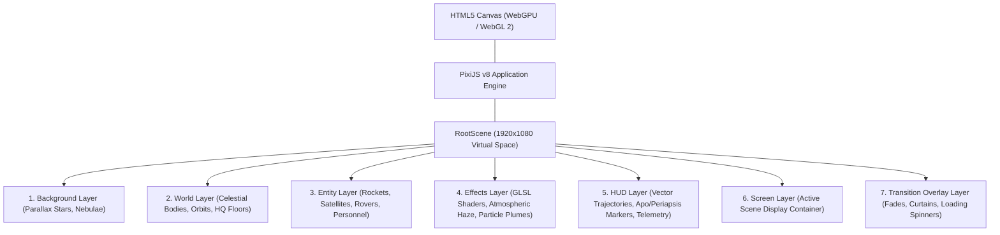
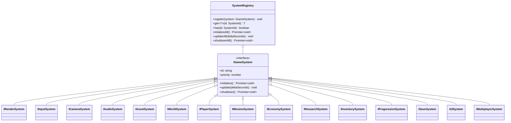
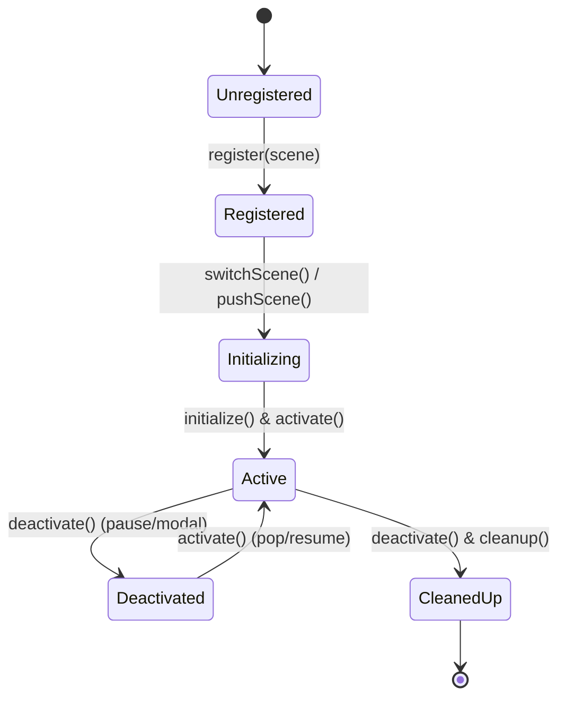
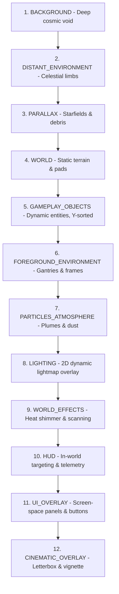

# Technical Architecture: INTERSTELLAR CONTINUUM

## 1. Selected Technology Stack & Runtimes

| Component           | Technology         | Version           | Purpose                                                              |
| :------------------ | :----------------- | :---------------- | :------------------------------------------------------------------- |
| **Language**        | TypeScript         | `^7.0.2` (ES2022) | Type-safe domain models, strict null-checks, compile-time contracts  |
| **Runtime**         | Node.js            | `v24.11.1`        | Local development tooling, compilation, testing, and scripts         |
| **Renderer**        | PixiJS             | `^8.23.0`         | High-performance 2D/2.5D WebGL/WebGPU batching, shaders, scene graph |
| **Build System**    | Vite               | `^8.3.8`          | Instant HMR dev server, lightning-fast Rollup production bundling    |
| **Test Runner**     | Vitest             | `^5.1.0`          | In-memory ESM unit testing for simulation math and services          |
| **Animation**       | GSAP & Pixi Ticker | `^3.15.1`         | Frame-accurate UI tweens, camera tracking, and cinematic sequencing  |
| **Audio Engine**    | Howler.js          | `^2.2.4`          | Spatial 2D audio channels, volume bus mixing, seamless loop playback |
| **Package Manager** | npm                | `11.6.2`          | Clean dependency resolution with locked manifests                    |

---

## 2. Rendering & Layer Hierarchy

The PixiJS v8 rendering pipeline uses a 7-layer stage container attached to a canonical 1920×1080 virtual resolution space:

---

## 3. Core System Architecture & Registration (`src/systems/`)

The application avoids monolithic coupling through the `SystemRegistry` and typed system interfaces. Systems are initialized and updated according to strict priority order:

---

## 4. Scene Management & Transition Pipeline (`src/scenes/`)

The `SceneManager` handles scene registration, lifecycle states, transitions, and modal overlays:

### Supported Transitions:

- **`InstantTransition`:** Immediate scene swap without animation delay.
- **`FadeTransition`:** Dual-phase fade to solid black, scene swap, and fade in to new scene.
- **`OpacityTransition`:** Direct crossfade of scene containers.
- **`LoadingTransition`:** Intermediate animated loading spinner while async assets load.
- **`CinematicTransition`:** Top and bottom widescreen letterbox bars sweep inward, swap scenes, and retract.

---

## 5. Centralized Modular Game State (`src/state/`)

State is partitioned into modular, cohesive slices managed by `GameStateManager`:

| State Slice               | Responsibilities            | Key Fields                                                                  |
| :------------------------ | :-------------------------- | :-------------------------------------------------------------------------- |
| `SceneState`              | Screen navigation tracking  | `currentScene`, `previousScene`, `sceneHistory`                             |
| `PlayerPositionState`     | Physical entity coordinates | `bodyId`, `worldCoords`, `surfaceCoords`, `headingDeg`, `speedMps`          |
| `ActiveMissionState`      | Flight trajectory telemetry | `missionId`, `code`, `title`, `phase`, `elapsedSeconds`, `trajectoryStage`  |
| `OrganisationState`       | Space agency metadata       | `agencyName`, `directorName`, `rank`, `prestigeScore`, `totalLaunches`      |
| `ResourceState`           | Multi-currency wallet       | `credits`, `researchData`, `rawMaterials`, `technologyPoints`               |
| `ResearchState`           | Tech tree progression       | `unlockedNodeIds`, `activeResearchNodeId`, `accumulatedPoints`              |
| `DestinationsState`       | Solar system discovery      | `unlockedBodyIds`, `surveyedSiteIds`, `surfaceFlagsPlanted`                 |
| `CompletedMissionsState`  | Historical flight archives  | `completedMissionIds`, `records: Array<{ missionId, score, date }>`         |
| `BuildingStates`          | Headquarters facilities     | `facilityId -> { tier, healthPercent, operational, efficiency }`            |
| `SettingsState`           | User configuration          | `display`, `graphics`, `audio`, `input`, `accessibility`                    |
| `MultiplayerSessionState` | Network co-op state         | `isMultiplayer`, `sessionId`, `isHost`, `role (FLIGHT, GNC, CAPCOM, EECOM)` |

---

## 6. Centralized Input Architecture (`src/input/`)

- **Hardware Support:** Keyboard (`code`), Mouse (buttons, movement, wheel), and Gamepad (standard button indices).
- **Actions:** `MoveUp`, `MoveDown`, `MoveLeft`, `MoveRight`, `Interact`, `Confirm`, `Cancel`, `Pause`, `OpenMap`, `OpenInventory`, `CameraZoom`, `CameraPan`.
- **Contexts:** `GAMEPLAY`, `UI`, `CUTSCENE`, `MODAL`, `DEBUG`.
- **Coordinate Virtualization:** Automatically maps physical screen coordinates to canonical 1920×1080 virtual game coordinates.
- **Input Locking:** Reentrant `lockInput(reason)` / `unlockInput(reason)` prevents input leakage during scene transitions and cinematics.

---

## 7. Typed Event Architecture & Memory Leak Prevention (`src/core/events/`)

- **Strongly Typed Payloads:** All domain and system events (`SceneChanged`, `PlayerMoved`, `InteractionRequested`, `InteractionCompleted`, `MissionSelected`, `MissionStarted`, `MissionCompleted`, `MissionFailed`, `ResourceCollected`, `ResearchUnlocked`, `TechnologyUnlocked`, `CreditsChanged`, `BuildingEntered`, `SaveRequested`, `SettingsChanged`) carry strict TypeScript payload definitions.
- **`ScopedEventSubscriber`:** Solves the classic game development listener leak problem. Each scene or subsystem registers listeners through a scoped subscriber. When the scene is deactivated or destroyed, calling `subscriber.dispose()` automatically cleans up all registered subscriptions.

---

## 8. Centralized Error Taxonomy (`src/core/errors/`)

Errors inherit from `GameError`, providing structured error categories, codes, and recovery advice:

- `SceneError`: `SCENE_INIT_FAILED`, `SCENE_TRANSITION_FAILED`, `SCENE_NOT_FOUND`
- `AssetError`: `ASSET_LOAD_FAILED`, `BUNDLE_NOT_FOUND`, `UNSUPPORTED_FORMAT`
- `ConfigError`: `MISSING_CONFIG`, `INVALID_SETTING`
- `StateError`: `INVALID_STATE_TRANSITION`, `CORRUPT_SAVE_STATE`
- `EventError`: `EVENT_LISTENER_CRASH`, `CIRCULAR_DISPATCH`
- `InputError`: `UNBOUND_ACTION`, `LOCKED_INPUT_DISCARD`

---

## 9. 2D/2.5D Graphics & Rendering Pipeline Architecture (`src/rendering/`)

### 9.1 The 12 Canonical Rendering Layers
Rendering is partitioned into 12 strictly ordered containers:

### 9.2 2.5D Depth Simulation
Spatial depth without 3D geometry:
- **Perspective Scaling:** $S(Z) = \frac{D_{focal}}{D_{focal} + Z}$ where $Z=0$ is focal plane, $Z>0$ is distant background, and $Z<0$ is foreground rush.
- **Parallax Factors:** Layers move at fractional camera velocity based on depth.
- **Aerial Perspective:** Distance-based color blending towards atmospheric haze fog.
- **Dynamic Y-Sorting:** PixiJS `sortableChildren` with zero runtime memory allocations.

### 9.3 2D Dynamic Lighting Architecture
- **Lightmap Compositing:** Ambient darkness overlay multiplied with world geometry, illuminated by additive point and spot light sources.
- **Presets:** `HEADQUARTERS`, `ROCKET_FACILITY`, `PLANETARY_DAY`, `PLANETARY_NIGHT`, `MARS_SURFACE`, `DEEP_SPACE`.

### 9.4 Shaders & Post-Processing
- Managed via `ShaderManager` with scalable quality profiles (`LOW`, `MEDIUM`, `HIGH`, `ULTRA`).
- Custom filters: `AtmosphericHazeFilter`, `ScanlineHologramFilter`, `ThrusterHeatFilter`, `VignetteFilter`.
- Built-in headless environment guard preventing `document is not defined` errors during test runs.

---

## 10. Camera, Viewport & Coordinate Systems Architecture (`src/camera/`)

### 10.1 Central Camera System (`CameraSystem.ts`)
Unified camera system implementing `ICameraSystem` (registered in `SystemRegistry` at priority 12):
- **Full Coordinate State:** Focal position $(x, y)$, zoom scale, rotation (radians), and target offsets $(ox, oy)$.
- **Smooth Interpolation:** Exponential dampening ($0.05 \le \text{smoothing} \le 1.0$) eliminating camera jitter.
- **Scripted Transitions:** `panTo`, `focusOn`, and `reset` with cubic ease-in-out interpolation.

### 10.2 Camera Modes & Zoom Presets
Supports 7 distinct operational modes:
1. `PLAYER_FOLLOW`: Deadzone box + velocity lookahead tracking.
2. `FREE`: Unconstrained manual panning & zooming.
3. `CINEMATIC`: Gentle drift, slow rotation, and letterbox framing.
4. `MISSION_OVERVIEW`: High-altitude strategic view.
5. `PLANETARY_EXPLORATION`: Large-scale surface map with terrain bounds clamping.
6. `HEADQUARTERS`: Facility room-to-room interior exploration.
7. `INTERFACE_FOCUSED`: Terminal and workbench framing.

Zoom presets: `CLOSE_INTERACTION` (1.8x), `NORMAL_EXPLORATION` (1.0x), `WIDE_ENVIRONMENT` (0.65x), `MISSION_OVERVIEW` (0.4x), `MAP_VIEW` (0.25x).

### 10.3 Coordinate Conversion Matrix
Seamless 4-way bi-directional conversions implemented in `CoordinateConverter.ts`:
- $\text{Physical Screen} \longleftrightarrow \text{Virtual Screen (1920×1080)} \longleftrightarrow \text{Camera Local} \longleftrightarrow \text{World Coordinates}$

### 10.4 Viewport Frustum & Culling
- Calculates visible world frustum AABB (`minX, maxX, minY, maxY`).
- Zero-overhead frustum intersection queries for entities (`isRectVisible`) and particles (`isPointVisible`).
- 5% safe area boundary margin calculation for tactical HUDs.

### 10.5 Trauma-Based Camera Shake & Accessibility
- Quadratic trauma model: $\text{shake} = \text{trauma}^2 \times \text{intensityMultiplier}$.
- Suppressed when `reducedMotion` accessibility is enabled.

---

## 11. Playable Character Controller, Movement & 2D Collision Architecture (`src/player/` & `src/collision/`)

### 11.1 Mission Director Player Character (`PlayerCharacter.ts`)
- **Player Persona:** Represents the Mission Director of an independent aerospace agency based on Earth.
- **Visual Presentation:** 2D/2.5D composite layered artwork (dark navy executive blazer, collared shirt, gold security badge on corporate cyan lanyard, slate trousers, dark boots, styled hair). Grounded by an elliptical drop shadow with stride-dependent squash and stretch.
- **Camera Target:** Implements `ICameraTarget` (`getPosition()` and `getVelocity()`).
- **2.5D Depth Sorting:** Base foot Y coordinate dynamically updates `container.zIndex` for seamless depth sorting around desks, consoles, and walls.
- **Facing & States:** 4 directions (`NORTH`, `SOUTH`, `EAST`, `WEST`) and 3 states (`IDLE`, `WALK`, `SPRINT`) with procedural stride animation.

### 11.2 Movement Integration & Diagonal Normalization (`MovementComponent.ts`)
- **8-Directional Vector:** Computes directional intent from inputs.
- **Diagonal Normalization:** Scales diagonal input by $1/\sqrt{2} \approx 0.7071$ ensuring diagonal traversal does not exceed cardinal speed.
- **Frame-Rate Independent Physics:** Accelerates (1400 px/s²) to target speed and decelerates (1800 px/s²) to zero; standard walk (180 px/s) and sprint (310 px/s).

### 11.3 Independent Axis Sliding Collision Resolution (`CollisionSystem.ts`)
- **Sliding Mechanics:** Movement is resolved in two distinct passes:
  1. **Horizontal Pass:** Advances X, queries broadphase spatial grid, and clamps position against obstacle boundary if colliding.
  2. **Vertical Pass:** Advances Y from newly resolved X, queries obstacles, and clamps position against obstacle boundary if colliding.
- **Result:** Player character smoothly slides along walls, desks, and corner geometries without catching or sticking.
- **Spatial Grid Broadphase:** `SpatialHashGrid` with configurable cell sizes (default 128px) for $O(1)$ spatial queries.
- **Collider Geometry:** `BoxCollider` and `CircleCollider` with independent offset support (foot collider positioned at base of character).
- **Collision Categories:** `SOLID`, `OBSTACLE`, `TRIGGER`, `RESTRICTED`, `BOUNDARY`.

### 11.4 Centralized Input & Event Integration (`PlayerController.ts`)
- Reads actions from `InputManager` (`MoveUp`, `MoveDown`, `MoveLeft`, `MoveRight`, `Sprint`, `Interact`).
- Enforces input lock (`isInputLocked()`) to freeze player motion during dialogue or menus.
- Triggers `player:interact` when pressing `Interact` (`KeyE`) within trigger zones.
- Emits `collision:trigger-enter`, `collision:trigger-exit`, and `player:moved` on `EventBus`.

---

## 12. Character Animation Architecture (`src/animation/`)

### 12.1 Animation State Machine (`AnimationStateMachine.ts`)
- **Supported States:** `IDLE`, `WALK`, `RUN`, `INTERACT`, `ENTER_BUILDING`, `EXIT_BUILDING`, `STOP_TRANSITION`.
- **Priority & Interruption Rules:** Prioritizes actions (`INTERACT`, `ENTER_BUILDING` are non-interruptible by standard movement until completion or forced override).
- **Dynamic Speed Synchronization:** Dynamically scales walk and run playback rates based on actual player speed ($ratio = \text{speed} / \text{baseSpeed}$), strictly eliminating foot sliding across all movement speeds.
- **Event Lifecycle:** Exposes `onStateEnter`, `onStateExit`, `onFrameChange`, `onLoop`, and `onComplete`.

### 12.2 Directional Selection with Hysteresis (`DirectionSelector.ts`)
- Resolves movement vectors to 4 cardinal directions (`NORTH`, `SOUTH`, `EAST`, `WEST`).
- Implements a 25% directional hysteresis threshold ($1.25\times$) preventing rapid sprite flickering during diagonal movement while maintaining smooth responsiveness.

### 12.3 Layered Visual Renderer (`CharacterVisualRenderer.ts`)
- **IDLE:** Sinusoidal chest/shoulder breathing oscillation and natural 3.8s eye-blinking cadence.
- **WALK:** Natural 8-frame walk stride cycle with counter-balanced arm swings and vertical bounce.
- **RUN:** Aggressive sprint cycle with forward torso lean (5 degrees), wider stride amplitude, bent elbow arm pumps, and higher bounce.
- **INTERACT:** Terminal typing posture with raised arm, rhythmic finger tapping, and head tilt towards console screens.
- **ENTER_BUILDING / EXIT_BUILDING:** Smooth step-in portal walk with linear alpha fade transitions.
- **STOP_TRANSITION:** 3-frame foot-bracing settling motion when decelerating from high speeds.
- **Contact Ground Shadow:** Dynamic elliptical drop shadow anchored to $(0, 0)$ that squashes on foot plant and softens/shrinks on peak bounce.
- **Stride Contact Effects:** Dust/impact rings triggered on ground contact during sprinting and stops.

### 12.4 Sprite Sheet & Frame Cache (`CharacterSpriteSheetGenerator.ts`)
- Canonical frame boundaries ($48 \times 72$ px) and anchor metadata $(0.5, 0.95)$ at character feet.
- Texture caching with disposal routines and headless environment safety guards.

---

## 13. Environmental Interaction Framework Architecture (`src/interaction/`)

### 13.1 Central Interaction Coordinator (`InteractionSystem.ts`)
- **System Registration:** Conforms to `IInteractionSystem` and `IGameSystem`, registered in `SystemRegistry` at **priority 14** (between `PlayerSystem` priority 13 and `RenderSystem` priority 15).
- **Decoupled Design:** Completely isolates interaction logic from `PlayerController` and movement loops.
- **Object Registry:** Thread-safe collection of `IInteractiveObject` instances supporting dynamic registration, unregistration, ID lookup, and range queries.

### 13.2 Stable Proximity Discovery with 20% Hysteresis (`TargetSelector.ts`)
- **Multi-Target Evaluation:** Gathers candidates within interaction radius, checks requirements, and ranks viable candidates.
- **Hysteresis Threshold ($0.8\times$):** When an active target is already focused, a competing candidate must be at least 20% closer or have strictly higher priority to steal focus. This prevents visual badge flickering and selection ping-ponging when standing equidistant between two interactive entities.
- **Tie-Breaking:** Equal priority candidates are selected by Euclidean distance.

### 13.3 Contextual In-World Prompt (`ContextualPrompt.ts`)
- **Visual Presentation:** Sci-fi cyber frame with glowing cyan/amber borders, prominent key badge (`[ E ]`), action text (e.g. `Access Flight Director Console`), and status reason when unavailable.
- **Smooth Transition:** Alpha interpolation ($8.0\times$ fade speed) for seamless appearance and disappearance.
- **Screen & World Anchoring:** Anchors in world coordinates above interactables with frustum clamping.
- **Mouse & Pointer Support:** Pointer events enabled on the prompt container for direct click interactions.

### 13.4 Reusable Information Dialogue Modal (`InformationPanel.ts`)
- **Modal Dialogue System:** Translucent backdrop with dark blue/cyan framed modal dialog displaying title, category tag, descriptive narrative, and key-value specification list.
- **Input Context Control:** Automatically acquires input lock (`InputManager.lockInput('InformationPanel')`) on open and safely unlocks on dismiss.
- **Keyboard & Click Controls:** Closes on `Escape` or secondary button click; confirms on `Enter`, `Space`, `E`, or primary button click.

### 13.5 Physical Facility Portals & Airlocks (`BuildingEntrance.ts`)
- **Specialized Portal Interactable:** Manages exterior building entrances and interior exits with automatic animation binding (`ENTER_BUILDING` / `EXIT_BUILDING`).
- **Dual Event Dispatches:** Emits system-level events (`building:entered`, `building:exited`) and domain events (`BuildingEntered`).

### 13.6 Safe Interaction Execution Pipeline
- **Validation:** Evaluates all preconditions (`clearanceLevel`, `unlockedTechs`, cooldowns).
- **Input Locking:** Locks player movement input (`InputManager.lockInput('InteractionExecution')`).
- **Animation Synchronization:** Triggers contextual player character animations (`playInteraction` or `playEnterBuilding`).
- **Resilient Recovery (3.0s Timeout):** All interaction execution promises race against a 3.0-second timeout safeguard. In a `finally` block, player movement input is guaranteed to be restored, preventing permanent control freezes.

---

## 14. Earth-Based Headquarters Campus Environment (`src/environment/headquarters/`)

### 14.1 Campus World Topology & Sizing
- **Dimensions:** $3600 \times 2400$ px with origin $(0, 0)$ at top-left.
- **Campus Grid Architecture:**
  - *Western Perimeter ($x: 200 - 800, y: 900 - 1500$):* Arrival & Security Gate, Visitor Drop-off, Finance & Administration.
  - *Central Hub ($x: 1500 - 2100, y: 1000 - 1450$):* Central Headquarters Plaza, Compass Rose mosaic, settings directory kiosk, benches, lamp posts.
  - *North Science Quad ($y: 200 - 800$):* Spacecraft & Satellite Cleanroom Lab, Advanced R&D Centre, Planetary Data Observatory.
  - *South Operations Sector ($y: 1550 - 2250$):* Mission Operations Centre (MOC), Robotics & Rover Yard, Deep Space Network (DSN) ground tracking station.
  - *East Spaceport Complex ($x: 2400 - 3500, y: 800 - 2300$):* Vehicle Assembly Building (VAB), Manufacturing Centre, crawler rollout tracks, Pad Alpha launch complex.

### 14.2 Ground & Pathway Rendering (`CampusGroundRenderer.ts`)
- Rendered on `RenderLayerType.BACKGROUND`.
- **Road System:** 90px asphalt roads with concrete curbs and yellow dashed centerlines.
- **Pedestrian Promenades:** 48px stone pavers with recessed glowing guide lines.
- **Launch Infrastructure:** Hexagonal blast pad foundation, flame trench with heat-resistant grill, water deluge trenches, dual-gauge crawler tracks.

### 14.3 Procedural Architectural Generator (`CampusBuilding.ts`)
- Layered 2.5D visual composition: contact ambient occlusion drop shadow, slate/navy wall blocks, reflective curtain glass, illuminated windows, customized roof structures (`RADOME`, `SOLAR`, `CRANE`, `ANTENNA`, `DOME`), glowing department signs.
- Footprint `BoxCollider` covering upper 75% structural body, leaving lower 25% entrance portico walkable.
- Integrated `BuildingEntrance` / `InteractiveObject` registered into `InteractionSystem`.

### 14.4 Environmental Props & Infrastructure (`CampusDecorations.ts`)
- Perimeter chainlink security fences with access gates and solid colliders.
- Landscaped deciduous and evergreen trees with drop shadows and trunk colliders.
- Campus streetlights with subtle illumination halos on `LIGHTING` layer.
- Plaza benches, directional signposts, electric cargo haulers.
- Twin 18m Cassegrain DSN tracking dishes.
- Pad Alpha steel truss umbilical service tower (180px tall) with red-and-white aviation bands, propellant swing-arms, lightning rod, and spherical LOX/LH2 cryogenic propellant storage tanks.

### 14.5 Headquarters Scene Integration (`HeadquartersScene.ts`)
- Production scene implementing `SceneId.HEADQUARTERS`.
- Connects camera bounds $(0, 0, 3600, 2400)$ with deadzone tracking, velocity lookahead, and zoom presets.
- Floating atmospheric dust motes on `PARTICLES_ATMOSPHERE` layer.
- Diagnostic HUD telemetry with active district detection and navigation waypoints.

---

## 15. Global In-Game User Interface & Strategic HUD Architecture (`src/ui/`)

### 15.1 UI Design System & Design Tokens (`src/ui/core/`)
- **Virtual Resolution Anchoring:** All UI elements reside within canonical $1920 \times 1080$ virtual space, mapped via `VirtualResolution`.
- **Aerospace Color Palette (`UIDesignTokens.ts`):**
  - Backgrounds: `BG_BASE` (`#020617`), `BG_PANEL` (`#091424`), `BG_PANEL_ELEVATED` (`#0c223c`).
  - Borders: `BORDER_DEFAULT` (`#1e3a5f`), `BORDER_SUBTLE` (`#132b47`), `BORDER_HIGHLIGHT` (`#38bdf8`).
  - Accents: `CYAN` (`#00f0ff`), `AMBER` (`#f59e0b`), `GREEN` (`#4ade80`), `RED` (`#ef4444`), `PURPLE` (`#a855f7`).
  - Text: `TEXT_PRIMARY` (`#f8fafc`), `TEXT_SECONDARY` (`#94a3b8`), `TEXT_MUTED` (`#64748b`), `TEXT_ACCENT` (`#38bdf8`).
- **Base UI Component (`UIComponent.ts`):**
  - Abstract foundation managing container lifecycle, visibility state (`show`, `hide`, `toggle`), linear/exponential alpha easing, and `reducedMotion` accessibility mode.

### 15.2 Tactile Reusable Component Suite (`src/ui/components/`)
- **`UIButton`:** 5 visual variants (`PRIMARY`, `SECONDARY`, `OUTLINE`, `DANGER`, `GHOST`) with hover/pressed states, keyboard shortcut badges (`[E]`, `[ESC]`, `[M]`), disabled state prevention, and audio hooks (`ui_hover`, `ui_confirm`).
- **`UIPanel`:** Modular window frame with title bar, close action, and content container.
- **`UITabGroup`:** Tab switcher with active cyan underline indicator and badge counts.
- **`UIProgressBar`:** Segmented/continuous progress bar with percentage readout and color overrides.
- **`UISpinner`:** Rotating radar reticle for async background operations with `start()`/`stop()`.
- **`UIScrollList`:** Masked viewport with draggable scrollbar and mousewheel support.
- **`UICard`:** Structured telemetry card with title, badge, description, and key-value specs table.
- **`UIDataTable`:** Tabular data display with formatted columns and zebra row striping.
- **`UIDialog`:** Modal confirmation dialog with backdrop shade blocker and confirm/cancel hooks.

### 15.3 Tooltip & Notification Subsystems (`src/ui/tooltips/`, `src/ui/notifications/`)
- **`TooltipManager` & `UITooltip`:** Context popovers with hover delay (250ms), target registration, and $1920 \times 1080$ virtual boundary clamping.
- **`NotificationManager` & `UINotification`:** Stacked tactical toasts (Info, Success, Warning, Error) with priority queueing, auto-dismiss countdown bar, anti-spam deduplication (2000ms window), and automatic subscriptions to domain events (`facility:visited`, `save:saved`, `error:captured`, `interaction:executed`).

### 15.4 Primary Strategic HUD (`GlobalHUD` & `src/ui/hud/`)
- **Organisation Badge HUD (`OrganisationBadgeHUD`):** Top-left panel (`x: 24, y: 24`) displaying agency name, rank & title, real-time campus location and district, and player movement status. Active mission objective is strictly gated on actual running game state (`state.mission.missionId !== null`).
- **Strategic Resources HUD (`ResourcesDisplayHUD`):** Top-center status bar (`x: 680, y: 24`) data-bound directly to `GameStateManager.getState().resources` (Credits, Research Data, Raw Materials, Tech Points).
- **Contextual Interaction Prompt (`InteractionPromptHUD`):** Bottom-center prompt (`x: 960, y: 990`) bound to `InteractionSystem` (`interaction:target-changed`), displaying the action verb, target name, and `[E]` key badge.
- **Campus Radar Minimap (`CampusMinimap`):** Real-time $240 \times 160$ vector radar minimap of the $3600 \times 2400$ Earth campus, facility markers, player position blip with heading arrow, camera frustum outline, and collapsible toggle (`M` key / button).
- **Operational Menu Button:** Top-right button (`x: 1786, y: 24`) displaying `[ESC] MENU` with callback hook for pause menu.

---

## 11. In-Game Pause Menu & Unified Settings Architecture

### 11.1 Pause Lifecycle & Simulation Isolation
- **Pause Triggering:** Opened via `Escape` key, centralized `InputAction.Pause`, or top-right HUD menu button.
- **Simulation Freezing:** Suspends player controller updates, 2.5D sliding collisions, dust mote translations, and environmental interaction hysteresis discovery.
- **Input Locking:** Locks input system with reason `'PauseMenu'` via `InputManager.lockInput()`, ensuring physical key presses do not bleed into gameplay controls while in menus.
- **Event Dispatch:** Emits `'game:pause'` with boolean flag on `EventBus`.

### 11.2 Centralized Settings Service (`SettingsManager`)
- **Schema & Versioning:** Strongly typed `FullSettingsSchema` with `schemaVersion: 1`. Automatically recovers and falls back to defaults if corrupted data is detected.
- **Storage Isolation:** Persisted separately in `localStorage` under `interstellar_continuum_settings` (with in-memory fallback for headless tests). Resetting settings strictly never touches or clears player organisation progression.
- **Subsystem Synchronization:**
  - `ShaderManager`: Sets quality tier (`LOW`, `MEDIUM`, `HIGH`, `ULTRA`).
  - `AudioService`: Sets master, music, ambience, sfx, ui, and dialogue channel volumes and mute state.
  - `VirtualResolution`: Sets resolution scaling factor (`0.75x` to `1.5x`).
  - `CameraSystem`: Sets reduced motion and shake multiplier.
  - `InputManager`: Rebinds physical keyboard actions with conflict detection.
  - `ConfigManager`: Syncs legacy configuration keys for backward compatibility.

### 11.3 Unified Settings View (`SettingsView`)
- Single authoritative UI implementation shared across the in-game Pause Menu, Title Screen (`SettingsModal`), and Headquarters Settings building (`SceneId.SETTINGS`).
- 6 Categories: Graphics, Audio, Controls, Accessibility, Interface, Gameplay.
- Reusable tactile controls: `UISlider`, `UIToggle`, `UIOptionStepper`, `UIKeybindRow`.
- Rebinding modal with conflict detection, preventing two actions from sharing conflicting keys.
- Category reset and global reset safeguards with confirmation modals.

---

## 12. Tutorial & Contextual Onboarding Architecture

### 12.1 Tutorial Manager Service (`TutorialManager`)
- **Singleton & ServiceLocator:** Registered under `'TutorialManager'` in `ServiceLocator`, with lifecycle hooks for `resetInstance()`.
- **Sequence Orchestration:** Supports multi-step sequences (`TutorialSequenceId`) comprised of structured `TutorialStep` instances.
- **Conditional Auto-Progression:** Evaluates dynamic condition checkers (`autoProgressCheck`) every frame:
  - `PLAYER_MOVED`: Detects accumulated director walking distance ($\ge 120$ px).
  - `FACILITY_DISCOVERED`: Detects proximity to targeted facility entrances (e.g. Mission Operations Centre).
  - `LAUNCH_APPROACHED`: Detects proximity to Pad Alpha launch complex.
  - `MANUAL_CONFIRM`: Gated on player keypress (`Space` / `Enter`).
- **Guidance State Management:** Supports step forward, step backward (`previousStep()`), sequence skipping (`skipCurrentSequence()`), and dismissal / minimization toggle (`toggleDismiss()`).
- **Domain Events:** Emits typed events on `EventBus`: `'tutorial:started'`, `'tutorial:step-changed'`, `'tutorial:step-completed'`, `'tutorial:completed'`, `'tutorial:skipped'`, `'tutorial:dismissed'`, `'tutorial:enabled-changed'`.

### 12.2 Authoritative 7-Step Initial Onboarding Sequence
- **Dynamic Controls Inspection:** Movement and interaction prompts dynamically query `InputManager.getBindings()` to resolve configured physical keys, reflecting custom bindings (e.g. `▲ UP` / `W`) rather than hardcoded text.
- **Single Source of Truth:** Facility purposes and descriptions dynamically query `FacilityRegistry.getInstance()` across all 10 campus facilities, eliminating duplicated or desynchronized strings.
- **Launch Pad Architecture:** Step 5 introduces Pad Alpha launch infrastructure, explaining staging and manifest requirements while strictly preventing premature launches.
- **Step Ordering:**
  1. `ONBOARDING_ARRIVAL`: Role, welcome message, and organisation objective.
  2. `ONBOARDING_MOVEMENT`: Campus locomotion and interactive console access.
  3. `ONBOARDING_CAMPUS_EXPLORATION`: Quadrant infrastructure and MOC waypoint.
  4. `ONBOARDING_FACILITY_DISCOVERY`: Overview of all 10 registered facilities.
  5. `ONBOARDING_LAUNCH_COMPLEX`: Surface launch pad and orbital deployment.
  6. `ONBOARDING_MISSION_PREPARATION`: 4 core pillars of mission architecture.
  7. `ONBOARDING_FREE_EXPLORATION`: Unrestricted campus clearance granted.

### 12.3 Contextual Waypoint Marker System (`TutorialWaypointMarker`)
- **Dual Visual Presentation:**
  - **In-World Beacon:** Rendered at target world coordinates with dual pulsing rings, precision crosshairs, diamond center pin, and label text when within the visible camera frustum.
  - **Off-Screen Edge Bearing Indicator:** Clamped to virtual screen edges ($1920 \times 1080$ with 80px margin) pointing toward target angle with live real-time distance telemetry (e.g. `450m`) when target is off-screen.
- **Accessibility:** Strictly checks `accessibility.reducedMotion` from `SettingsManager`, disabling pulsing scale oscillation when active.

### 12.4 Compact Tutorial HUD Panel (`TutorialPanel`)
- Non-obstructive aerospace card anchored at bottom-left ($x: 35, y: 780$, $480 \times 240$ px).
- Displays step progress indicator (`STEP X/7`), directive title, subtitle, wrapped body text, key badges, Continue button, and Skip button.
- Minimized pill mode (`[H] OBJECTIVE: ...`) allows player to minimize guidance at any time to preserve campus visibility.
- Dynamic layout scaling supports `accessibility.textSize === 'LARGE'`.

### 12.5 Progression Persistence & Replay Integration
- **Save State Extension:** `GameSaveSchema` includes `tutorial?: TutorialProgressState`.
- **First-Time vs Returning Players:** Returning players who completed onboarding are not forced to repeat it, but can freely replay it on demand via the `REPLAY ONBOARDING TUTORIAL` action in `PauseMenu`.

---

## 13. Mission Operations Centre & Solar System Exploration Architecture

### 13.1 Authoritative Destination System (`src/destinations/`)
- **Single Source of Truth:** Centralized database ([DestinationData.ts](file:///c:/Users/user-pc/OneDrive/Documents/GitHub/Space/src/destinations/DestinationData.ts)) and singleton registry ([DestinationRegistry.ts](file:///c:/Users/user-pc/OneDrive/Documents/GitHub/Space/src/destinations/DestinationRegistry.ts)) defining 20 Solar System celestial bodies.
- **Data Coverage:**
  - Sun (Sol)
  - 8 Primary Planets (Mercury, Venus, Earth, Mars, Jupiter, Saturn, Uranus, Neptune)
  - Asteroid Belt (Main Belt)
  - Major Moon Systems (Luna, Io, Europa, Ganymede, Titan, Enceladus)
  - Earth Orbital Regimes (LEO, MEO, GEO, HEO)
- **Physical Telemetry Metrics:** Semi-major axis, orbital period, mean radius, planetary mass, surface gravity, surface temperature range, atmospheric pressure, atmospheric composition, magnetic field presence, and radiation hazard levels (`NEGLIGIBLE` to `LETHAL`).
- **Hierarchy & Queries:**
  - `getPrimaryPlanets()`: Returns the 8 primary planets sorted heliocentrically.
  - `getMoonsForBody(parentId)`: Returns registered moons for a given celestial parent.
  - `getEarthOrbitRegimes()`: Returns the 4 distinct orbital regimes around Earth.
  - `isDestinationUnlocked(id)`: Returns unlock gating status based on progression.
- **EventBus Integration:** Emits `'destination:selected'` and `'destination:unlocked'` domain events.

### 13.2 Interactive 2D Schematic Solar System Map (`SolarSystemMapCanvas`)
- **Schematic Orbital Scaling:** Planets are rendered on a clear schematic coordinate grid with logarithmic orbital spacing for optimal interactive hit detection, accompanied by an explicit header disclaimer (`SCHEMATIC MAP: RELATIVE PROPORTIONS (NOT TO 1:1 PHYSICAL ORBITAL SCALE)`).
- **Celestial Visuals:**
  - Sun: Core radius with animated dual-frequency corona pulsation.
  - Orbits: Subtle elliptical guide rings with dashed stroke.
  - Planets: Color-coded bodies with proportional radius scaling.
  - Rings: High-fidelity procedural ring discs for Saturn and Uranus.
  - Asteroid Belt: Procedural particle ring with 140+ individual rock nodes between Mars and Jupiter.
- **Pan & Zoom Navigation:**
  - Clamped zoom ($0.3\times$ to $3.0\times$) with mouse wheel or on-screen `+`/`-`/`RESET` buttons.
  - Smooth mouse drag panning with canvas coordinate transform.
  - Keyboard cycling through primary planets via `A`/`D` or Left/Right arrow keys.
- **Target Selection & Reticle:**
  - Generous hit-testing bounding boxes for celestial bodies.
  - Glowing cyan targeting reticle with corner brackets and precision crosshairs.
  - Recursion guard (`notify = false`) breaking selection synchronization loops between map and parent scenes.

### 13.3 Earth Orbital Regimes Hierarchy (`EarthOrbitDisplay`)
- **Concentric Sub-Navigation:** Activated when inspecting Earth's vicinity, transitioning smoothly from heliocentric space to geocentric orbital shells:
  - Low Earth Orbit (LEO): 160 – 2,000 km (Space stations, Earth observation, remote sensing).
  - Medium Earth Orbit (MEO): 2,000 – 35,786 km (Global navigation satellite constellations, GPS/Galileo).
  - Geostationary Earth Orbit (GEO): 35,786 km (Continuous weather monitoring, telecommunications relays).
  - Highly Elliptical Orbit (HEO): High apogee transfer and Molniya polar coverage.
  - Luna: 384,400 km (Earth's natural satellite, translunar gateway).
- **Interface & Back Navigation:** Dedicated node cards displaying altitude range and purpose, with an instant "BACK TO SOLAR SYSTEM" return action.

### 13.4 Tactical Destination Info Panel (`DestinationInfoPanel`)
- **Telemetry Card Layout:** Docked at right edge of MOC ($x: 1380, y: 130$, $500 \times 920$ px).
- **Content Organization:**
  - Body title, scientific classification badge, unlock status badge (`[UNLOCKED]` vs `[LOCKED]`).
  - Narrative scientific summary.
  - Key-value physical specifications grid: semi-major axis, orbital period, surface gravity, surface temperature, atmospheric pressure/profile, radiation hazard rating.
  - Mission progression ledger: Available, Active, Completed, and Failed mission counters.
  - Gated restriction notice for locked bodies indicating unlock requirements.
  - Action buttons: `BROWSE MISSIONS`, `ORBITAL REGIONS / EXPLORE MOONS`, and `CLOSE`.

### 13.5 Mission Operations Centre Scene (`MissionOperationsScene`)
- Registered under `SceneId.MISSION_OPERATIONS` in `SceneManager`.
- Replaces generic interior placeholder for `FacilityId.MISSION_OPERATIONS`.
- Top header bar with facility title, UTC mission clock, campus return shortcut (`[ESC]`), and 5-section tab group (`Solar System`, `Mission Catalogue`, `Active Missions`, `Mission Archive`, `Destination Intel`).
- Campus return restores the player character at the physical MOC building entrance $(x: 1800, y: 1730)$ with full movement, camera, and HUD systems preserved.
- Input isolation ensures MOC navigation keys do not bleed into character movement.

---

## 14. Central Destination Registry & Progression Architecture

### 14.1 Authoritative Master Destination Registry (`src/destinations/`)
- **Single Source of Truth:** Centralized database ([DestinationData.ts](file:///c:/Users/user-pc/OneDrive/Documents/GitHub/Space/src/destinations/DestinationData.ts)) and registry service ([DestinationRegistry.ts](file:///c:/Users/user-pc/OneDrive/Documents/GitHub/Space/src/destinations/DestinationRegistry.ts)) defining 28 celestial destinations with zero duplicate static strings.
- **Data Coverage:**
  - Star: Sun (`DEST_SUN`).
  - Terrestrial Worlds: Mercury (`DEST_MERCURY`), Venus (`DEST_VENUS`), Earth (`DEST_EARTH`), Mars (`DEST_MARS`).
  - Earth Orbital Regimes: LEO (`DEST_EARTH_LEO`), MEO (`DEST_EARTH_MEO`), GEO (`DEST_EARTH_GEO`), HEO (`DEST_EARTH_HEO`).
  - Earth Satellite: The Moon / Luna (`DEST_MOON`).
  - Mars Satellites: Phobos (`DEST_PHOBOS`), Deimos (`DEST_DEIMOS`).
  - Small Bodies: Asteroid Belt (`DEST_ASTEROID_BELT`), Ceres (`DEST_CERES`), Vesta (`DEST_VESTA`).
  - Gas Giants: Jupiter (`DEST_JUPITER`), Saturn (`DEST_SATURN`).
  - Jovian Satellites: Io (`DEST_IO`), Europa (`DEST_EUROPA`), Ganymede (`DEST_GANYMEDE`), Callisto (`DEST_CALLISTO`).
  - Saturnian Satellites: Titan (`DEST_TITAN`), Enceladus (`DEST_ENCELADUS`).
  - Ice Giants: Uranus (`DEST_URANUS`), Neptune (`DEST_NEPTUNE`).
  - Outer Satellites: Titania (`DEST_TITANIA`), Triton (`DEST_TRITON`).
  - Extensible Dwarf Planets: Pluto (`DEST_PLUTO`).

### 14.2 Ten Canonical Environmental Classifications
1. `EARTH_TERRESTRIAL`: Earth-like nitrogen-oxygen atmosphere, surface liquid water, biogenic safety.
2. `AIRLESS_ROCKY`: Vacuum boundary, pulverized abrasive regolith, extreme diurnal thermal swings (Moon, Mercury).
3. `ROCKY_HOSTILE_ATMOSPHERE`: Crushing supercritical CO2 or dense smog (Venus, Mars, Titan).
4. `EXTREME_TEMP_ROCKY`: Thermal radiation shock, diurnal thermal swing or tidal sulfur volcanism (Mercury, Io).
5. `ICY_MOON`: Thick silicate-ice crust, impact craters, cryotectonics (Ganymede, Callisto, Titania).
6. `OCEAN_WORLD`: Icy exterior shell over global subsurface liquid water oceans with cryovolcanic plumes (Europa, Enceladus, Triton).
7. `GAS_GIANT_ATMOSPHERE`: Boundless hydrogen-helium gas envelopes, supersonic jet streams, lethal radiation belts (Jupiter, Saturn).
8. `ICE_GIANT_ATMOSPHERE`: Methane-rich dynamic gas mantles, extreme axial tilt, supersonic winds (Uranus, Neptune).
9. `ASTEROID_SMALL_BODY`: Microgravity rubble piles, irregular geometries, volatile outgassing (Asteroid Belt, Ceres, Vesta, Phobos, Deimos).
10. `ORBITAL_SPACE`: Microgravity vacuum corridors, orbital debris, Van Allen radiation zones (LEO, MEO, GEO, HEO).

### 14.3 Surface Availability & Safety Validation Architecture
- **Surface Classification:**
  - `WALKABLE_SURFACE`: Solid ground available for standard rover traversal and crew extractions (Earth, Moon, Mars, Ganymede, Callisto, Titania, Pluto).
  - `HAZARDOUS_SURFACE_SPECIALIZED_ONLY`: Solid surface exists but requires specialized protection hulls (e.g. Venus 92-bar hull with 2.0-hour survival limit; Mercury thermal insulation; Europa radiation vault).
  - `SMALL_BODY_MICROGRAVITY`: Microgravity contact only; anchoring harpoons, cold-gas thrusters, and touch-and-go sampling required (Asteroid Belt, Ceres, Vesta, Phobos, Deimos).
  - `NO_SURFACE_ORBITAL_ATMOSPHERIC_ONLY`: No solid ground exists. Surface missions are strictly prohibited; orbital insertion and atmospheric descent probes only (Jupiter, Saturn, Uranus, Neptune, Sun, Earth orbits).
- **Enforcement (`canAccessSurface(id)`):** Provides runtime protection against illegal open-world entry, returning `{ allowed: false, rejectionReason: ... }` for non-solid destinations.

### 14.4 Environment Loading Interface (`getEnvironmentLoadConfig(id)`)
- Returns structured `EnvironmentLoadConfig` providing target scene type (`HEADQUARTERS_CAMPUS`, `ORBITAL_SPACE`, `PLANETARY_SURFACE`, `ATMOSPHERIC_DESCENT`, `ASTEROID_SURFACE`, `LUNAR_SURFACE`), surface availability, rover deployment flags, crew permissions, surface pressure, gravity acceleration, and safe insertion altitudes.

### 14.5 Centralized Progression Engine (`DestinationProgressionManager`)
- Evaluates multi-condition data structures:
  - `REQUIRED_RANK`: Checks Director rank progression.
  - `COMPLETED_MISSION`: Checks completed flight IDs.
  - `REQUIRED_TECH`: Checks tech tree unlock status.
  - `REQUIRED_RESEARCH_POINTS`: Compares accumulated research points.
  - `COMPLETED_MILESTONE`: Verifies agency milestones.
  - `PREREQUISITE_DESTINATION_SURVEYED`: Enforces parent/orbital survey prerequisites.
- Computes progress percentages, provides exact requirement telemetry to tactical UI panels, and updates unlock states.

---

## 15. Central Mission Architecture & Mission Catalogue Engine

### 15.1 Master Mission Data Contracts (`src/missions/MissionTypes.ts`)
- **Single Source of Truth:** All mission definitions reference destination IDs (`DestinationId`) directly from `DestinationRegistry` without duplicating physical planetary parameters.
- **Three Core Mission Categories:**
  - `TRANSPORTATION`: Focuses on cargo transfer, commercial cubesat rideshares, satellite deployments, and infrastructure delivery.
  - `SCIENTIFIC_EXPLORATION`: Focuses on atmospheric sounding, optical & infrared surveys, radar topography mapping, surface sampling, and rover traversal.
  - `COMBINED`: Dual-category missions that require and separately track both delivery objectives (`isDeliveryObjective: true`) AND exploration objectives (`isExplorationObjective: true`).
- **Engineering Requirements Envelope (`EngineeringRequirements`):**
  - Spacecraft Type: `SOUNDING_ROCKET`, `SATELLITE_BUS`, `ORBITAL_SURVEYOR`, `ATMOSPHERIC_ENTRY_PROBE`, `SURFACE_LANDER`, `PLANETARY_ROVER`, `DEEP_SPACE_OBSERVATORY`, `CREW_CAPSULE`.
  - Payload Type: `COMMUNICATION_RELAY`, `EARTH_OBSERVATION_SUITE`, `SURFACE_EQUIPMENT_CONTAINER`, `RESEARCH_MODULE`, `ROBOTIC_ROVER`, `ATMOSPHERIC_AEROSHELL`, `SAMPLE_RETURN_CAPSULE`, `SCIENCE_INSTRUMENT_PACKAGE`, `SUBSURFACE_DRILL_SYSTEM`.
  - Scientific Instruments: 12 instruments including multispectral imagers, radar, magnetometers, spectrometers, altimeters, and drills.
  - Engineering constraints: Payload mass range (min/max kg), electrical power requirements (Watts), battery capacity (Wh), communications bandwidth (kbps), relay necessity, target orbit specifications (min/max altitude, inclination, eccentricity), and surface landing coordinates.
- **Budgetary, Reward & Educational Schemas:**
  - `MissionBudget`: Explicit allocated credits and launch cost caps.
  - `MissionRewards`: Credits, Research Data, Raw Materials, Technology Points, and Agency Prestige.
  - `MissionEducationalContent`: Core concept, aerospace scientific explanation, and real-world mission parallels.

### 15.2 Master Mission Validation Engine (`src/missions/MissionValidation.ts`)
- **Static Contract Verification:**
  - Validates non-empty IDs, names, summaries, descriptions, and completion conditions.
  - Rejects unknown destination references against `DestinationRegistry`.
  - Enforces combined mission rules: must have at least one delivery objective AND at least one exploration objective.
  - Validates engineering constraints: $\text{minPayloadMassKg} \ge 0$, $\text{maxPayloadMassKg} \ge \text{minPayloadMassKg}$, and non-negative power.
  - Validates budgetary limits: $\text{allocatedCredits} > 0$ and $\text{launchCostCapCredits} \le \text{allocatedCredits}$.
- **Acyclic Prerequisite Cycle Detection:**
  - Implements depth-first search (DFS) with recursion tracking across prerequisite dependency chains.
  - Detects and reports circular dependency loops (e.g. $A \to B \to A$) before runtime initialization, ensuring deadlock-free progression.

### 15.3 Authoritative Master Mission Dataset (`src/missions/MissionData.ts`)
- 21 authored missions covering the complete progression of the Solar System:
  - Low Earth Orbit (Pioneer-1, Terra Vista, Commercial rideshare).
  - Medium & Geostationary Earth Orbits (MEO radiation relay, GEO telecommunications).
  - The Moon (Selene Prospect ice mapper, Artemis lander delivery, Lunokhod rover drilling, Lunar station module).
  - Mars & Moons (Areo Recon atmosphere surveyor, Cydonia astrobiology rover).
  - Venus (Aphrodite radar mapper, Venera supercritical surface lander).
  - Asteroids (Dawn Ceres rendezvous, Vesta sample return).
  - Jupiter & Moons (Great Red Spot atmospheric probe, Europa plume mass spectrometer).
  - Saturn & Moons (Chronos ring scan, Titan Dragonfly aerial rotorcraft).
  - Uranus & Neptune (Titania/Uranus orbital recon, Neptune supersonic atmospheric probe).

### 15.4 Mission Catalogue Registry Service (`src/missions/MissionCatalogueRegistry.ts`)
- Singleton service managing all registered missions.
- Dynamic operational status evaluation:
  - `LOCKED`: Destination is locked, player rank is insufficient, or prerequisite missions are incomplete.
  - `AVAILABLE`: All progression prerequisites satisfied; ready for flight manifest planning.
  - `ACTIVE`: Currently assigned to an active flight or assembly queue.
  - `COMPLETED`: Successfully executed; rewards awarded and prerequisite flags updated.
- Destination Synchronization (`syncDestinationMissionCounts`):
  - Automatically iterates all registered destinations in `DestinationRegistry` and updates `availableMissionsCount` and `completedMissionsCount`.

### 15.5 Mission Operations Centre Catalogue View (`MissionCatalogueView`)
- Tactical aerospace interface mounted in `MissionOperationsScene` Tab 2 (`MISSION_CATALOGUE`).
- **Interactive Controls:**
  - Dynamic filter bar: Destination scope tag with clear button, Category filter buttons (`ALL`, `TRANSPORTATION`, `SCIENTIFIC_EXPLORATION`, `COMBINED`), and Status filter buttons.
  - Left panel: Scrollable card list with category color bars, level indicators, reward previews, and real-time status badges.
  - Right panel: Complete mission dossier featuring narrative briefing, primary flight objectives (with visual badges distinguishing delivery vs exploration), engineering parameters grid, educational briefing banner, and rewards strip.
  - Contextual Actions: `OPEN MISSION BRIEFING` (enabled when available, opens briefing console) and `VIEW ON SOLAR MAP` (jumps to the destination in the Solar System map).
  - Wired directly to `DestinationInfoPanel`'s "BROWSE MISSIONS" action to filter missions for any selected celestial body.

---

## 16. Mission Briefing Subsystem & Engineering Trade-Off Analysis Engine

### 16.1 Authoritative Briefing Model Architecture (`src/missions/MissionBriefingModel.ts`)
- **Zero Fabrication Guarantee:** Transforms authoritative domain data from `MissionDefinition` and `DestinationRecord` without inventing unverified numbers or hardcoding briefings.
- **10 Formal Briefing Sections:**
  1. *Mission Overview:* Name, short code, sequence level, stage type, estimated duration, difficulty score (1–5) and difficulty factors.
  2. *Scientific Purpose:* Hypothesis, physics context, key observations, educational takeaways.
  3. *Primary Objectives:* Mandatory milestones with clear delivery vs. exploration type distinctions.
  4. *Optional Objectives:* Bonus scientific goals with reward multipliers.
  5. *Destination Telemetry:* Surface gravity ($m/s^2$ & $g$), temperature ranges ($^\circ\text{C}$ & $\text{K}$), atmospheric pressure ($\text{atm}$) & composition, radiation rating, communications latency (seconds) & DSN relay requirements, surface access safety & operational limits.
  6. *Spacecraft & Payload Constraints:* Canonical platform profile, modular payload specifications, 12 scientific instruments with mass/power metrics and sensor descriptions.
  7. *Engineering Constraints & Trade-Off Matrix:* Delta-V estimates, battery/power budgets, bandwidth requirements, target orbit/landing zones, and four quantitative trade-offs.
  8. *Budget & Financial Allocation:* Initial funding credits, launch cost expenditure cap, efficiency index bonuses.
  9. *Prerequisites & Qualification Matrix:* Director Rank status, destination unlock confirmation, prior mission dependency chain, technology node locks, and specific unmet reason strings.
  10. *Success & Failure Conditions:* Definitive aerospace mission completion criteria and operational failure boundaries.
- **Difficulty Telemetry Engine (`calculateDifficultyAnalysis`):**
  - Synthesizes composite difficulty score (1 to 5) based on destination transit distance ($\Delta v$), hostile environmental barriers (92-bar pressure, extreme thermal swings), landing vehicle complexity (atmospheric probes vs. planetary rovers), and combined mission profile multi-tasking.

### 16.2 Aerospace Engineering Trade-Off Matrix Engine (`generateEngineeringTradeOffs`)
- Models four fundamental design tensions faced by space exploration agencies:
  1. **Mass vs. Cost:** Balances payload instrumentation weight against launch vehicle booster class and budget cap.
  2. **Power vs. Mass:** Weighs solar panel array surface area vs. radioisotope thermoelectric generators (RTG) and battery capacity.
  3. **Bandwidth vs. Antenna Aperture:** Balances high-gain directional dish mass against telemetry downlink data rate and DSN contact windows.
  4. **Staging Efficiency vs. Operational Flexibility:** Evaluates multi-stage expendable propulsion vs. single-stage reusability tradeoffs for orbital insertion.

### 16.3 Tactical 4-Tab Mission Briefing Interface (`src/missions/ui/MissionBriefingView.ts`)
- Aerospace tactical operations console integrated into `MissionOperationsScene`.
- **Four Analytical Views:**
  1. `OVERVIEW & OBJECTIVES`: Summary narrative, scientific rationale, primary & bonus mission objectives cards.
  2. `DESTINATION & ENVIRONMENT`: Planetary characteristics, atmospheric telemetry, comms latency, surface accessibility, and hazard mitigation badges.
  3. `ENGINEERING CONSTRAINTS`: Spacecraft platform, payload assembly, 12 instrument specifications, vehicle design constraints, and aerospace trade-off matrix.
  4. `PREREQUISITES & BUDGET`: Prerequisites checklist (Rank, Destination, Missions, Tech) and funding/reward allocation cards.
- **Workflow & Lifecycle Actions:**
  - `ACCEPT MISSION & AUTHORIZE CONTRACT`: Enforces prerequisites, prevents duplicate authorizations, transitions mission to `ACTIVE`, and dispatches `'mission:accepted'` events.
  - `PROCEED TO VEHICLE ASSEMBLY (VAB)`: Contextual navigation shortcut to the Rocket Engineering Facility.
  - `VIEW ON SOLAR MAP`: Switches to the Solar System interactive map focused on the destination body.
  - `RETURN TO MISSION CATALOGUE`: Restores catalogue view while preserving destination and mission selection state.

### 16.4 Contract Acceptance & Active Lifecycle Engine (`src/missions/MissionCatalogueRegistry.ts`)
- Manages active mission lifecycle states:
  - `acceptMission(missionId, customContext)` validates that the mission is available and not already active.
  - Transitions mission status to `ACTIVE`.
  - Dispatches `'mission:accepted'` domain event across the application `EventBus`.
  - Surfaces tactical toast notifications via `NotificationManager`.
  - Provides queries `getActiveMissions()` and `getActiveMissionIds()`.

---

## 17. Central Mission Lifecycle, Objective Tracking & Active Dashboard Architecture

### 17.1 The 11-State Mission Lifecycle State Machine (`MissionLifecycleManager.ts`)
- **Authoritative Lifecycle States:**
  1. `LOCKED`: Progression requirements unmet (rank, destination lock, tech nodes).
  2. `AVAILABLE`: Ready for selection and acceptance in the catalogue.
  3. `ACCEPTED`: Formally accepted by the player; generates runtime `MissionInstance`.
  4. `PREPARING`: Vehicle configuration, spacecraft design, and payload integration active.
  5. `READY_FOR_VALIDATION`: Player submitted configurations for aerospace readiness checks.
  6. `READY`: All mandatory preparation tasks configured and validated.
  7. `ACTIVE`: Flight operations in progress; telemetry and objective tracking engaged.
  8. `PAUSED`: Flight simulation or mission operations temporarily suspended.
  9. `COMPLETED`: Mandatory flight objectives satisfied; rewards awarded and archived.
  10. `FAILED`: Flight failure triggered; eligible for non-destructive reconfiguration.
  11. `CANCELLED`: Contract aborted by Mission Director; permanently archived.
- **Strict Transition Validator:**
  - Evaluates requested transitions against an authoritative graph matrix (`VALID_TRANSITIONS`).
  - Prohibits arbitrary jumps (`LOCKED -> ACTIVE`, `ACCEPTED -> ACTIVE`, `COMPLETED -> ACTIVE`).
  - **Unimplemented Build Safeguard:** When transition to `READY` is requested, `MissionPreparationService.validatePreparation()` checks both configuration status and whether required systems are implemented. If any required system is marked `systemImplemented: false` (e.g. Rocket Engineering VAB pending PROMPT 21), readiness is **rejected** with a descriptive report, strictly preventing false readiness in development builds.

### 17.2 Dedicated Mission Instance Model (`src/missions/MissionLifecycleTypes.ts`)
- **Lightweight Runtime Schema:** Rather than cloning static mission definitions, instances reference the authoritative `MissionDefinition` by ID:
  - `instanceId`: Unique identifier (`inst_${missionId}_${timestamp}`).
  - `missionId`: Foreign key to `MissionDefinition`.
  - `destinationId`: Target celestial body.
  - `status`: Current `MissionLifecycleState`.
  - `acceptedTimestamp`: Epoch time of formal acceptance.
  - `currentObjectiveId`: Pointer to active milestone.
  - `objectives`: Array of `TrackedObjectiveState` instances.
  - `preparation`: `MissionPreparationState` containing checklist tasks.
  - `committedResources`: Tracked credits and research data.
  - `history`: Immutable array of `MissionHistoryEvent` items.
  - `completionInfo` / `failureInfo`: Terminal telemetry logs.

### 17.3 Dynamic Mission Preparation Service (`MissionPreparationService.ts`)
- Synthesizes bespoke preparation task checklists from `MissionDefinition.engineeringRequirements`:
  1. **Launch Vehicle & Propulsion Staging:** Mapped to `FacilityId.ROCKET_ENGINEERING` ("Rocket Engineering Facility").
  2. **Spacecraft Platform Architecture:** Mapped to `FacilityId.SPACECRAFT_LAB` ("Spacecraft & Satellite Laboratory").
  3. **Payload Module Fabrication:** Mapped to `FacilityId.MANUFACTURING_CENTRE` ("Resource & Manufacturing Centre").
  4. **High-Gain Telemetry & DSN Relay:** Mapped to `FacilityId.COMMUNICATIONS_CENTRE` ("Communications Centre").
  5. **Robotics Mobility & Autonomous Navigation:** Mapped to `FacilityId.ROBOTICS_CENTRE` (for rovers and drills).
  6. **Scientific Sensor Package:** Mapped to `FacilityId.RESEARCH_DEVELOPMENT` (for scientific sensor arrays).
- Directly reuses `FacilityRegistry` to preserve mission context when routing the player to preparation facilities.

### 17.4 Objective Tracking Engine (`MissionObjectiveTracker.ts`)
- Reusable objective tracking supporting 11 canonical categories:
  - `DELIVER_PAYLOAD`, `REACH_DESTINATION`, `DEPLOY_SPACECRAFT`, `ESTABLISH_COMMUNICATION`, `COLLECT_SCIENTIFIC_DATA`, `MAP_AREA`, `ANALYSE_SAMPLE`, `DEPLOY_ROVER`, `COMPLETE_RESEARCH`, `CONSTRUCT_FACILITY`, `MAINTAIN_OPERATIONS`.
- Partitions objectives into **Mandatory** and **Optional** goals.
- Increments progress via `updateProgress()` and marks objectives complete upon reaching `targetValue`.
- Avoids invented precision by displaying stage-based progress ratios (e.g. `1/2 Mandatory Objectives`) rather than fabricated percentages.

### 17.5 Active Missions Dashboard (`ActiveMissionsDashboardView.ts`)
- Mounted in Mission Operations Centre Tab 3 (`ACTIVE_MISSIONS`):
  - **Left Panel:** Filter tabs (`ALL ACTIVE`, `PREPARATION`, `READY / FLIGHT`, `ARCHIVE`) with scrollable mission instance cards showing real-time status badges, destination tags, and objective readouts.
  - **Right Panel (Dossier):**
    - Header: Mission name, short code, destination badge, category, instance ID, status badge.
    - Objectives Section: Checklist of mandatory and optional milestones with progress readouts.
    - Preparation Section: Dynamic tasks with facility badges, development status notes, and facility navigation buttons.
    - History Section: Reverse-chronological timeline of mission events.
    - Action Controls: `VALIDATE READINESS`, `ACTIVATE FLIGHT`, `PAUSE / RESUME`, `RETRY MISSION` (if failed), and `CANCEL MISSION` (with `UIDialog` confirmation).
  - Empty State: Displays guided prompts and a direct navigation shortcut to the Mission Catalogue.

### 17.6 Non-Destructive Failure Retry & Persistence Architecture
- **Non-Destructive Failure Recovery:**
  - `retryMission(instanceId)` re-initializes objectives and preparation state, moves the instance from archive to active, resets status to `PREPARING`, and increments `retryCount`.
  - Preserves overall agency Director Rank, unlocked technologies, accumulated credits, and celestial survey progression.
- **Serialization & Persistence:**
  - `serialize(): MissionManagementSaveData` creates JSON-safe serializable state maps.
  - `deserialize(data: MissionManagementSaveData)` restores mission instances, active queues, and archived records without state corruption.

---

## 18. Rocket Engineering Facility & Workspace Architecture (`src/engineering/`)

### 18.1 Rocket Project Lifecycle & Data Models (`RocketProjectTypes.ts`)
- **Lifecycle States (`RocketProjectStatus`):**
  - `DRAFT`: Initial blueprint creation.
  - `UNDER_DEVELOPMENT`: Staging, propulsion, or structural modifications in progress.
  - `AWAITING_VALIDATION`: Submitted for 5-point engineering validation.
  - `VALIDATED`: All 5 engineering checks passed; certified for flight.
  - `ASSIGNED_TO_MISSION`: Assigned as flight launch vehicle for active mission instance.
  - `ARCHIVED`: Historical vehicle design stored in agency records.
- **Vehicle Class Ratings (`RocketClassRating`):**
  - `SUBORBITAL_TEST`, `LIGHT_ORBITAL`, `MEDIUM_FREIGHTER`, `HEAVY_INTERPLANETARY`, `SUPER_HEAVY_CARRIER`.
- **Staging Data Models (`RocketStageConfiguration` & `RocketDesign`):**
  - Multi-stage propulsion configurations specifying engine models, SL/vacuum thrust, specific impulse (ISP), dry mass, propellant capacity, burn duration, separation mechanism, and fairing shroud dimensions.

### 18.2 Educational Component Catalogue (`RocketComponentCatalogue.ts`)
- Authoritative collection of 11 abstract fictional components across 6 canonical families:
  1. `PROPELLANT_TANKS`: Aluminum-lithium fuselages, cryogenic bulkheads, and heavy isogrid booster cores.
  2. `BOOSTER_ENGINES`: Open-cycle gas generator engines, staged-combustion sustainer engines.
  3. `UPPER_STAGE_ENGINES`: Radiation-cooled vacuum engines and cryogenic multi-restart engines.
  4. `SOLID_ROCKET_MOTORS`: Strap-on composite boosters.
  5. `AERODYNAMICS_FAIRINGS`: Carbon composite shrouds, expanded fairings, and titanium grid fins.
  6. `STAGING_AVIONICS`: Pneumatic ring decouplers and dual-core guidance computers.
- All values are balanced educational parameters strictly distinct from hazardous real-world chemical formulations or manufacture steps.

### 18.3 Rocket Project Manager (`RocketProjectManager.ts`)
- Singleton pattern managing project inventory and default starter designs (*Astra-1 Sounding Test Rig*, *Pioneer Orbital-1*, *Continuum Heavy-1*).
- **5-Point Engineering Validation Engine (`validateProject`):**
  1. **Thrust-to-Weight Ratio (`val_twr`):** Verifies liftoff $\text{TWR} \ge 1.15$.
  2. **Propulsion Delta-V (`val_deltav`):** Verifies sufficient total vacuum delta-V for flight envelope.
  3. **Structural Mass Ratio (`val_mass_ratio`):** Verifies favorable structural mass and propellant fraction.
  4. **Guidance Avionics & Decouplers (`val_avionics`):** Verifies guidance computer and interstage separation mechanisms.
  5. **Aerodynamic Fairing (`val_fairing`):** Verifies payload shroud clearance and envelope diameter.
- **Mission Compatibility Evaluator (`evaluateMissionCompatibility`):**
  - Assesses vehicle capabilities against target mission engineering requirements (payload mass range, destination delta-V estimate, fairing diameter, TWR).
  - Returns structured `RocketCompatibilityAnalysis` with ratings (`OPTIMAL`, `ACCEPTABLE`, `DEFICIENT`, `INCOMPATIBLE`) and actionable engineering recommendations.
- **Vehicle-to-Mission Assignment:** Direct binding of project to active mission instance ID.
- **Hot-Fire Simulation:** Static test stand telemetry calculations (chamber pressure, thrust, ISP) and chronological firing sequence logs.
- **Persistence:** JSON-serializable `serialize()` and `deserialize()` routines.

### 18.4 Rocket Engineering Facility Scene (`RocketEngineeringScene.ts`)
- Replaces interior placeholder scene for `SceneId.ROCKET_ENGINEERING`.
- **Dual Navigation Routing:**
  - Campus exterior navigation: spawns player at `(2750, 1210)` upon return to headquarters.
  - Mission Operations navigation: preserves mission context (`missionId`, `instanceId`), shows active target banner, and provides direct "RETURN TO MISSION PREPARATION".
- **8 Workspace Sections:**
  - `OVERVIEW`: Hero project summary, specifications grid, stage cards, action console.
  - `BUILDER`: 2D blueprint grid canvas, visual vehicle staging silhouette, and honest development notice for Phase 22 modular snap builder.
  - `COMPONENTS`: Filterable component catalogue with specification cards.
  - `SAVED_DESIGNS`: Vehicle inventory management (activate, validate, archive, create).
  - `MISSION_COMPATIBILITY`: Side-by-side comparison matrix of target mission requirements vs rocket capabilities.
  - `VALIDATION`: 5-point engineering readiness checklist with live inspection trigger.
  - `SIMULATION`: Static hot-fire test stand schematic, telemetry gauges (chamber pressure, thrust, ISP, RPM), and real-time terminal readout.
  - `RECORDS`: Chronological engineering activity log.

---

## 19. Central Rocket Component Database, Registry & Inventory Architecture (`src/engineering/`)

### 19.1 Component Schema & 8 Canonical Categories (`RocketComponentTypes.ts`)
- **8 Canonical Categories (`RocketComponentCategory`):**
  1. `STRUCTURE_AND_STAGING`: Load-bearing cylindrical fuselages, upper modular trusses, interstage connector rings, pneumatic stage decouplers, payload support skirts.
  2. `PROPULSION_SYSTEMS`: Basic booster thrust vector units, standard high-efficiency sustainer units, advanced heavy multi-chamber clusters, specialized upper-stage vacuum expanders.
  3. `FUEL_AND_PROPELLANT_SYSTEMS`: Standard liquid reservoirs, high-density pressurized cells, cryogenic reserve blocks, solid reaction mass cores.
  4. `GUIDANCE_AND_NAVIGATION`: Basic gyroscopic units, autonomous flight directors, deep-space trajectory synthesizers.
  5. `ELECTRICAL_POWER`: Chemical battery banks, deployable solar generation buses, advanced thermoelectric generators (RTG).
  6. `PAYLOAD_AND_FAIRING`: Satellite platform cores, constellation relays, multispectral scanners, deep-space science probes, microgravity research modules, robotic equipment cargo, rover cradles, and 2.0m/3.5m aerodynamic payload fairings.
  7. `COMMUNICATION_AND_TELEMETRY`: Omnidirectional beacons, S-band transceivers, high-gain phased array dishes.
  8. `RECOVERY_AND_SAFETY_SYSTEMS`: Stage separation status monitors, range safety monitors, auxiliary recovery drogue kits, integrated diagnostic sentinels.
- **Abstract Game Balancing Stats:** Mass Units (MU), Performance Rating, Efficiency Rating, Reliability Rating (%), Power Generation/Demand (Watts), Capacity Rating, Structural Rating, Protection Rating, and Cost in Mission Credits. Strictly non-hazardous fictional educational parameters.
- **Data-Driven Compatibility Tags (`ComponentCompatibilityTag`):** Reusable tags governing structural, staging, and mission compatibility across all rocket builder systems.
- **Availability States (`ComponentAvailabilityState`):** `AVAILABLE`, `LOCKED`, `RESEARCH_REQUIRED`, `MANUFACTURING_REQUIRED`, `INSUFFICIENT_CREDITS`, `UNAVAILABLE_FOR_CURRENT_MISSION`.

### 19.2 Authoritative Component Database (`RocketComponentDatabase.ts`)
- Central catalog containing 26 authored abstract components with unique IDs, display names, rarity tiers, short descriptions, educational engineering trade-off explanations, and unlock requirements.

### 19.3 Authoritative Registry Singleton (`RocketComponentRegistry.ts`)
- Singleton registry providing:
  - Querying by category, tag, or tier.
  - Substring search across component names, descriptions, types, and tags.
  - Dynamic availability evaluation via `EconomyService` and `ResearchService`.
  - Side-by-side comparative analysis calculating attribute diffs, advantage indicators, tag intersections, and balanced educational trade-off syntheses.

### 19.4 Component Inventory & Procurement Service (`ComponentInventoryService.ts`)
- Tracks owned quantities, installed units, reserved components, and project allocations.
- Safe purchasing with Mission Credits: verifies availability and balance, deducts credits via `EconomyService`, updates inventory, and emits `'component:purchased'` events with guaranteed rollback on failure.
- Project installation tracking: ensures unique component allocations across active rocket designs.
- Serialization and deserialization supporting game-state persistence.

### 19.5 Interactive Comparison Modal View (`ComponentComparisonModal.ts`)
- Side-by-side comparative inspection modal featuring attribute diff table, tag contrasts, and educational engineering trade-off callouts.

## 20. Visual Rocket Builder, Modular Configuration Engine & Design Canvas Architecture (`src/engineering/builder/`)

### 20.1 Modular Staging & Configuration Data Model (`RocketBuilderTypes.ts`)
- **Configuration Slot Types (`ConfigurationSlotType`):**
  - `STRUCTURE`: Core booster airframes, modular trusses, interstage connector rings, decouplers, and payload skirts.
  - `PROPULSION`: Booster propulsion clusters, vacuum upper nozzles, and reaction engines.
  - `FUEL`: Pressurized resource cells and cryogenic propellant reservoirs.
  - `GUIDANCE`: Inertial navigation computers, flight directors, and trajectory synthesizers.
  - `POWER`: Chemical battery banks, deployable solar buses, and RTG power units.
  - `PAYLOAD`: Satellite platforms, science probes, microgravity modules, rover cradles, and fairing shrouds.
  - `COMMUNICATION`: Omnidirectional telemetry antennas, S-band transceivers, and phased array dishes.
  - `RECOVERY_SAFETY`: Range safety termination units, separation monitors, and recovery drogue kits.
- **Authoritative Data Structures:**
  - `ModularConfigurationSlot`: Strongly typed slot descriptor featuring stage number, slot type, label, installed component ID, allowed categories, allowed compatibility tags, and requirement flags.
  - `ModularStageGroup`: Logical grouping representing physical vehicle stages (Stage 1 Booster Core, Stage 2 Vacuum Inserter, optional Stage 3 Auxiliary).
  - `ModularRocketConfiguration`: Root configuration entity containing vehicle name, semantic version, class rating, stage groups, and timestamps.
  - `RocketBuilderStats`: Real-time composite vehicle metrics (Mass Units, Payload Capacity Rating, Performance/Thrust Rating, Reliability %, Net Power, Communication Rating, Completeness %, Estimated Cost, Flight Readiness flag, and Warnings).
  - `MissionRequirementStatus`: Multi-factor criteria evaluation (Destination Profile, Payload Envelope, Minimum Lift Capacity, Reliability Threshold, Net Power Margin).

### 20.2 Authoritative Rocket Builder Engine (`RocketBuilderEngine.ts`)
- Central singleton engine providing transactional mutations and query operations:
  - `loadProject(project)`: Synchronizes active configuration with an existing project.
  - `canInstallComponent(slotId, componentId)`: Validates category and compatibility tag constraints before mounting.
  - `installComponent(slotId, componentId)`: Mounts component, binds project allocation in `ComponentInventoryService`, updates stats, and flags unsaved changes.
  - `removeComponent(slotId)`: Removes component, releases allocation back to inventory, recalculates stats, and flags unsaved changes.
  - `addStageGroup()` / `removeStageGroup(stageNumber)`: Dynamic multi-stage expansion (up to 3 stages) and safe contraction down to Stage 1.
  - `calculateStats()`: Real-time synthesis of all installed component stats into balanced flight metrics.
  - `evaluateMissionRequirements(mission)`: Real-time validation against active mission constraints.
  - `saveToProject(projectId, asNewVersion)`: Translates modular slots into `RocketProject.design.stages` and bumps semantic versions (`v1.0.0` -> `v1.1.0`).
  - `duplicateConfiguration()` / `discardChanges()`: Deep cloning and rollback to last persisted snapshot.

### 20.3 Interactive 2D Blueprint Design Canvas (`RocketDesignCanvas.ts`)
- Visual vector design canvas built on PixiJS:
  - Technical grid rendering with scale and origin references.
  - Procedural launch mount cradle and multi-stage vehicle silhouette rendering.
  - Interactive configuration slot hotspot tags with leader lines, category badges, and click triggers.
  - Viewport navigation subsystem supporting smooth panning, zoom controls (clamped between 0.5x and 2.2x), reset (`1:1`), fit-to-screen, and center view.

### 20.4 Unified 8-Panel Visual Rocket Builder Interface (`VisualRocketBuilderView.ts`)
- Professional aerospace assembly layout composing:
  1. **Top Action & Status Bar (Panel 8):** Project Name, Version Badge, Class Badge, Sync Indicator, Save, New Version, Duplicate, Discard, and Return to Dashboard.
  2. **Stage Overview & Configuration Slots (Panels 4 & 6):** Staging architecture tree with `+ ADD STAGE` and `- REMOVE TOP` controls, slot type badges, component indicators, and slot selection handlers.
  3. **2D Blueprint Design Canvas (Panel 1):** Central design viewport with interactive slot hotspot selection and zoom/pan controls.
  4. **Design Performance & Staging Metrics (Panel 5):** Real-time 8-metric grid (Mass, Payload Cap, Performance, Reliability, Net Power, Comms, Completeness %, Cost) with flight readiness indicator.
  5. **Mission Compatibility Overlay:** Dynamic checklist comparing live vehicle stats against active mission profile constraints.
  6. **Component Selection & Inventory Catalogue (Panels 2 & 3):** Slot-filtered component catalog with inventory quantities, stats, and `INSTALL`, `UNINSTALL`, and `BUY & INSTALL` actions.
  7. **Component Details & Educational Inspector (Panel 7):** Comprehensive educational trade-off explanations, description, and compatibility tags.

## 21. Central Rocket Validation Engine & Mission Readiness Architecture (`src/engineering/validation/`)

### 21.1 Validation Domain Models & Contracts (`RocketValidationTypes.ts`)
- **7 Canonical Categories (`ValidationCategory`):**
  1. `CONFIGURATION_COMPLETENESS`: Mandatory slot occupancy, stage architecture existence, core booster presence, and naming metadata.
  2. `COMPONENT_AVAILABILITY`: Definition verification, registry availability state (`LOCKED` / `AVAILABLE`), stock ownership in inventory, and active project reservation conflicts.
  3. `COMPONENT_COMPATIBILITY`: Slot category matching, compatibility tag intersections, and staging efficiency heuristics (e.g. vacuum engine at sea-level warning).
  4. `STRUCTURAL_AND_RATINGS`: Thrust-to-weight performance margin, electrical net power buffer, composite reliability with complexity penalty, and required slot completeness %.
  5. `MISSION_COMPATIBILITY`: Destination orbital reachability vs vehicle class rating, payload platform type match, minimum payload capacity, minimum propulsion rating, certified reliability, and telemetry communication.
  6. `ECONOMIC_VALIDATION`: Read-only procurement cost evaluation of unowned hardware against available Mission Credits.
  7. `TECHNOLOGY_VALIDATION`: Component research node prerequisites (`techNodeId`) and organization director tier / rank gates.
- **Three-Tier Issue Severity (`ValidationSeverity`):**
  - `ERROR`: Hard blocking constraint preventing vehicle flight certification and readiness sign-off.
  - `WARNING`: Sub-optimal staging or trade-off advisory; does not block vehicle certification.
  - `INFORMATION`: Factual staging observation (e.g. unpopulated optional slot, zero procurement overhead).
- **Deterministic Overall Status (`ValidationOverallStatus`):**
  - `NOT_VALIDATED`, `VALIDATION_IN_PROGRESS`, `FAILED` ($>0$ errors), `PASSED_WITH_WARNINGS` ($0$ errors, $>0$ warnings), `PASSED` ($0$ errors, $0$ warnings).
  - Derived strictly from evaluated issue counts; cannot be forced or bypassed by UI.

### 21.2 Authoritative Validation Engine (`RocketValidationEngine.ts`)
- Singleton pipeline executing deterministic evaluations across all 7 categories.
- Guaranteed **read-only execution**: strictly prohibits credit deductions, inventory quantity mutations, or configuration alterations during validation.
- State Hashing & Stale Detection: Computes configuration hash from configuration ID, version, class rating, and installed component slot tuples. Reports are flagged stale (`isReportStale`) whenever builder modifications invalidate cached certifications.
- Validation Run History: Maintains rolling in-memory history of up to 20 validation runs per project.
- EventBus Integration: Dispatches `'rocket:validation_completed'`, `'rocket:validation_passed'`, and `'rocket:validation_failed'` with typed payloads.

### 21.3 Educational Trade-Off Synthesis Model
- Concrete educational insights generated across 6 fundamental topics:
  1. `MASS_AND_CAPABILITY`: Upper stage dry mass penalty and exponential lower booster demand.
  2. `PAYLOAD_AND_MISSION`: Sizing payload platforms against mission targets to avoid performance wastage.
  3. `POWER_AND_SYSTEMS`: Electrical generation buffer vs continuous sensor and transceiver drain.
  4. `COMMUNICATION_AND_DATA`: Telemetry bandwidth and antenna gain vs transmission range and relay support.
  5. `COST_AND_PERFORMANCE`: High-tier propulsion efficiency vs procurement and fabrication budget caps.
  6. `RELIABILITY_AND_COMPLEXITY`: Staging complexity penalties and component certified reliability thresholds.

### 21.4 Rocket Mission Readiness Service (`RocketMissionReadinessService.ts`)
- Decoupled bridge between rocket validation and the mission preparation lifecycle.
- **Partial Readiness Enforcement:**
  - Certified launch vehicle satisfies `PreparationTaskType.LAUNCH_VEHICLE_CONFIGURATION` on the active mission instance.
  - Overall mission readiness is **not** granted if other mandatory tasks (`SPACECRAFT_DESIGN`, `PAYLOAD_INTEGRATION`, `COMMUNICATION_SETUP`) remain unconfigured.
  - Once all preparation tasks across all disciplines are configured, automatically advances mission state through `PREPARING` and `READY_FOR_VALIDATION` to `READY`.

### 21.5 Section 6 Validation Scene UI (`RocketEngineeringScene.ts`)
- Top certification banner with color-coded status styling, summary readout, and quick actions (`OPEN IN BUILDER`, `RE-VALIDATE`).
- Stale validation alert when vehicle design was edited in builder after last validation.
- Interactive 7-category status matrix with category-level pass/warn/fail indicators and category filter triggers.
- Filterable issue cards with severity icons, affected slot/stage references, detailed explanations, and direct "FIX IN BUILDER" jump links.
- Educational trade-off callout cards with concrete game-value observations and engineering recommendations.

---

## 22. Rocket Testing Workbench, Design Inspection & Pre-Launch Readiness Architecture (`src/engineering/testing/`)

### 22.1 Testing Domain Models & Contracts (`RocketTestingTypes.ts`)
- **Component Slot Inspection States (`ComponentInspectionStatus`):**
  - `INSTALLED`: Component mounted into slot.
  - `COMPATIBLE`: Component passes slot category and tag compatibility checks.
  - `MISSING`: Required slot unpopulated.
  - `LOCKED`: Component research or director rank locked.
  - `UNAVAILABLE`: Unowned in inventory.
  - `AWAITING_VALIDATION`: Pending validation pass.
  - `VALIDATION_FAILED`: Fails critical validation rules.
- **Abstract Simulation Outcomes (`RocketTestStatus`):**
  - `PASSED`: All checkpoints satisfied without advisory warnings.
  - `PASSED_WITH_WARNINGS`: Minimal functional performance met; non-blocking trade-offs noted.
  - `FAILED`: Hard engineering failure (missing propulsion, negative power balance, excessive complexity).
- **Deterministic Pre-Launch Readiness States (`PreLaunchReadinessStatus`):**
  - `NOT_PREPARED`: Project unconfigured or empty.
  - `PREPARATION_IN_PROGRESS`: Staging or components missing.
  - `AWAITING_ASSESSMENT`: Validated design awaiting workbench simulation run.
  - `ASSESSMENT_FAILED`: Simulation run or validation errors present.
  - `READY_WITH_WARNINGS`: Non-blocking advisories exist; vehicle certified for deployment.
  - `READY_FOR_MISSION_DEPLOYMENT`: All 10 checklist criteria passed; full launch clearance authorized.
- **10-Point Deterministic Readiness Criteria:**
  1. `crit_completeness`: Mandatory configuration slots occupied.
  2. `crit_ownership`: All mounted components owned in inventory stock.
  3. `crit_hardware_compat`: Slot categories and compatibility tags valid.
  4. `crit_payload_capacity`: Lift capacity meets or exceeds mission payload mass.
  5. `crit_propulsion_rating`: Propulsion rating meets destination reachability threshold.
  6. `crit_composite_reliability`: Composite reliability meets mission certification threshold.
  7. `crit_director_rank`: Required research and director rank satisfied.
  8. `crit_test_run`: Test simulation executed on current design version.
  9. `crit_mission_contract`: Valid active mission contract bound to vehicle.
  10. `crit_version_integrity`: Configuration hash matches tested version without modifications.

### 22.2 Central Testing Engine (`RocketTestingManager.ts`)
- Singleton manager coordinating design inspection, 6-category abstract simulation execution, 10-point pre-launch readiness evaluations, and rolling history records (up to 20 runs per vehicle project).
- Strictly read-only execution: does not deduct credits or alter inventory during assessments.
- Automatically detects stale test runs when configuration hash or design version changes (`builderEngine.bumpVersion()`).
- Clearance and Deployment: Deploys authorized vehicle to `FAC_LAUNCH_COMPLEX_PAD_ALPHA` ("Launch Complex Pad Alpha", PAD-01), marks mission preparation task `LAUNCH_VEHICLE_CONFIGURATION` as `COMPLETED`, and dispatches lifecycle events on `EventBus`.

### 22.3 Interactive Testing Workbench View (`RocketTestingWorkbenchView.ts`)
- Multi-panel PixiJS workbench UI mounted in Section 7 of Rocket Engineering Scene, supporting 7 sub-tabs:
  1. `DESIGN INSPECTION`: 2D staging diagram with color-coded component nodes, interactive slot selection, component role inspector, and summary vehicle metrics.
  2. `COMPATIBILITY`: Hardware tag breakdown, slot category allowances, and staging heuristics.
  3. `PERFORMANCE`: Capacity margins, propulsion lift ratings, and net power balance.
  4. `RELIABILITY`: Composite reliability percentage, complexity penalties, and mission certification thresholds.
  5. `MISSION SUITABILITY`: Orbital reachability vs destination classification and payload platform alignment.
  6. `TEST HISTORY`: Rolling log of up to 20 previous simulation runs with score, outcome, version tags, and stale badges.
  7. `PRE-LAUNCH READINESS`: 10-point deterministic readiness checklist with status badges, clearance summary banner, and `"PROCEED TO LAUNCH COMPLEX"` deployment button.

### 22.4 Launch Complex Deployment & Mission Preparation Bridge
- When clearance is achieved (`READY_FOR_MISSION_DEPLOYMENT` or `READY_WITH_WARNINGS`):
  - Authorizes deployment clearance record (`PreLaunchDeploymentClearance`).
  - Sets active mission preparation task `LAUNCH_VEHICLE_CONFIGURATION` to `COMPLETED`.
  - Dispatches `rocket:pre_launch_cleared` and `rocket:deployed_to_launch_complex`.
  - Routes player directly to Launch Complex Pad Alpha (`FAC_LAUNCH_COMPLEX_PAD_ALPHA`) without triggering an automatic flight launch, adhering to player agency.

---

## 23. Launch Complex Operations, Deployment State Machine & Launchpad Presentation (`src/launch/`)

### 23.1 Canonical Deployment Domain Models & Contracts (`LaunchDeploymentTypes.ts`)
- **11-State Finite State Machine (`DeploymentState`):**
  - `NOT_ASSIGNED`: Launchpad is clear with no active deployment record assigned.
  - `AWAITING_ROCKET`: Mission assigned to pad; awaiting rocket project assignment.
  - `AWAITING_PAYLOAD`: Rocket assigned; payload integration or spacecraft module pending.
  - `AWAITING_VALIDATION`: Vehicle lacks a certified engineering validation report.
  - `AWAITING_FINAL_READINESS`: Validation passed; ground test simulation or benchmark pending.
  - `ELIGIBLE_FOR_DEPLOYMENT`: All 10 deterministic criteria satisfied. Ready for countdown scheduling.
  - `DEPLOYMENT_SCHEDULED`: Countdown initiated; service umbilicals primed, GSE active.
  - `DEPLOYMENT_INITIATED`: T-0 reached; engine ignition sequence underway.
  - `DEPLOYED`: Vehicle has successfully lifted off pad into atmospheric ascent corridor.
  - `CANCELLED`: Mission director or flight controller scrubbed deployment.
  - `DEPLOYMENT_FAILED`: Critical pad failure or countdown hold violation.
- **Central Deployment Record (`DeploymentRecord`):**
  - `deploymentId`: Unique ID (`dep_...`).
  - `missionInstanceId` & `missionId`: Bound mission contract references.
  - `projectId`, `designVersion`, `configurationHash`: Vehicle hardware specifications.
  - `payload`: `PayloadAssignment` detailing payload category, mass, mounting status, and spacecraft type.
  - `launchLocation`: Facility identifier (`FAC_LAUNCH_COMPLEX_PAD_ALPHA`).
  - `padCode`: Pad designation (`PAD-01`).
  - `status`: Canonical `DeploymentState`.
  - `events`: Array of `DeploymentEvent` audit entries.
  - `requirements`: Array of evaluated `DeploymentRequirementCheck` objects.
  - `isEligible`: Deterministic readiness flag.

### 23.2 Central Launch Deployment Manager (`LaunchDeploymentManager.ts`)
- **Deterministic 10-Point Eligibility Evaluation:**
  1. `req_mission_assigned`: Valid mission contract and lifecycle instance bound to deployment.
  2. `req_mission_lifecycle`: Mission instance in valid preparation state (`ACCEPTED`, `PREPARING`, `READY_FOR_VALIDATION`, `READY`).
  3. `req_rocket_assignment`: Valid rocket project bound to deployment.
  4. `req_version_current`: Design version and configuration hash match current vehicle specifications.
  5. `req_validation_status`: Engineering validation engine reports `isValid = true` on file.
  6. `req_testing_benchmark`: Ground testing simulation benchmark passed on current design version.
  7. `req_mission_compatibility`: Vehicle delta-V and LEO payload lift capacity satisfy mission flight envelope.
  8. `req_payload_integration`: Payload module mounted in upper stage or integrated into flight stack.
  9. `req_hardware_inventory`: All components in vehicle configuration owned in agency inventory.
  10. `req_no_conflicts`: No other active deployment is currently assigned the same rocket project.
- **Payload Integration Architecture:**
  - Evaluates upper stage configuration for payload modules matching required mission categories.
  - If mounted in staging: marks as `MOUNTED_IN_VEHICLE` with envelope details.
  - If requiring cleanroom/CAD assembly not yet integrated: cleanly marks as `UNAVAILABLE` with pending status notes without faking readiness.
- **EventBus Telemetry:**
  - Emits `deployment:created`, `deployment:rocket_assigned`, `deployment:payload_assigned`, `deployment:readiness_updated`, `deployment:scheduled`, `deployment:initiated`, `deployment:completed`, and `deployment:cancelled`.

### 23.3 Standing Rocket 2D/2.5D Visual Presentation (`LaunchpadRocketVisual.ts`)
- Procedural rendering of the vehicle standing on Pad Alpha $(3050, 1830)$:
  - Launch cradle with 4 hydraulic hold-down clamps and flame deflector trench.
  - Booster stage with clustered sea-level exhaust nozzles and aerodynamic stabilization fins.
  - Interstage separation ring and upper vacuum stage.
  - Aerodynamic fairing shroud with internal payload bay platform.
  - Umbilical swing arms extending from East steel lattice service tower.
  - Per-frame particle boil-off venting simulation with ascending cryogenic vapor wisps.

### 23.4 Launch Operations Dashboard & Blast Bunker Views
- **Launch Operations Dashboard Modal (`LaunchOperationsDashboardModal.ts`):**
  - 1560×880 dashboard terminal modal rendering the 9 required operational cards: Assigned Mission, Selected Rocket Project, Design Version, Payload Integration, Validation Status, Testing Status, Mission Compatibility, Deployment State, and Outstanding Requirements.
  - Vehicle switcher modal allowing quick vehicle re-assignment.
  - Quick-action buttons to MOC, Rocket Engineering, and Launch Observation bunker.
- **Launch Observation View (`LaunchObservationView.ts`):**
  - 1560×880 observation bunker viewport with optical periscope tracking reticle and range grid.
  - 4 telemetry cards: Mission Briefing, Rocket Specs, Target Destination, and Payload Status.
  - T-10s countdown sequencer with live timer, progress bar, audio cues, and Emergency Abort Hold switch.

