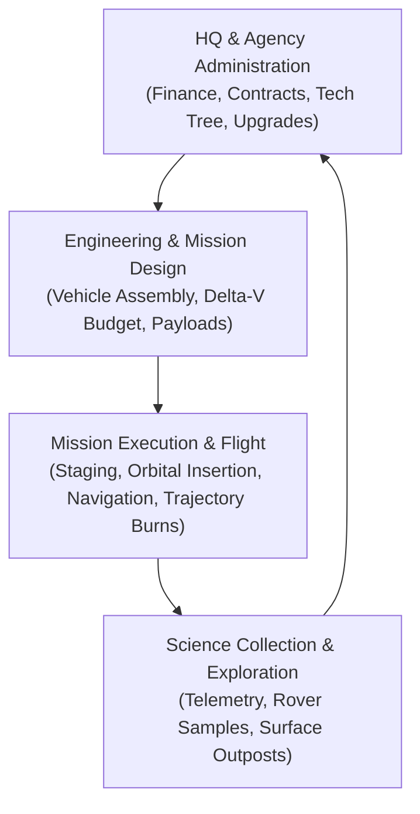

# Game Design Reference: INTERSTELLAR CONTINUUM

## 1. Game Identity & High Concept
- **Title:** INTERSTELLAR CONTINUUM
- **Genre:** 2D/2.5D Space Agency Simulation, Mission Engineering & Orbital Exploration Game
- **Perspective:** Sophisticated 2D / 2.5D isometric & layered planar perspective with multi-layer depth simulation, parallax, dynamic 2D lighting, and custom GLSL/WGSL shaders.
- **Core Philosophy:** Scientifically grounded, accessible, educational, and intellectually rewarding. The game presents authentic aerospace and orbital physics simplified into engaging, intuitive gameplay loops.

---

## 2. Established Story & Narrative Framework
The year marks the beginning of an era of independent exploration. Traditional state agencies have stagnated under bureaucratic paralysis. The player assumes the mantle of **Mission Director** of a nascent independent space exploration agency founded on Earth.

Starting with modest seed capital, rudimentary facilities, an unpaved launch apron, and an enthusiastic handful of engineers, the director must:
1. Conduct safe suborbital validation flights and atmospheric telemetry collection.
2. Establish reliable Earth orbital access and deploy communication constellations.
3. Journey to the Moon to prospect water ice and establish lunar science stations.
4. Reach out across the Solar System to Mars, Venus, Mercury, asteroid belts, and the outer gas giants.
5. Expand human scientific understanding while sustaining agency solvency and public trust.

---

## 3. Core Gameplay Loop
The gameplay loop consists of four interconnected pillars:

1. **Plan & Administer:** Review incoming contracts, manage budgets, recruit specialists, upgrade headquarters facilities, and select research trajectories.
2. **Design & Validate:** Construct multi-stage launch vehicles and satellites in the engineering bay. Balance wet/dry mass, specific impulse ($I_{sp}$), thrust-to-weight ratio (TWR), aerodynamic drag, battery life, solar exposure, and scientific instrument payloads.
3. **Execute & Pilot:** Launch the vehicle through Earth's atmosphere, perform pitch kicks to establish parking orbits, execute Hohmann transfer burns, enter planetary spheres of influence (SOI), and complete orbital insertions or soft landings.
4. **Discover & Profit:** Deploy scientific sensors, transmit telemetry, drive rovers over alien terrain, extract sample cores, fulfill commercial and scientific contracts, and earn Credits and Research Data to reinvest into the agency.

---

## 4. Game Modes
1. **Career Campaign (Standard):**
   - Full progression mode. Funds, materials, science, and facility tiers must be earned.
   - Dynamic contracts, reputational ratings, public goodwill, and milestone achievements.
2. **Science Sandbox:**
   - Unlimited funds; tech tree unlocks through scientific exploration achievements.
3. **Open Simulation (Director's Sandbox):**
   - All technologies, facilities, and bodies unlocked. Complete creative and experimental freedom.
4. **Cooperative Flight Operations (Multiplayer):**
   - Up to 4 players manage an agency together, taking on specialized roles in real time.

---

## 5. Headquarters Systems & Facilities
The agency headquarters is an explorable 2.5D facility featuring interactive sectors:

1. **Mission Operations Centre (MOC):**
   - The nerve center. Multi-monitor telemetry walls, global tracking maps, orbital trajectory planners, flight logs, and active mission timelines.
2. **Rocket Engineering Facility (Vehicle Assembly Bay):**
   - Modular 2D vehicle construction. Assemble rocket boosters, interstages, fairings, fuel tanks, and rocket engines with real-time delta-V and TWR telemetry.
3. **Spacecraft & Satellite Laboratory:**
   - Delicate assembly of orbital probes, communications relays, space telescopes, and planetary landers. Configures power grids, thermal radiators, antennae, and science sensors.
4. **Research and Development Centre (R&D):**
   - Tech tree visualization and node research. Analyzes incoming Research Data and Technology Points to unlock aerospace materials, ion propulsion, nuclear thermal drives, and automated instruments.
5. **Finance and Administration:**
   - Budget balancing, commercial contracts, government grant applications, loan management, staff salaries, insurance, and agency rank progression.
6. **Resource and Manufacturing Centre:**
   - Fabrication pipelines for composite fairings, refined propellants (RP-1, LOX, LH2, Methane, Xenon), solar arrays, and specialized alloy structures.
7. **Robotics and Exploration Centre:**
   - Design and testing of surface rovers, sample drills, automated drones, and robotic arms for extraterrestrial surface analysis.
8. **Communication and Satellite Network Centre:**
   - Ground station network management, Deep Space Network (DSN) tracking arrays, orbital relay links, and transmission latency tracking across the Solar System.
9. **Planetary Research and Data Centre:**
   - Interactive celestial compendium and archive. Catalogs planetary physical characteristics, atmospheric compositions, gravity maps, magnetic fields, and completed scientific surveys.
10. **Physical Launch Facilities (Spaceport & Pads):**
    - Pad A (Suborbital & Light Lift), Pad B (Medium Lift), Pad C (Heavy / Super-Heavy Lift), fuel storage cryo-farms, integration rails, and recovery landing zones.
11. **Settings and System Administration:**
    - High-fidelity audio mixers, keybindings, gamepad support, graphics fidelity toggles, UI scaling, accessibility settings, and save data backup management.

---

## 6. Mission Categories
- **Suborbital Test Flights:** Atmospheric boundary probes (Karman line 100km), aerodynamic stress validation, engine ignition tests.
- **Orbital Deployment Missions:** Low Earth Orbit (LEO), Medium Earth Orbit (MEO), Geostationary Orbit (GEO), and Sun-Synchronous Orbit (SSO) satellite placement.
- **Scientific Exploration Probes:** Flybys, orbital mappers, atmospheric entry probes, and gravity surveyors.
- **Lunar Missions:** Translunar injection, lunar orbiters, soft landers, and sample return vehicles.
- **Interplanetary Planetary Missions:** Interplanetary Hohmann transfers to Venus, Mars, Mercury, and the Outer Gas Giants.
- **Rover & Surface Exploration:** Surface rover landing, waypoint traverse, rock drilling, spectral analysis, and sample caching.
- **Transportation & Logistics:** Fuel depot delivery, orbital station module transport, crew rotation transfers.
- **Surface Construction & Outposts:** Modular habitat delivery, solar farm assembly, resource extraction drills on the Moon and Mars.

---

## 7. Planetary Progression & Solar System Reach
The game features an authentic, scaled 2D celestial model:
1. **Earth & Orbital Regions:**
   - Atmosphere (Troposphere, Stratosphere, Mesosphere, Thermosphere).
   - Low Earth Orbit (160 - 2,000 km).
   - Van Allen Radiation Belts.
   - Geostationary Orbit (35,786 km).
2. **The Moon (Luna):**
   - Low lunar orbit, tidally locked rotation, cratered terrain, polar water-ice deposits.
3. **Venus:**
   - Super-dense carbon dioxide atmosphere, extreme surface pressures (92 atm) and temperatures (467°C), sulfuric acid cloud layers, challenging entry probe dynamics.
4. **Mars & Moons (Phobos & Deimos):**
   - Thin atmosphere, dust storms, Olympus Mons, Valles Marineris, polar ice caps, rover mobility challenges.
5. **Mercury:**
   - High delta-V orbital insertion requirements, intense solar radiation, extreme diurnal temperature swings.
6. **Asteroid Belt & Near-Earth Objects (NEOs):**
   - Ceres, Vesta, carbonaceous chondrite and metallic asteroids, prospecting and microgravity anchoring.
7. **Jupiter System:**
   - Massive radiation belts, Galilean moons (Io's volcanism, Europa's subsurface ice ocean, Ganymede's magnetic field, Callisto).
8. **Saturn System:**
   - Spectacular ring system, Titan (dense methane atmosphere, hydrocarbon lakes), Enceladus (cryovolcanic plumes).
9. **Uranus & Neptune:**
   - Tilted ice giant orbits, supersonic storms, Triton's retrograde orbit and nitrogen geysers.

---

## 8. Economy, Resources & Progression
### Resource Currencies:
- **Mission Credits (MC):** Primary financial capital. Earned from contracts, public grants, and patent licensing. Used for facility upgrades, vehicle parts, propellant, and operations.
- **Research Data (RD):** Scientific information gathered by atmospheric sensors, spectrometers, cameras, and sample drills. Reinvested in R&D to unlock tech nodes.
- **Raw Materials (RM):** Titanium alloys, carbon fiber composites, semiconductor wafers, rare-earth magnets, and propellant precursors needed for advanced manufacturing.
- **Technology Points (TP):** Breakthrough engineering knowledge gained from milestone mission completions and flight telemetry analysis.

### Agency Ranking:
- Rank 1: **Suborbital Pioneer**
- Rank 2: **Orbital Operator**
- Rank 3: **Cislunar Explorer**
- Rank 4: **Interplanetary Pioneer**
- Rank 5: **Solar System Authority**
- Rank 6: **Grand Continuum Director**

---

## 9. Cooperative Multiplayer Architecture (Up to 4 Players)
Cooperative multiplayer allows four directors to operate a single space agency in synchronized real time:
- **Player 1 (Flight Director / FLIGHT):** Overall mission abort/go authority, staging sequences, launch pad management.
- **Player 2 (Guidance, Navigation & Control / GNC):** Trajectory burns, orbital node timing, attitude orientation, delta-V throttle.
- **Player 3 (Capsule Communicator & Science / CAPCOM & INCO):** Sensor array activations, telemetry downlinks, rover driving, sample collection.
- **Player 4 (Electrical, Environmental & Consumables / EECOM):** Battery levels, solar alignment, fuel tank pressurization, thermal control, and communications antenna alignment.

---

## 10. Visual Direction
- **Style:** Polished, sleek, retro-futuristic aerospace aesthetic inspired by high-end tactical flight software, modern agency mission control, and clean technical vector schematics.
- **Depth & Atmosphere:**
  - Rich multi-layer parallax backgrounds featuring nebula clouds and procedural twinkling starfields.
  - 2.5D isometric view of Headquarters facilities with animated personnel, diagnostic terminal flickers, and crane operations.
  - Realistic atmospheric haze glow shaders that shift color as altitudes increase from sea level into the blackness of vacuum.
  - Dynamic 2D particle systems for rocket plumes, cryogenic boil-off vapors, RCS thruster puffs, and lunar dust kick-up.
  - Tactical vector HUD overlays showing velocity vectors, orbital apoapsis/periapsis nodes, and atmospheric re-entry heating bands.
