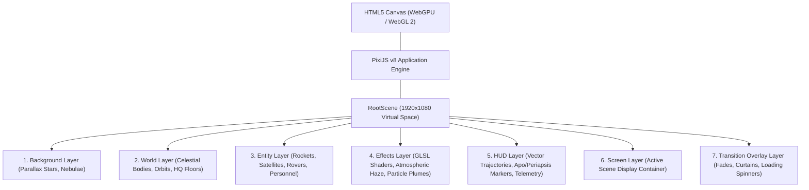
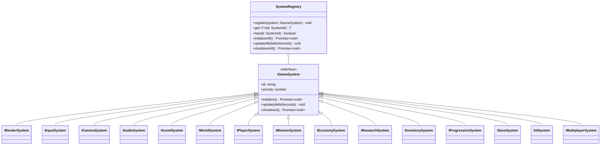
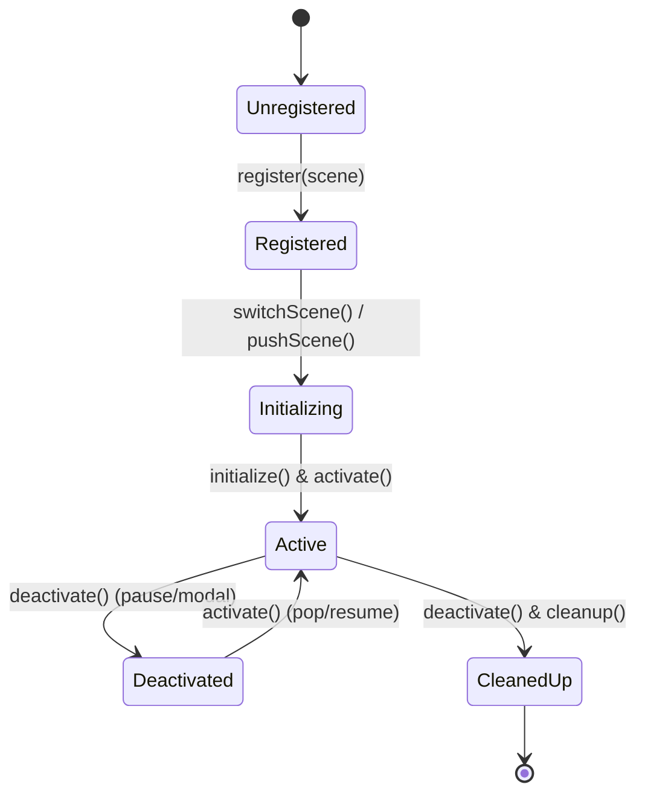
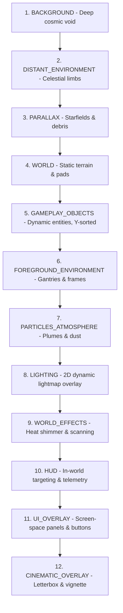

# Technical Architecture: INTERSTELLAR CONTINUUM

## 1. Selected Technology Stack & Runtimes

| Component           | Technology         | Version           | Purpose                                                              |
| :------------------ | :----------------- | :---------------- | :------------------------------------------------------------------- |
| **Language**        | TypeScript         | `^7.0.2` (ES2022) | Type-safe domain models, strict null-checks, compile-time contracts  |
| **Runtime**         | Node.js            | `v24.11.1`        | Local development tooling, compilation, testing, and scripts         |
| **Renderer**        | PixiJS             | `^8.23.0`         | High-performance 2D/2.5D WebGL/WebGPU batching, shaders, scene graph |
| **Build System**    | Vite               | `^8.3.8`          | Instant HMR dev server, lightning-fast Rollup production bundling    |
| **Test Runner**     | Vitest             | `^5.1.0`          | In-memory ESM unit testing for simulation math and services          |
| **Animation**       | GSAP & Pixi Ticker | `^3.15.1`         | Frame-accurate UI tweens, camera tracking, and cinematic sequencing  |
| **Audio Engine**    | Howler.js          | `^2.2.4`          | Spatial 2D audio channels, volume bus mixing, seamless loop playback |
| **Package Manager** | npm                | `11.6.2`          | Clean dependency resolution with locked manifests                    |

---

## 2. Rendering & Layer Hierarchy

The PixiJS v8 rendering pipeline uses a 7-layer stage container attached to a canonical 1920×1080 virtual resolution space:

---

## 3. Core System Architecture & Registration (`src/systems/`)

The application avoids monolithic coupling through the `SystemRegistry` and typed system interfaces. Systems are initialized and updated according to strict priority order:

---

## 4. Scene Management & Transition Pipeline (`src/scenes/`)

The `SceneManager` handles scene registration, lifecycle states, transitions, and modal overlays:

### Supported Transitions:

- **`InstantTransition`:** Immediate scene swap without animation delay.
- **`FadeTransition`:** Dual-phase fade to solid black, scene swap, and fade in to new scene.
- **`OpacityTransition`:** Direct crossfade of scene containers.
- **`LoadingTransition`:** Intermediate animated loading spinner while async assets load.
- **`CinematicTransition`:** Top and bottom widescreen letterbox bars sweep inward, swap scenes, and retract.

---

## 5. Centralized Modular Game State (`src/state/`)

State is partitioned into modular, cohesive slices managed by `GameStateManager`:

| State Slice               | Responsibilities            | Key Fields                                                                  |
| :------------------------ | :-------------------------- | :-------------------------------------------------------------------------- |
| `SceneState`              | Screen navigation tracking  | `currentScene`, `previousScene`, `sceneHistory`                             |
| `PlayerPositionState`     | Physical entity coordinates | `bodyId`, `worldCoords`, `surfaceCoords`, `headingDeg`, `speedMps`          |
| `ActiveMissionState`      | Flight trajectory telemetry | `missionId`, `code`, `title`, `phase`, `elapsedSeconds`, `trajectoryStage`  |
| `OrganisationState`       | Space agency metadata       | `agencyName`, `directorName`, `rank`, `prestigeScore`, `totalLaunches`      |
| `ResourceState`           | Multi-currency wallet       | `credits`, `researchData`, `rawMaterials`, `technologyPoints`               |
| `ResearchState`           | Tech tree progression       | `unlockedNodeIds`, `activeResearchNodeId`, `accumulatedPoints`              |
| `DestinationsState`       | Solar system discovery      | `unlockedBodyIds`, `surveyedSiteIds`, `surfaceFlagsPlanted`                 |
| `CompletedMissionsState`  | Historical flight archives  | `completedMissionIds`, `records: Array<{ missionId, score, date }>`         |
| `BuildingStates`          | Headquarters facilities     | `facilityId -> { tier, healthPercent, operational, efficiency }`            |
| `SettingsState`           | User configuration          | `display`, `graphics`, `audio`, `input`, `accessibility`                    |
| `MultiplayerSessionState` | Network co-op state         | `isMultiplayer`, `sessionId`, `isHost`, `role (FLIGHT, GNC, CAPCOM, EECOM)` |

---

## 6. Centralized Input Architecture (`src/input/`)

- **Hardware Support:** Keyboard (`code`), Mouse (buttons, movement, wheel), and Gamepad (standard button indices).
- **Actions:** `MoveUp`, `MoveDown`, `MoveLeft`, `MoveRight`, `Interact`, `Confirm`, `Cancel`, `Pause`, `OpenMap`, `OpenInventory`, `CameraZoom`, `CameraPan`.
- **Contexts:** `GAMEPLAY`, `UI`, `CUTSCENE`, `MODAL`, `DEBUG`.
- **Coordinate Virtualization:** Automatically maps physical screen coordinates to canonical 1920×1080 virtual game coordinates.
- **Input Locking:** Reentrant `lockInput(reason)` / `unlockInput(reason)` prevents input leakage during scene transitions and cinematics.

---

## 7. Typed Event Architecture & Memory Leak Prevention (`src/core/events/`)

- **Strongly Typed Payloads:** All domain and system events (`SceneChanged`, `PlayerMoved`, `InteractionRequested`, `InteractionCompleted`, `MissionSelected`, `MissionStarted`, `MissionCompleted`, `MissionFailed`, `ResourceCollected`, `ResearchUnlocked`, `TechnologyUnlocked`, `CreditsChanged`, `BuildingEntered`, `SaveRequested`, `SettingsChanged`) carry strict TypeScript payload definitions.
- **`ScopedEventSubscriber`:** Solves the classic game development listener leak problem. Each scene or subsystem registers listeners through a scoped subscriber. When the scene is deactivated or destroyed, calling `subscriber.dispose()` automatically cleans up all registered subscriptions.

---

## 8. Centralized Error Taxonomy (`src/core/errors/`)

Errors inherit from `GameError`, providing structured error categories, codes, and recovery advice:

- `SceneError`: `SCENE_INIT_FAILED`, `SCENE_TRANSITION_FAILED`, `SCENE_NOT_FOUND`
- `AssetError`: `ASSET_LOAD_FAILED`, `BUNDLE_NOT_FOUND`, `UNSUPPORTED_FORMAT`
- `ConfigError`: `MISSING_CONFIG`, `INVALID_SETTING`
- `StateError`: `INVALID_STATE_TRANSITION`, `CORRUPT_SAVE_STATE`
- `EventError`: `EVENT_LISTENER_CRASH`, `CIRCULAR_DISPATCH`
- `InputError`: `UNBOUND_ACTION`, `LOCKED_INPUT_DISCARD`

---

## 9. 2D/2.5D Graphics & Rendering Pipeline Architecture (`src/rendering/`)

### 9.1 The 12 Canonical Rendering Layers
Rendering is partitioned into 12 strictly ordered containers:

### 9.2 2.5D Depth Simulation
Spatial depth without 3D geometry:
- **Perspective Scaling:** $S(Z) = \frac{D_{focal}}{D_{focal} + Z}$ where $Z=0$ is focal plane, $Z>0$ is distant background, and $Z<0$ is foreground rush.
- **Parallax Factors:** Layers move at fractional camera velocity based on depth.
- **Aerial Perspective:** Distance-based color blending towards atmospheric haze fog.
- **Dynamic Y-Sorting:** PixiJS `sortableChildren` with zero runtime memory allocations.

### 9.3 2D Dynamic Lighting Architecture
- **Lightmap Compositing:** Ambient darkness overlay multiplied with world geometry, illuminated by additive point and spot light sources.
- **Presets:** `HEADQUARTERS`, `ROCKET_FACILITY`, `PLANETARY_DAY`, `PLANETARY_NIGHT`, `MARS_SURFACE`, `DEEP_SPACE`.

### 9.4 Shaders & Post-Processing
- Managed via `ShaderManager` with scalable quality profiles (`LOW`, `MEDIUM`, `HIGH`, `ULTRA`).
- Custom filters: `AtmosphericHazeFilter`, `ScanlineHologramFilter`, `ThrusterHeatFilter`, `VignetteFilter`.
- Built-in headless environment guard preventing `document is not defined` errors during test runs.

---

## 10. Camera, Viewport & Coordinate Systems Architecture (`src/camera/`)

### 10.1 Central Camera System (`CameraSystem.ts`)
Unified camera system implementing `ICameraSystem` (registered in `SystemRegistry` at priority 12):
- **Full Coordinate State:** Focal position $(x, y)$, zoom scale, rotation (radians), and target offsets $(ox, oy)$.
- **Smooth Interpolation:** Exponential dampening ($0.05 \le \text{smoothing} \le 1.0$) eliminating camera jitter.
- **Scripted Transitions:** `panTo`, `focusOn`, and `reset` with cubic ease-in-out interpolation.

### 10.2 Camera Modes & Zoom Presets
Supports 7 distinct operational modes:
1. `PLAYER_FOLLOW`: Deadzone box + velocity lookahead tracking.
2. `FREE`: Unconstrained manual panning & zooming.
3. `CINEMATIC`: Gentle drift, slow rotation, and letterbox framing.
4. `MISSION_OVERVIEW`: High-altitude strategic view.
5. `PLANETARY_EXPLORATION`: Large-scale surface map with terrain bounds clamping.
6. `HEADQUARTERS`: Facility room-to-room interior exploration.
7. `INTERFACE_FOCUSED`: Terminal and workbench framing.

Zoom presets: `CLOSE_INTERACTION` (1.8x), `NORMAL_EXPLORATION` (1.0x), `WIDE_ENVIRONMENT` (0.65x), `MISSION_OVERVIEW` (0.4x), `MAP_VIEW` (0.25x).

### 10.3 Coordinate Conversion Matrix
Seamless 4-way bi-directional conversions implemented in `CoordinateConverter.ts`:
- $\text{Physical Screen} \longleftrightarrow \text{Virtual Screen (1920×1080)} \longleftrightarrow \text{Camera Local} \longleftrightarrow \text{World Coordinates}$

### 10.4 Viewport Frustum & Culling
- Calculates visible world frustum AABB (`minX, maxX, minY, maxY`).
- Zero-overhead frustum intersection queries for entities (`isRectVisible`) and particles (`isPointVisible`).
- 5% safe area boundary margin calculation for tactical HUDs.

### 10.5 Trauma-Based Camera Shake & Accessibility
- Quadratic trauma model: $\text{shake} = \text{trauma}^2 \times \text{intensityMultiplier}$.
- Suppressed when `reducedMotion` accessibility is enabled.
